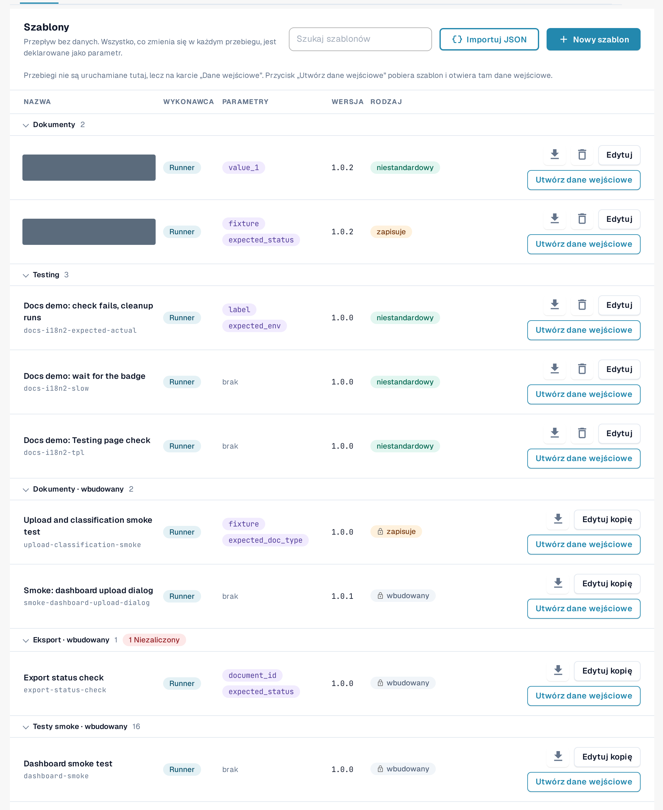
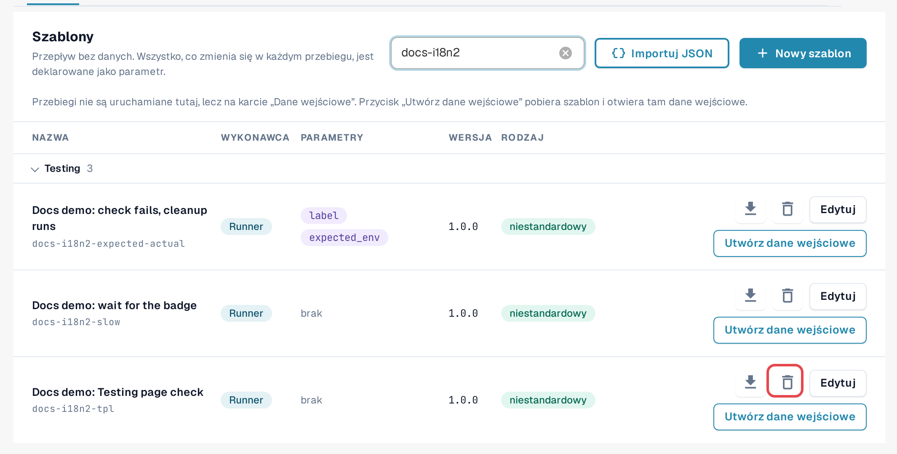
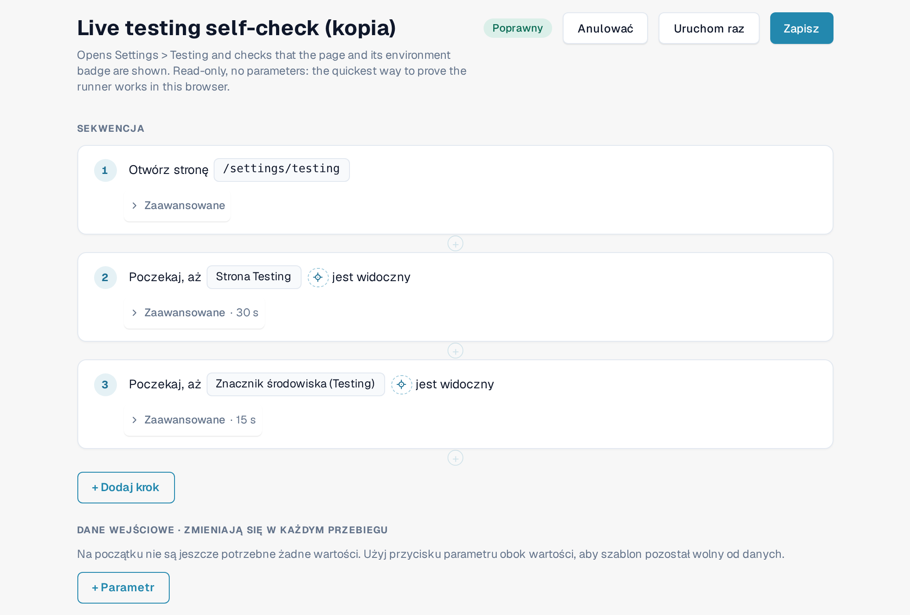
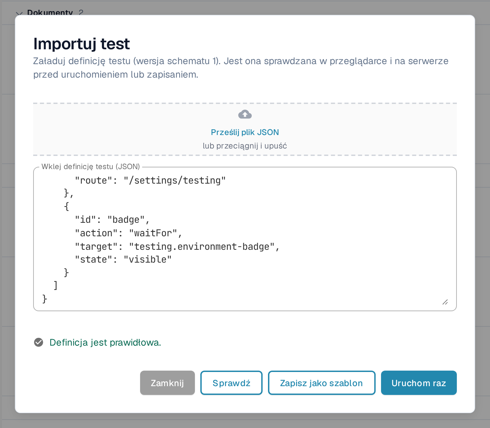
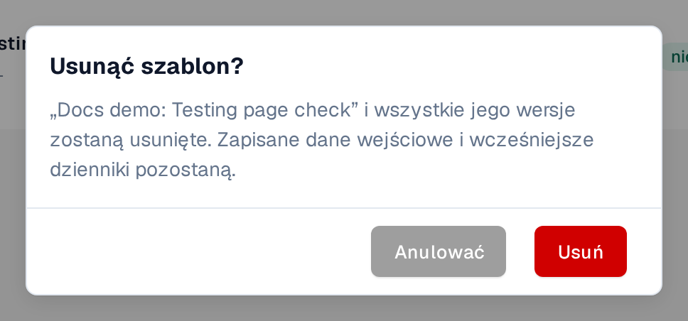

# Szablony

Szablon opisuje, **co** jest sprawdzane: jaka strona się otwiera, co jest klikane lub wypełniane i co musi być
widoczne lub prawdziwe na końcu. Nie zawiera żadnych danych Twojej organizacji. Wartości, które różnią się między
organizacjami lub między przebiegami, na przykład identyfikator dokumentu, są deklarowane jako **parametry** i uzupełniane przez [dane wejściowe](inputs.md).

Otwórz **Ustawienia → Testing**, zakładka **Szablony**.

<figure><figcaption>
Zakładka Szablony: grupy, kolumny i akcje w wierszach.
</figcaption></figure>

## Odczytywanie listy

Szablony są pogrupowane według kategorii (na przykład **Testy dymne**, **Walidacja**, **Dokumenty**, **Eksport**).
Wybierz nazwę grupy, aby ją zwinąć; czerwona etykieta przy grupie podaje liczbę szablonów, których ostatni przebieg zakończył się niepowodzeniem.
**Szukaj szablonów** filtruje według nazwy.

| Kolumna | Znaczenie |
|---|---|
| **Nazwa** | Nazwa szablonu, a pod nią jego identyfikator. |
| **Wykonawca** | **Runner**: działa w karcie Twojej przeglądarki z tej strony. **Playwright**: kontrola uruchamiana przez Twoją automatyzację testów; można ją tu udokumentować, ale nie można jej uruchomić z tej strony. |
| **Parametry** | Wartości, które muszą dostarczyć dane wejściowe. *brak* oznacza, że szablon działa w takiej postaci, w jakiej jest. |
| **Wersja** | Zapisane wersje nigdy się nie zmieniają. Zmiana jest zapisywana jako nowa wersja. |
| **Rodzaj** | **Wbudowany** (ikona kłódki): część zestawu domyślnego, taki sam dla każdej organizacji, tylko do odczytu. **Niestandardowy**: własny szablon Twojej organizacji. **zapisuje**: szablon zmienia dane (na przykład przesyła dokument) i wymaga potwierdzenia przed uruchomieniem. |

Akcje w wierszu:

| Akcja | Co robi |
|---|---|
| Ikona pobierania (**Eksportuj jako JSON**) | Pobiera definicję szablonu jako plik JSON, na przykład aby ją zachować lub zaimportować do innej organizacji. |
| **Edytuj kopię** (wbudowany) / **Edytuj** (niestandardowy) | Otwiera edytor szablonu z kopią, którą możesz zmienić i zapisać jako własny szablon. |
| **Utwórz dane wejściowe** | Otwiera zakładkę [Dane wejściowe](inputs.md) z nowymi danymi dla tego szablonu. Testy uruchamia się tam, a nie tutaj. |
| Ikona kosza (**Usuń szablon**) | Tylko przy własnych szablonach. Zobacz *Usuwanie własnego szablonu* poniżej. |

<figure><figcaption>
Wiersz szablonu domyślnego i wiersz własnego szablonu wraz z ich akcjami.
</figcaption></figure>

## Tworzenie własnego szablonu

Własny szablon jest potrzebny, gdy żaden domyślny nie sprawdza tego, czego potrzebujesz, lub gdy chcesz mieć zmienioną kopię szablonu domyślnego.

**Zacznij od szablonu domyślnego:** wybierz **Edytuj kopię** w jego wierszu. **Zacznij od pustego:** wybierz **Nowy szablon**.

W edytorze szablonu:

1. W polu **Nazwa szablonu** wpisz nazwę i, opcjonalnie, do czego szablon służy.
2. Wybierz **+ Dodaj krok** i wskaż blok, na przykład **Otwórz stronę**, **Kliknij**, **Wypełnij**, **Wybierz**,
   **Czekaj na**, **Sprawdź tekst**, **Sprawdź pole** lub **Sprawdź status**. **Gotowe bloki** dodają od razu typową sekwencję, na przykład
   **Prześlij dokument** lub **Prześlij dokument i poczekaj na przetworzenie**. Grupy kroków, ustawienia **Zaawansowane** oraz kroki czyszczenia opisuje strona [Gotowe kroki i bloki](steps-and-blocks.md).
3. Dla każdej wartości, która różni się między organizacjami lub między przebiegami, użyj przycisku parametru obok wartości. Wartość
   staje się parametrem w sekcji **Dane wejściowe · zmieniają się w każdym przebiegu**, z typem (**Tekst**, **Liczba**, **Tak/Nie**,
   **Plik testowy serwera**), wartością domyślną i opcją **Obowiązkowe**, jeśli musi zostać wypełniona.
4. Wybierz **Zapisz**. Aby jednorazowo wypróbować szkic bez zapisywania, wybierz **Uruchom raz**.

Aby wybrać element kroku, wskazując go w aplikacji, użyj **Wybierz w aplikacji**
([Wybieranie elementu w aplikacji](pick-in-app.md)).

Kroki zmieniające dane (na przykład przesyłanie dokumentu) są oznaczone jako **zapisuje dane**. Szablon z takimi krokami
wymaga potwierdzenia przy każdym uruchomieniu.

<figure><figcaption>
Edytor szablonu z dwoma krokami i jednym parametrem.
</figcaption></figure>

Jeśli w międzyczasie ktoś zapisał tę samą wersję tego szablonu (na przykład w innej karcie), DocBits zachowuje Twój
szkic i proponuje **Zapisz jako następną wolną wersję** lub **Załaduj najnowszą wersję**.

## Import szablonu z JSON

1. Wybierz **Importuj JSON**.
2. Wybierz **Prześlij plik JSON** lub wklej definicję do pola **Wklej definicję testu (JSON)**.
3. Wybierz **Sprawdź**. DocBits sprawdza definicję w przeglądarce i na serwerze oraz wyświetla listę ewentualnych problemów.
4. Wybierz **Zapisz jako szablon**, aby dodać ją do swoich szablonów, lub **Uruchom raz**, aby wypróbować ją bez zapisywania.

<figure><figcaption>
Okno Importuj test ze sprawdzoną definicją.
</figcaption></figure>

Format opisuje strona [Dla programistów](for-developers.md).

## Usuwanie własnego szablonu

1. W wierszu własnego szablonu wybierz ikonę kosza (**Usuń szablon**).
2. Przeczytaj potwierdzenie **Usunąć szablon?** i wybierz **Usuń**.

Szablon i **wszystkie jego wersje** zostają usunięte. Zapisane dane wejściowe i dotychczasowe dzienniki pozostają, dzięki czemu historia nadal jest czytelna.
Dane wejściowe, które wskazywały na ten szablon, pozostają na liście; edytuj je lub usuń. Później możesz ponownie zapisać szablon z tym samym
identyfikatorem. Szablonów wbudowanych i domyślnych nie można usunąć.

<figure><figcaption>
Potwierdzenie usunięcia szablonu.
</figcaption></figure>
