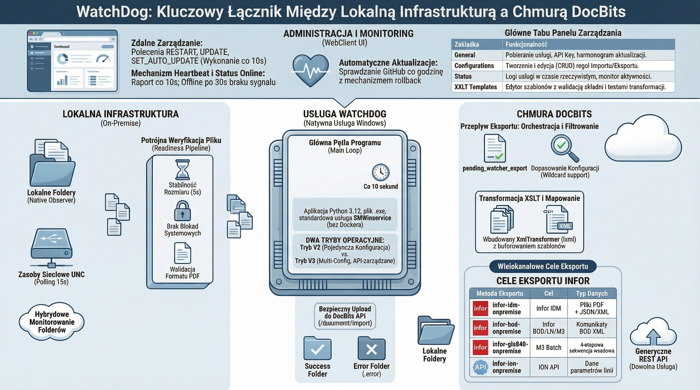
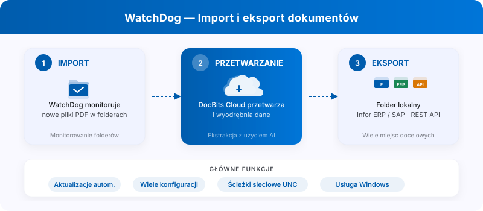

# WatchDog

<figure><figcaption></figcaption></figure>

<figure><figcaption><p>WatchDog: monitorowanie folderów, przetwarzanie w DocBits i cele eksportu.</p></figcaption></figure>

**WatchDog** to lokalna usługa oparta na systemie Windows, która monitoruje lokalne foldery pod kątem przychodzących dokumentów, przesyła je do chmury DocBits w celu przetworzenia i eksportuje gotowe dokumenty z powrotem do folderów lokalnych lub systemów ERP.

## Najważniejsze funkcje

* **Automatyczne monitorowanie folderów** — obserwuje ścieżki lokalne i ścieżki sieciowe UNC pod kątem nowych plików PDF
* **Obsługa wielu konfiguracji** — wiele konfiguracji importu/eksportu na instancję
* **6 metod eksportu** — Folder lokalny, Infor IDM, Infor BOD, ION API, GLS840MI, REST API
* **Auto-Update** — automatyczne aktualizacje wersji z możliwością cofnięcia w przypadku awarii
* **Zdalne zarządzanie** — uruchom ponownie, zaktualizuj i skonfiguruj za pomocą DocBits UI

## Szybki start

### 1. Pobierz WatchDog

Pobierz `WatchDog.exe` z **Ustawienia → Przetwarzanie dokumentów → WatchDog → Zakładka Ogólne** w aplikacji DocBits.

### 2. Skonfiguruj za pomocą klawisza API

Otwórz **Wiersz poleceń jako Administrator** i uruchom:

```powershell
WatchDog.exe -api YOUR_API_KEY
```

> **Uwaga:** Klucz API jest dostępny w ustawieniach DocBits w zakładce Ogólne WatchDog. To łączy WatchDog z Twoją organizacją DocBits.

### 3. Zainstaluj jako usługę Windows

```powershell
WatchDog.exe install
WatchDog.exe start
```

### 4. Utwórz konfiguracje w DocBits

Wszystkie konfiguracje importu i eksportu tworzone są bezpośrednio w aplikacji **DocBits**:

**Ustawienia → Przetwarzanie dokumentu → WatchDog → Zakładka Konfiguracje**

* **Importuj konfiguracje** — zdefiniuj foldery obserwowane i typy dokumentów
* **Konfiguracje eksportu** — zdefiniuj miejsca docelowe eksportu, szablony XSLT i metody eksportu

> **Ważne:** Konfiguracje eksportu wymagają **typu dokumentu** (`doc_type`). Konfiguracje bez typu dokumentu zostaną odrzucone.

### 5. Automatyczne uruchamianie (opcjonalnie)

Aby automatycznie uruchomić WatchDog podczas rozruchu:

1. Open **Services** (`Win + R` → `services.msc`)
2. Znajdź **WatchDog** na liście
3. Ustaw **Typ uruchomienia** na **Automatyczny (opóźniony start)**

## Dokumentacja poleceń

| Command | Description |
| :--- | :--- |
| `WatchDog.exe -api KEY` | Skonfiguruj klucz API i połącz się z DocBits |
| `WatchDog.exe install` | Zainstaluj jako usługę systemu Windows |
| `WatchDog.exe start` | Uruchom usługę |
| `WatchDog.exe stop` | Zatrzymaj usługę |
| `WatchDog.exe debug` | Uruchom w trybie konsoli, aby rozwiązać problemy |
| `WatchDog.exe --version` | Pokaż aktualną wersję |
| `WatchDog.exe --list-folders` | Lista skonfigurowanych folderów obserwowanych |
| `WatchDog.exe remove` | Odinstaluj usługę |

## Dodatkowe zasoby

* [WatchDog Installation](watchdog-installation.md)
* [WatchDog Configuration](watchdog-v2-configuration.md)
* [WatchDog Admin FAQ](watchdog-admin-faq.md)
