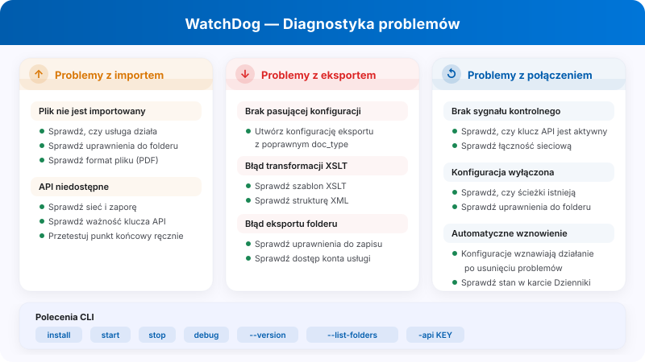
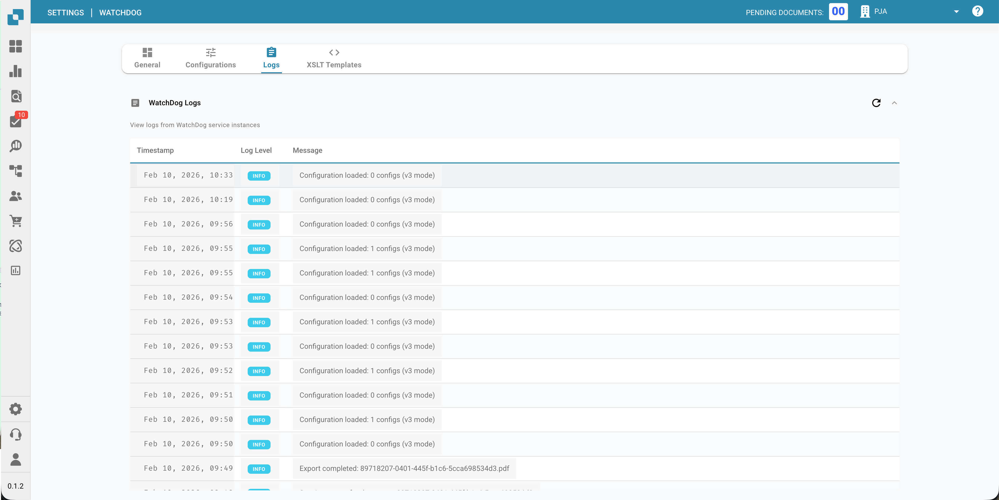

# WatchDog Admin FAQ i rozwiązywanie problemów

<figure><figcaption><p>Diagnostyka problemów z importem, eksportem i połączeniem w WatchDog.</p></figcaption></figure>

Ta dokumentacja pomaga administratorom zrozumieć komunikaty o błędach WatchDog i rozwiązywać problemy.

**Lokalizacja w interfejsie:** Settings → Document Processing → WatchDog

---

## 1. Strony ustawień WatchDog (interfejs)

### 1.1 Karta General

<figure><figcaption></figcaption></figure>

* **Download:** Pobierz najnowszy plik WatchDog.exe
* **API Key:** Skopiuj polecenie konfiguracyjne
* **Auto-Update Schedule:** Skonfiguruj częstotliwość aktualizacji
* **Installation Guide:** Instrukcja instalacji krok po kroku

### 1.2 Karta Configurations

* **Import Configurations:** Zdefiniuj foldery nadzorowane i typy dokumentów
* **Export Configurations:** Zdefiniuj miejsca docelowe i metody eksportu
* **Bulk Copy:** Kopiuj konfiguracje między podorganizacjami
* **Import/Export:** Importuj/eksportuj konfiguracje jako JSON

> **Ważne:** Konfiguracje eksportu **wymagają teraz typu dokumentu** (`doc_type`). Konfiguracje bez prawidłowego typu dokumentu zostaną odrzucone.

### 1.3 Karta Status

<figure><figcaption></figcaption></figure>

* Pokazuje stan połączenia WatchDog w czasie rzeczywistym
* **Nowe pola:** `last_restart`, `version_first_seen`, `latest_version_checked_at`
* **Informacje o systemie:** ścieżka instalacji, wolna pamięć RAM, wolne miejsce na dysku

### 1.4 Karta Logs

<figure><figcaption></figcaption></figure>

* Pokazuje wszystkie zdarzenia WatchDog z OpenSearch
* Można filtrować według typu zdarzenia, okresu itp.
* **Typy zdarzeń:**
  * `FILE_IMPORT_STARTED`: Rozpoczęto import pliku
  * `FILE_IMPORT_COMPLETED`: Import zakończony powodzeniem
  * `FILE_IMPORT_FAILED`: Import nie powiódł się
  * `EXPORT_STARTED`: Rozpoczęto eksport
  * `EXPORT_COMPLETED`: Eksport zakończony powodzeniem
  * `EXPORT_FAILED`: Eksport nie powiódł się
  * `FOLDER_VALIDATION_FAILED`: Folder jest nieosiągalny
  * `CONFIG_LOADED`: Konfiguracja została załadowana
  * `SERVICE_RESTART_INITIATED`: Zażądano ponownego uruchomienia usługi
  * `SERVICE_RESTART_COMPLETED`: Usługa została uruchomiona ponownie

### 1.5 Karta XSLT Templates

<figure><figcaption></figcaption></figure>

* Przesyłaj szablony transformacji XSLT i zarządzaj nimi
* Walidacja na żywo z analizą pól
* Łącz szablony z konfiguracjami eksportu

---

## 2. Komunikaty o błędach walidacji folderu

| Błąd | Znaczenie | Rozwiązanie |
| :--- | :--- | :--- |
| `not_found` | Folder nie istnieje | Utwórz folder lub popraw ścieżkę |
| `no_read_access` | Brak uprawnień do odczytu | Ustaw uprawnienia dla konta usługi WatchDog |
| `no_write_access` | Brak uprawnień do zapisu | Nadaj kontu usługi prawa zapisu |
| `not_configured` | Ścieżka folderu nie jest skonfigurowana | Wprowadź ścieżkę w konfiguracji |

**Których folderów dotyczy:**

* **Watch Folder (Import):** Miejsce, w którym WatchDog szuka nowych plików
* **Success Folder:** Miejsce, do którego przenoszone są pomyślnie zaimportowane pliki
* **Export Folder:** Miejsce, w którym zapisywane są wyeksportowane pliki XML/PDF

---

## 3. Komunikaty o błędach importu

| Błąd | Znaczenie | Rozwiązanie |
| :--- | :--- | :--- |
| `file_not_found` | Plik został usunięty przed importem | Dostarcz plik ponownie |
| `invalid_file_type` | Obsługiwane są tylko pliki PDF | Usuń pliki innych typów |
| `api_not_accessible` | API DocBits jest nieosiągalne | Sprawdź sieć/zaporę, zweryfikuj adres URL API |
| `api_check_failed` | Kontrola stanu API nie powiodła się | Sprawdź klucz API i połączenie |
| `upload_failed` | Przesyłanie do API nie powiodło się | Sprawdź klucz API, sieć i stan serwera |

---

## 4. Komunikaty o błędach eksportu

| Błąd | Znaczenie | Rozwiązanie |
| :--- | :--- | :--- |
| `transformation_error` | Transformacja XSLT nie powiodła się | Sprawdź szablon XSLT, zwaliduj strukturę XML |
| `folder_error` | Folder eksportu jest nieosiągalny | Utwórz folder, sprawdź uprawnienia |
| `file_write_error` | Nie udało się zapisać pliku | Sprawdź miejsce na dysku, uprawnienia i blokady plików |
| `permission_denied` | Brak uprawnień do zapisu | Ustaw uprawnienia konta usługi |
| `creation_failed` | Nie udało się utworzyć folderu | Sprawdź uprawnienia folderu nadrzędnego |
| `no_config_match` | Brak pasującej konfiguracji eksportu | Utwórz konfigurację eksportu z właściwym typem dokumentu |

> **Uwaga:** Konfiguracje eksportu wymagają `doc_type`. Jeśli widzisz `no_config_match`, sprawdź, czy istnieje aktywna konfiguracja eksportu dla typu dokumentu.

---

## 5. Konfiguracja wyłączona — przyczyny

Gdy konfiguracja jest wyłączona, pojawia się jedna z poniższych przyczyn:

| Przyczyna wyłączenia | Znaczenie |
| :--- | :--- |
| `Watch folder: not_found` | Folder importu nie istnieje |
| `Watch folder: no_read_access` | Folder importu nie jest dostępny do odczytu |
| `Export folder: not_found` | Folder eksportu nie istnieje |
| `Export folder: no_write_access` | Folder eksportu nie jest dostępny do zapisu |
| `Success folder: not_found` | Folder sukcesu nie istnieje |
| `Success folder: no_write_access` | Folder sukcesu nie jest dostępny do zapisu |

**Automatyczna reaktywacja:** WatchDog regularnie sprawdza foldery (co 60 sekund). Gdy tylko folder znów będzie osiągalny, konfiguracja zostaje automatycznie ponownie aktywowana.

---

## 6. Folder błędów (`_error`)

Pliki, które nie zostały przetworzone, są przenoszone do folderu `_error`:

**Lokalizacja:** `{import_folder}/_error/{error_type}/`

**Format pliku:** `{original_name}_{YYYYMMDD_HHMMSS}.pdf`

**Plik pomocniczy (sidecar):** Każdy plik z błędem ma towarzyszący plik `.error` zawierający:

```
Error Type: transformation_error
Error Message: XSLT template not found
Timestamp: 2026-03-26 08:30:15
Original File: invoice_001.pdf
Original Path: C:\WatchDog\Import\invoice_001.pdf
```

---

## 7. Heartbeat i stan połączenia

WatchDog wysyła do DocBits sygnał heartbeat mniej więcej co 10 sekund wraz z informacjami o systemie:

| Przesyłane dane | Opis |
| :--- | :--- |
| Timestamp | Bieżący czas |
| Version | Zainstalowana wersja WatchDog |
| Last Restart | Czas ostatniego ponownego uruchomienia usługi |
| Auto-Update Enabled | Czy automatyczna aktualizacja jest aktywna |
| Latest Version | Najnowsza dostępna wersja |
| Installation Path | Miejsce zainstalowania WatchDog |
| Free RAM / Disk | Dostępne zasoby systemowe |

### Stan połączenia

| Stan | Znaczenie |
| :--- | :--- |
| ✅ **Online** | WatchDog jest połączony i aktywny |
| ⚠️ **Offline** | Brak heartbeat od ponad 30 sekund |
| ❌ **Not Installed** | WatchDog nigdy się nie połączył |

**Błędy heartbeat:**

* `Heartbeat failed - invalid API key` → Klucz API jest nieprawidłowy
* `Heartbeat failed: 401` → Uwierzytelnianie nie powiodło się
* `Heartbeat failed: 5xx` → Problem po stronie serwera

---

## 8. Typowe problemy i rozwiązania

### Problem: WatchDog nie importuje plików

1. Sprawdź, czy usługa jest uruchomiona: `services.msc` → WatchDog
2. Sprawdź logi: Settings → WatchDog → karta Logs
3. Sprawdź uprawnienia do folderów dla konta usługi WatchDog
4. Przetestuj połączenie z API: `WatchDog.exe debug` w CMD
5. Sprawdź, czy typ pliku to PDF

### Problem: Eksport nie działa

1. Czy istnieje konfiguracja eksportu z właściwym typem dokumentu?
2. Czy typ dokumentu zgadza się z konfiguracją?
3. Czy szablon XSLT jest powiązany (dla eksportu do folderu)?
4. Czy folder eksportu jest dostępny do zapisu dla konta usługi?
5. W przypadku eksportów do Infor: czy dane uwierzytelniające ION są poprawnie skonfigurowane?

### Problem: Konfiguracja jest wyłączona

1. Czy ścieżka folderu istnieje?
2. Czy są uprawnienia dla `NT AUTHORITY\LOCAL SERVICE` lub konta usługi?
3. Czy dysk sieciowy jest osiągalny? (Sprawdź ścieżki UNC)
4. WatchDog automatycznie ponownie aktywuje konfigurację, gdy foldery znów staną się dostępne

### Problem: Transformacja XSLT kończy się niepowodzeniem

1. Czy szablon XSLT jest prawidłowy? (użyj karty XSLT Templates → Validate)
2. Czy szablon pasuje do typu dokumentu?
3. Sprawdź strukturę XML dokumentu
4. Eksport V3 do folderu używa transformacji po stronie serwera — sprawdź łączność z API

### Problem: Eksport przez REST API kończy się niepowodzeniem

1. Czy dane uwierzytelniające ION OAuth są skonfigurowane w konfiguracji eksportu?
2. Czy docelowy punkt końcowy API jest osiągalny z serwera WatchDog?
3. Sprawdź, czy format ładunku (payload) odpowiada oczekiwaniom docelowego API
4. Przejrzyj konfigurację łańcucha żądań pod kątem błędów JSONPath

---

## 9. Polecenia wiersza poleceń

```bash
# Configure API connection
WatchDog.exe -api YOUR_API_KEY

# Install Service
WatchDog.exe install

# Start Service
WatchDog.exe start

# Stop Service
WatchDog.exe stop

# Run in debug mode (console output)
WatchDog.exe debug

# Uninstall Service
WatchDog.exe remove

# Show version
WatchDog.exe --version

# List watch folders
WatchDog.exe --list-folders

# Add/remove watch folder
WatchDog.exe --add-folder "C:\Import\Invoices"
WatchDog.exe --remove-folder "C:\Import\Invoices"

# Check Windows service status
sc query WatchDog
```

---

## 10. Pliki logów

**Lokalizacja:** `C:\WatchDog\logs\{module}\`

**Format logu:**
```
INFO  - 2026-03-26 10:00:00 - module_name - Message - function=func_name - line=42
```

**Poziom logowania:** DEBUG, INFO, WARNING, ERROR

**Logi zdalne:** WatchDog wysyła logi także do DocBits (widoczne na karcie Logs) oraz opcjonalnie do chmurowego systemu logowania Logtail.
