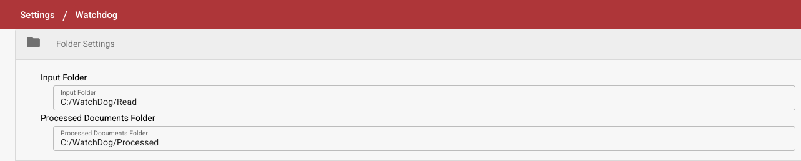

# Instalacja WatchDog

<figure><figcaption></figcaption></figure>

> **Zalecane:** Użyj nowoczesnej konfiguracji opisanej poniżej. Konfiguracje WatchDog są teraz tworzone bezpośrednio w aplikacji DocBits — lokalne pliki konfiguracyjne nie są potrzebne.

## Wymagania wstępne

* Windows Server lub Windows 10/11
* Dostęp administratora
* Łączność sieciowa z API DocBits
* Klucz API DocBits (dostępny w Settings → WatchDog → karta General)

## Kroki instalacji

### 1. Utwórz wymagane foldery

Utwórz katalog główny i podfoldery dla WatchDog:

```
C:\WatchDog\              ← WatchDog executable
C:\WatchDog\Import\       ← Watch folder for incoming documents
C:\WatchDog\Processed\    ← Success folder for processed documents
C:\WatchDog\Export\        ← Export folder for exported files
```

> **Uwaga:** Zaleca się używanie ścieżek lokalnych. Ścieżki sieciowe UNC (np. `\\server\share`) są obsługiwane, ale mogą wymagać Polling Observer, aby niezawodnie wykrywać pliki.

### 2. Pobierz WatchDog

Pobierz `WatchDog.exe` z aplikacji DocBits:

**Settings → Document Processing → WatchDog → karta General → Download**

Umieść pobrany plik `WatchDog.exe` w `C:\WatchDog\`.

### 3. Skonfiguruj połączenie z API

Otwórz **Wiersz polecenia (CMD)** jako **Administrator** i uruchom:

```powershell
cd C:\WatchDog
WatchDog.exe -api YOUR_API_KEY
```

To połączy WatchDog z Twoją organizacją DocBits i automatycznie pobierze konfiguracje.

### 4. Zainstaluj jako usługę systemu Windows

```powershell
WatchDog.exe install
```

### 5. Uruchom usługę

```powershell
WatchDog.exe start
```

### 6. Utwórz konfiguracje w DocBits

Przejdź w DocBits do **Settings → Document Processing → WatchDog → karta Configurations**:

* Kliknij **New Import Configuration**, aby ustawić foldery nadzorowane
* Kliknij **New Export Configuration**, aby ustawić miejsca docelowe eksportu

> **Ważne:** Konfiguracje eksportu wymagają **typu dokumentu**. Wszystkie konfiguracje są zarządzane centralnie w DocBits, a nie w lokalnych plikach konfiguracyjnych.

### 7. Ustaw automatyczne uruchamianie

1. Otwórz **Usługi** (`Win + R` → `services.msc`)
2. Znajdź **WatchDog** na liście usług
3. Kliknij dwukrotnie, aby otworzyć właściwości
4. Ustaw **Typ uruchomienia** na **Automatyczny (opóźniony start)**
5. Kliknij **OK**

## Weryfikacja instalacji

Po instalacji sprawdź stan WatchDog w DocBits:

**Settings → WatchDog → karta General**

<figure><figcaption></figcaption></figure>

* ✅ **Online** — WatchDog jest połączony i wysyła heartbeat
* Powinny być widoczne wersja, czas ostatniego restartu i informacje o systemie

## Opis poleceń

| Polecenie                           | Opis                                                    |
| ----------------------------------- | ------------------------------------------------------- |
| `WatchDog.exe -api KEY`             | Konfiguruje klucz API                                   |
| `WatchDog.exe install`              | Instaluje jako usługę systemu Windows                   |
| `WatchDog.exe start`                | Uruchamia usługę                                        |
| `WatchDog.exe stop`                 | Zatrzymuje usługę                                       |
| `WatchDog.exe debug`                | Uruchamia w trybie konsoli (do rozwiązywania problemów) |
| `WatchDog.exe remove`               | Odinstalowuje usługę                                    |
| `WatchDog.exe --version`            | Pokazuje bieżącą wersję                                 |
| `WatchDog.exe --list-folders`       | Wyświetla skonfigurowane foldery nadzorowane            |
| `WatchDog.exe --add-folder PATH`    | Dodaje folder nadzorowany                               |
| `WatchDog.exe --remove-folder PATH` | Usuwa folder nadzorowany                                |

***

## Starsza wersja: konfiguracja V1 (przestarzała)

Poniższa metoda konfiguracji V1 z lokalnymi plikami konfiguracyjnymi jest **przestarzała**. Zamiast niej użyj nowoczesnej konfiguracji opartej na API, opisanej powyżej.

<details>

<summary>Konfiguracja V1 (kliknij, aby rozwinąć)</summary>

### Konfigurowanie WatchDog w DocBits (V1)

1. **Dostęp do ustawień WatchDog**
   * Przejdź do **Settings → Document Processing → WatchDog**
2.  **Ustawienia folderów**

    * Zdefiniuj ścieżki: `C:/WatchDog/Read` i `C:/WatchDog/Processed`

    <figure><figcaption></figcaption></figure>
3.  **Ustawienia ogólne**

    * Wybierz typy dokumentów, skonfiguruj miejsce docelowe eksportu

    <figure><figcaption></figcaption></figure>
4.  **Konfiguracje eksportu**

    * Pokazuje skonfigurowane eksporty dla przetwarzania lokalnego (on-premise)

    <figure><figcaption></figcaption></figure>
5.  **Pobierz konfigurację**

    * Pobierz `watchdog-config.json` i umieść go w `C:\WatchDog\`

    <figure><figcaption></figcaption></figure>

</details>
