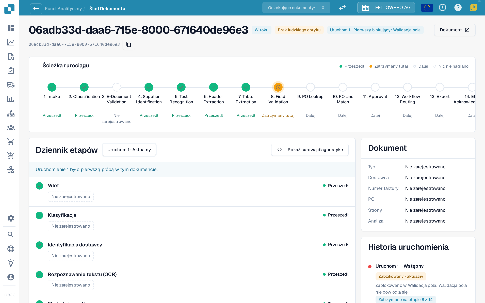
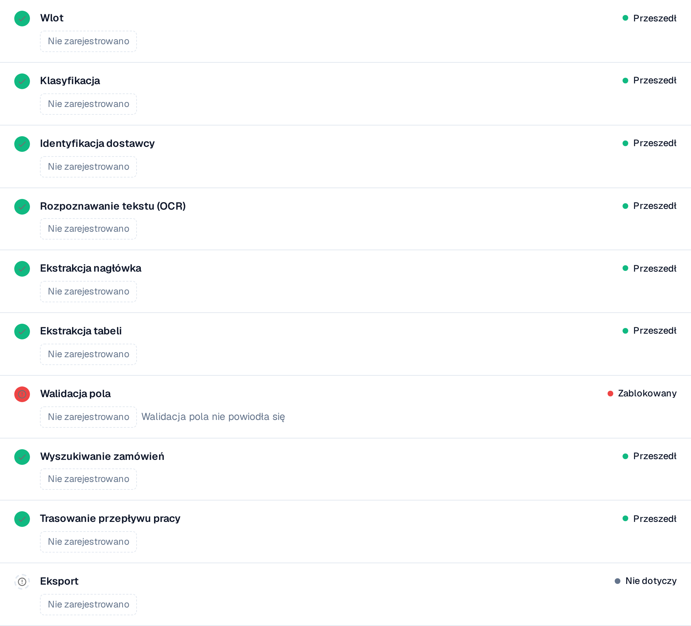

# Touchless Intelligence: Ślad dokumentu

Wpisz identyfikator dokumentu w polu **Document ID** albo otwórz dokument przykładowy z klastra, aby zobaczyć, **co stało się z tym jednym dokumentem**.

Nagłówek pokazuje plik, jego status (na przykład **W toku**), przeglądane uruchomienie i jego pierwszą blokadę oraz przycisk **Dokument** z identyfikatorem dokumentu.

<figure><figcaption>
Ślad dokumentu: ścieżka rurociągu ze wszystkimi etapami i dziennik etapów z danymi zapisanymi przez każdy etap.
</figcaption></figure>

**Ścieżka rurociągu** pokazuje 14 etapów: Intake, Classification, E-Document Validation, Supplier Identification, Text Recognition, Header Extraction, Table Extraction, Field Validation, PO Lookup, PO Line Match, Approval, Workflow Routing, Export, ERP Acknowledgement. Każdy etap ma jeden stan:

| Stan | Znaczenie |
| --- | --- |
| **Przeszedł** (zielony) | Etap przebiegł bez problemów |
| **Zatrzymany tutaj** (pomarańczowy) | Etap zablokował dokument |
| **Dalej** | Dokument nigdy nie dotarł tak daleko |
| **Nic nie nagrano** (przerywany) | Dla tego etapu nie zapisano żadnych danych |
| **Nie dotyczy** | Etap nie ma zastosowania do tego dokumentu |

### Dziennik etapów

**Dziennik etapów** pod ścieżką wymienia te same etapy wraz z tym, co każdy z nich zapisał. Kropka statusu i słowo statusu znajdują się po lewej i prawej stronie każdego wiersza.

* Każda wartość to **żeton wartości**: liczba wraz z jednostką, na przykład **Pewność 100 %**, **Próg 60 %**, **Nieudane reguły 0**, **8 brakujących pól** lub **0 luk w mapowaniu**. Wartości procentowe pokazywane są jako `97 %`, nigdy jako `0.97`.
* **Szczegóły** otwierają pełną listę wartości zapisanych przez etap, łącznie z rozważanymi alternatywami.
* Etap, który zablokował dokument, podaje przyczynę, na przykład **Walidacja pola nie powiodła się**.
* Wartość, której żaden etap nie zapisał, pokazywana jest jako **Nie zarejestrowano**, nigdy jako wartość wymyślona. Wartości to liczby i ustalone terminy, nigdy tekst dokumentu.
* **Pokaż surową diagnostykę** włącza dane surowe, gdy poprosi o nie wsparcie.

<figure><figcaption>
Każdy etap pokazuje, co zapisał; zablokowany etap podaje swoją przyczynę.
</figcaption></figure>

### Uruchomienia i zmiany

Selektor uruchomień u góry dziennika etapów (**Uruchom 1 · Bieżące**) przełącza między uruchomieniami dokumentu. **Historia uruchomień** po prawej wymienia każde uruchomienie z jego wynikiem i miejscem zatrzymania. Jeśli dokument był uruchamiany więcej niż raz, wybierz uruchomienie w selektorze, aby porównać je z bieżącym: zmienione wartości otrzymają wtedy odznakę z różnicą i jednostką, na przykład **−2 pola** lub **+3 %**.

Karta **Dokument** obok dziennika etapów podaje typ dokumentu, dostawcę, numer faktury, zamówienie zakupu, liczbę stron oraz to, czy analiza opiera się na **regułach**, czy została napisana przez SI.

**Przykład.** Dokumenty jednego dostawcy zatrzymują się wszystkie na etapie 8. W śladzie widzisz za każdym razem te same brakujące pola. To nie jest problem ekstrakcji pojedynczych dokumentów, lecz brakująca wartość domyślna w konfiguracji pól: popraw ją raz, a cały klaster będzie do odzyskania.

## Powiązane strony

* [Touchless Intelligence](touchless-intelligence.md)
* [Diagnoza dostawcy i klastry problemów](touchless-supplier-diagnosis.md)
* [Diagnoza dopasowania PO](touchless-po-matching-diagnosis.md)

Zrzuty ekranu na tej stronie pokazują interfejs w języku polskim.
