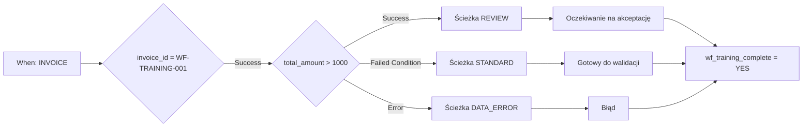

# Przykład Advanced: kierowanie faktur

Faktura szkoleniowa powyżej 1000 EUR wymaga weryfikacji. Do 1000 EUR włącznie wybierana jest ścieżka standardowa. Brak kwoty lub nieprawidłowa wartość liczbowa prowadzi do korekty danych. Trzy ścieżki kończą się wspólnym działaniem końcowym.

## Wymagania i budowa

Użyj organizacji testowej z aktywnym Advanced i [pakietu szkoleniowego](workflow-training-kit.md). Zaimportuj `advanced-workflow.json` przez **Import Workflow**, pozostaw regułę nieaktywną i otwórz graf. When sprawdza Fakturę; pierwsza karta And ogranicza ćwiczenie do `invoice_id = WF-TRAINING-001`. Nie skonfigurowano odbiorców ani eksportu.

Pierwsze sprawdzenie używa `invoice_id`, `eq` i `WF-TRAINING-001`; inny numer pomija wszystkie dalsze działania. Kwotę sprawdza **Docfield is**, wersja 2, z `total_amount`, `gt`, `1000`. Działania tekstowe zapisują `wf_training_route`. Karty statusu używają wersji 3 i **Trigger Workflows = false**.

**v2:** Karta statusu wybranej ścieżki łączy się bezpośrednio ze wspólną Then `complete`, zapisującą `wf_training_complete = YES`. Nie ma tu oczekującego OR. V1 dowodziła tylko trybu testowego: przy nieosiągniętych poprzednikach harmonogram może pominąć scalenie oceniane przez test. [Opis P0](masterclass/control-nodes.md) wyjaśnia różnicę. Wspólna bezpośrednia Then nie zastępuje bariery dla kilku równoległych obowiązkowych działań.

## Budowa i sprawdzenie

1. Zweryfikuj cały graf.
2. Przygotuj pliki dla swojej organizacji zgodnie z instrukcją pakietu.
3. Otwórz **Test → Custom Data** i użyj pełnego pliku dla danego przypadku. Obiekt zawierający wyłącznie `total_amount` nie wystarczy.
4. Uruchom od pełnego wejścia. Sprawdź wyjście `amount`, osiągniętą ścieżkę, komunikat statusu i `complete`.
5. Porównaj z niezależnymi oczekiwaniami. Zapisane odpowiedzi pokazują faktycznie zaobserwowane wyniki węzłów.

| Przypadek | Kwota | Wyjście amount | Ścieżka / status | Wynik ogólny |
| --- | --- | --- | --- | --- |
| above | 1785,00 | Success | REVIEW / validated_pending_approval | success |
| below | 999,00 | Failed Condition | STANDARD / ready_for_validation | success |
| boundary | 1000,00 | Failed Condition | STANDARD / ready_for_validation | success |
| just-above | 1000,01 | Success | REVIEW / validated_pending_approval | success |
| missing | brak | Error | DATA_ERROR / error | error |
| invalid-number | invalid | Error | DATA_ERROR / error | error |
| other-invoice | 1785,00 | niewykonane | inny numer; brak działania | failed_condition |

W przypadku błędu `data_error` i `complete` mogą zakończyć się pomyślnie, mimo że wynik ogólny pozostaje **error**. Obsługa błędu nie usuwa pierwotnego błędu oceny.

## Rozszerzenie procesu

Testy wykonano 21 października 2026 na wdrożonej usłudze Dev DocFlow **2.10.38**. Pakiet zawiera prawdziwe odpowiedzi testowe; zmiany pól i statusów były symulowane. Nie zawiera utrwalonych dokumentowych Workflow Logs i nie potwierdza osobistej akceptacji ani rzeczywistego odbioru eksportu.

Zastąp znaczniki skonfigurowanymi przypisaniami i działaniami akceptacji. Podłącz eksport wyłącznie do jawnie sprawdzanego warunku zatwierdzenia. Potwierdź prawdziwe wykonanie na dokumencie oraz odbiór po stronie odbiorcy, używając własnego dokumentu szkoleniowego i wyznaczonego celu testowego. Zobacz [diagnostykę](workflow-troubleshooting.md).

## WF-02: Ćwiczenie i odbiór

Wykonaj siedem przypadków i zapisz wyjście amount, ścieżkę, status, complete oraz wynik całości. Odbierz test i rzeczywiste wykonanie osobno. Obsłużony błąd nie oznacza bezbłędnego wykonania mimo powodzenia complete.

[Ścieżka nauki](workflow-learning-path.md)
