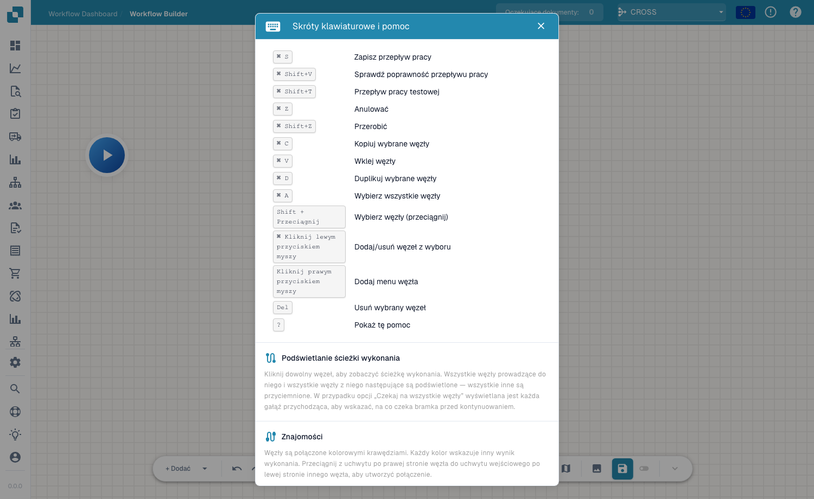

# Pasek narzędzi i Kanwa

## Film: Edytor i płótno

Poznaj Piotra i śledź jego wyjaśnienia w rzeczywistym polskim interfejsie DocBits. Sprawdza pulpit, listę workflow i licencję, a następnie otwiera niezapisany szkic w projektancie. Krok po kroku nadaje nazwę workflow, konfiguruje kontrolę kwoty oraz dwie akcje, rozmieszcza karty i łączy obie ścieżki. Następnie pokazuje przygotowanie testów z dokumentem lub własnymi danymi. Konto demonstracyjne nie ma subskrypcji Advanced Workflow i blokuje walidację; szkic pozostaje niezapisany i nieaktywny.



[Otwórz film](https://docbits-videos.fra1.cdn.digitaloceanspaces.com/settings-assistant/advanced_workflows_canvas-admin/v7/pl.mp4) · [Napisy (WebVTT)](https://docbits-videos.fra1.cdn.digitaloceanspaces.com/settings-assistant/advanced_workflows_canvas-admin/v7/pl.vtt) · [Transkrypcja (tekst)](https://docbits-videos.fra1.cdn.digitaloceanspaces.com/settings-assistant/advanced_workflows_canvas-admin/v7/pl.txt) · 3:15

| W tym filmie | Początek |
| --- | --- |
| Poznaj administratora | [0:00](https://docbits-videos.fra1.cdn.digitaloceanspaces.com/settings-assistant/advanced_workflows_canvas-admin/v7/pl.mp4#t=0) |
| Sprawdź dostęp | [0:04](https://docbits-videos.fra1.cdn.digitaloceanspaces.com/settings-assistant/advanced_workflows_canvas-admin/v7/pl.mp4#t=4) |
| Nazwij workflow | [0:29](https://docbits-videos.fra1.cdn.digitaloceanspaces.com/settings-assistant/advanced_workflows_canvas-admin/v7/pl.mp4#t=29) |
| Skonfiguruj kontrolę kwoty | [0:42](https://docbits-videos.fra1.cdn.digitaloceanspaces.com/settings-assistant/advanced_workflows_canvas-admin/v7/pl.mp4#t=42) |
| Dodaj akcję Approval | [1:08](https://docbits-videos.fra1.cdn.digitaloceanspaces.com/settings-assistant/advanced_workflows_canvas-admin/v7/pl.mp4#t=68) |
| Dodaj akcję Standard | [1:29](https://docbits-videos.fra1.cdn.digitaloceanspaces.com/settings-assistant/advanced_workflows_canvas-admin/v7/pl.mp4#t=89) |
| Rozmieść karty | [1:49](https://docbits-videos.fra1.cdn.digitaloceanspaces.com/settings-assistant/advanced_workflows_canvas-admin/v7/pl.mp4#t=109) |
| Połącz ścieżki | [2:04](https://docbits-videos.fra1.cdn.digitaloceanspaces.com/settings-assistant/advanced_workflows_canvas-admin/v7/pl.mp4#t=124) |
| Przygotuj testy | [2:28](https://docbits-videos.fra1.cdn.digitaloceanspaces.com/settings-assistant/advanced_workflows_canvas-admin/v7/pl.mp4#t=148) |
| Walidacja, zapis i aktywacja | [2:49](https://docbits-videos.fra1.cdn.digitaloceanspaces.com/settings-assistant/advanced_workflows_canvas-admin/v7/pl.mp4#t=169) |

Transkrypcja

**Poznaj administratora**

Zarządzam DocBits. Zbudujemy kontrolę kwoty faktury.

**Sprawdź dostęp**

Zaczynam od pulpitu workflow i otwieram listę. Następnie sprawdzam licencję. Workflow i Advanced Workflow wymagają aktywnego dostępu. Po włączeniu obu uprawnień opcja Nowy workflow oferuje Advanced Workflow. To konto dokumentacyjne nie ma aktywnej licencji workflow. Dlatego pracuję dalej na niezapisanym podglądzie w projektancie.

**Nazwij workflow**

Pracuję w prawdziwym projektancie DocBits. Najpierw nadaję wersji roboczej czytelną nazwę. Sprawdzimy kwotę faktury i pokażemy dwie możliwe ścieżki za pomocą prostych akcji. Ta demonstracja pozostanie niezapisana.

**Skonfiguruj kontrolę kwoty**

Otwieram menu dodawania i wybieram kartę warunku. W kategorii Pole dokumentu wybieram warunek Docfield. Wpisuję pole total_amount. Następnie wybieram porównanie większe niż. I wpisuję tysiąc. Użyjcie klucza pola ze swojego dokumentu. Kwota równa dokładnie tysiąc nie spełnia tego porównania.

**Dodaj akcję Approval**

Teraz dodaję kartę akcji z kategorii Pole dokumentu. Akcja ustawia wartość pola dokumentu. Używam przykładowego klucza approval_route. I wpisuję wartość Approval. To oznacza ścieżkę. Rzeczywisty proces zatwierdzania wymaga odpowiednich akcji biznesowych.

**Dodaj akcję Standard**

Dodaję drugą kartę z tą samą akcją. Akcja ustawia wartość pola dokumentu. Używam przykładowego klucza approval_route. Tym razem przykładowe pole otrzymuje wartość Standard. Obie karty są skonfigurowane. Potrzebują jeszcze połączeń, które określą wykonywaną akcję.

**Rozmieść karty**

Przeciągam karty, aby układ był czytelny. Obie akcje umieszczam po prawej stronie. Warunek znajduje się pośrodku, a Start po lewej. Przeniesienie karty zmienia jej położenie. Nie tworzy połączenia.

**Połącz ścieżki**

Przeciągam od wyjścia Start do wejścia warunku. Ścieżka sukcesu prowadzi do Approval przez niebieskie połączenie. Pomarańczowa ścieżka niespełnionego warunku prowadzi do Standard. Czerwone wyjście błędu jest osobnym wyjściem dla błędów oceny. Tutaj pozostaje niepołączone. W produkcyjnym workflow ustalcie sposób obsługi takich błędów.

**Przygotuj testy**

Przycisk testu na pasku otwiera wybór dokumentu testowego. Mogę wybrać dokument demonstracyjny albo przygotować kompletne dane niestandardowe. Przetestujcie kwoty większe, mniejsze i równe tysiąc. Sprawdźcie też brakującą kwotę. To konto nie ma licencji Advanced Workflow. Pokazuję przygotowanie testu, a nie wykonany wynik.

**Walidacja, zapis i aktywacja**

Walidacja sprawdza połączenia i ustawienia kart. Tutaj brak licencji blokuje walidację. Na koncie z dostępem zapisałbym workflow bezpośrednio na serwerze. Następnie osobno sprawdziłbym aktywację. Przed pierwszym zapisem przełącznik jest wyłączony. Wskaźnik automatycznego szkicu dotyczy lokalnej kopii w przeglądarce. Nie oznacza, że workflow jest zapisany lub aktywny.

[Zobacz wszystkie pięć rozdziałów](../advanced-workflow-videos.md)

Pasek narzędzi Zaawansowanego Workflow biegnie wzdłuż dolnej krawędzi kanwy i daje wszystko, czego potrzebujesz do budowania, nawigowania i zarządzania przepływem.

## Elementy sterujące paska narzędzi

- **+ Add** — otwiera menu węzłów, aby dodać węzeł (zobacz [Węzły](nodes.md)).
- **Undo / Redo** — cofa lub przywraca Twoje zmiany.
- **Zoom in / Zoom out** — zmienia poziom powiększenia kanwy.
- **Workflow name** — nadaje nazwę workflow w miejscu.
- **Edit description** — dodaje opis workflow.
- **Variables** — otwiera panel [Zmiennych](variables.md).
- **Help** — otwiera okno skrótów klawiszowych i pomocy.
- **Validate / Test** — sprawdza i uruchamia przepływ (zobacz [Walidacja i Testowanie](validation-and-testing.md)).
- **Snap to grid** — włącza lub wyłącza przyciąganie węzłów do siatki dla schludnych układów.
- **Mini-map** — włącza lub wyłącza małą mapę poglądową do nawigowania po dużych grafach.
- **Save** — zapisuje workflow. Wskaźnik **auto-save** pokazuje, kiedy przepływ został ostatnio zapisany automatycznie.

## Skróty klawiszowe

Naciśnij <kbd>?</kbd> na kanwie, aby w dowolnym momencie otworzyć okno skrótów i pomocy.

<figure><figcaption>
Okno skrótów klawiszowych i pomocy — skróty, podświetlanie ścieżki wykonania i kolory połączeń.
</figcaption></figure>

| Skrót | Działanie |
|---|---|
| <kbd>Cmd/Ctrl</kbd> + <kbd>S</kbd> | Zapisz workflow |
| <kbd>Cmd/Ctrl</kbd> + <kbd>Shift</kbd> + <kbd>V</kbd> | Zwaliduj workflow |
| <kbd>Cmd/Ctrl</kbd> + <kbd>Shift</kbd> + <kbd>T</kbd> | Przetestuj workflow |
| <kbd>Cmd/Ctrl</kbd> + <kbd>Z</kbd> / <kbd>Shift</kbd> + <kbd>Z</kbd> | Cofnij / Przywróć |
| <kbd>Cmd/Ctrl</kbd> + <kbd>C</kbd> / <kbd>V</kbd> / <kbd>D</kbd> | Kopiuj / Wklej / Duplikuj zaznaczone węzły |
| <kbd>Cmd/Ctrl</kbd> + <kbd>A</kbd> | Zaznacz wszystkie węzły |
| <kbd>Shift</kbd> + Przeciągnięcie | Zaznacz węzły (przeciągnięciem) |
| <kbd>Cmd/Ctrl</kbd> + Lewy przycisk myszy | Dodaj/usuń węzeł z zaznaczenia |
| Prawy przycisk myszy | Menu dodawania węzła |
| <kbd>Del</kbd> | Usuń zaznaczony węzeł |
| <kbd>?</kbd> | Pokaż tę pomoc |

## Następne kroki

- Buduj przepływ za pomocą [Węzłów](nodes.md) i [Zmiennych](variables.md).
