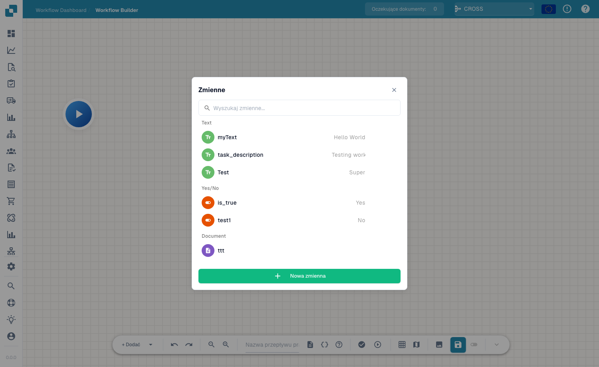

# Zmienne

## Film: Zmienne, testy i aktywacja



[Napisy (WebVTT)](https://docbits-videos.fra1.cdn.digitaloceanspaces.com/settings-assistant/advanced_workflows_testing/v2/pl.vtt) · 1:53

Transkrypcja

**Wybierz typ zmiennej**

Otwórz zmienne ikoną nawiasów klamrowych. Wybierz tekst, liczbę, tak lub nie albo dokument. Szukaj według nazwy. Zmienna Document przechowuje odwołanie ustawiane dedykowaną akcją; formularz nie przyjmuje wartości dokumentu.

**Zmienne organizacji**

Wybierz unikalną nazwę, typ i wartość początkową. Tworzenie, edycja i usuwanie zmiennych zapisują się natychmiast dla organizacji. Inne workflow mogą je współdzielić. Zapisanie lub odrzucenie płótna nie cofa zmian zmiennych.

**Najpierw sprawdź strukturę**

Wybierz walidację. Przejrzyj błędy i ostrzeżenia nad płótnem. Kliknij komunikat, aby przejść do węzła. Sprawdź akcje, wejścia, wyjścia, cykle i połączenia gałęzi. Poprawna struktura nie gwarantuje poprawności danych wykonania.

**Wybierz kontekst testu**

Odtwarzanie na pasku otwiera wybór dokumentu. Użyj dokumentu, danych niestandardowych lub testu bez dokumentu dla niezależnych kart. Odtwarzanie na Start uruchamia bezpośrednio. Test obejmuje bieżące płótno z niezapisanymi zmianami i symuluje działania destrukcyjne.

**Sprawdź wyniki**

Sprawdź komunikaty i czasy węzłów: zielony to sukces, pomarańczowy fałszywy warunek, czerwony błąd, szary pominięcie. Powtórz test po poprawkach. Menedżer testów zapewnia powtarzalne scenariusze: sukces, alternatywy, brak danych i błędy.

**Zapisz przed aktywacją**

Automatyczny zapis zachowuje lokalny szkic około trzydzieści sekund po zmianach. Zapisz jawnie na serwerze. Aktywacja wymaga pierwszego zapisu. Sprawdź stan włączenia na liście workflow, zanim oczekujesz automatycznego wykonania.

[Zobacz wszystkie pięć rozdziałów](../advanced-workflow-videos.md)

**Zmienne** pozwalają zapisać wartości raz i wykorzystać je ponownie w węzłach Zaawansowanego Workflow — na przykład próg, stałego odbiorcę lub wartość odczytaną z dokumentu i przekazaną do późniejszego węzła. Panel zmiennych otwierasz przyciskiem **Variables** (ikona `{ }`) na pasku narzędzi.

<figure><figcaption>
Panel zmiennych — zmienne pogrupowane według typu, z wyszukiwaniem i przyciskiem <strong>New Variable</strong>.
</figcaption></figure>

## Typy zmiennych

Zmienne są pogrupowane według typu:

- **Text** — wartość tekstowa (np. opis lub stała etykieta).
- **Yes/No** — flaga logiczna (Yes / No).
- **Document** — odwołanie do dokumentu lub pola dokumentu.

Użyj pola wyszukiwania, aby szybko znaleźć zmienną, gdy lista się rozrasta.

## Tworzenie zmiennej

Kliknij **New Variable**, nadaj jej nazwę i typ oraz ustaw jej wartość. Zmienna staje się wtedy dostępna do odwołania z kart na Twoich węzłach, dzięki czemu możesz przechowywać konfigurację w jednym miejscu i zmieniać ją bez edytowania każdego węzła.

## Następne kroki

- Zobacz, jak węzły korzystają z tych wartości, w sekcji [Węzły](nodes.md).
- Zwaliduj i uruchom workflow w [Walidacji i Testowaniu](validation-and-testing.md).
