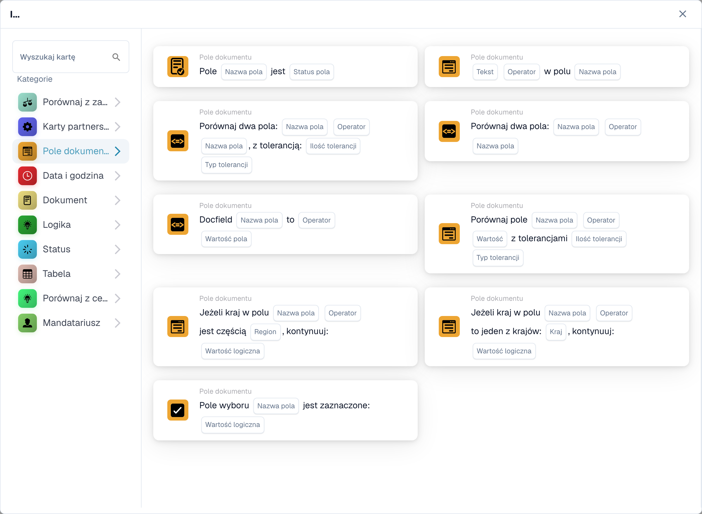
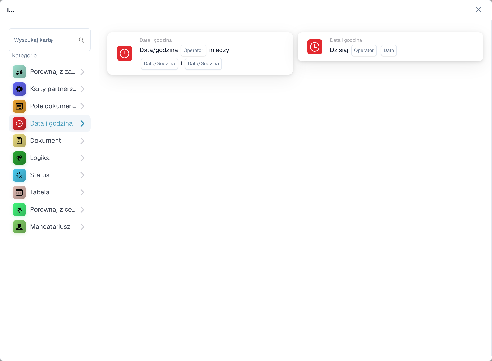
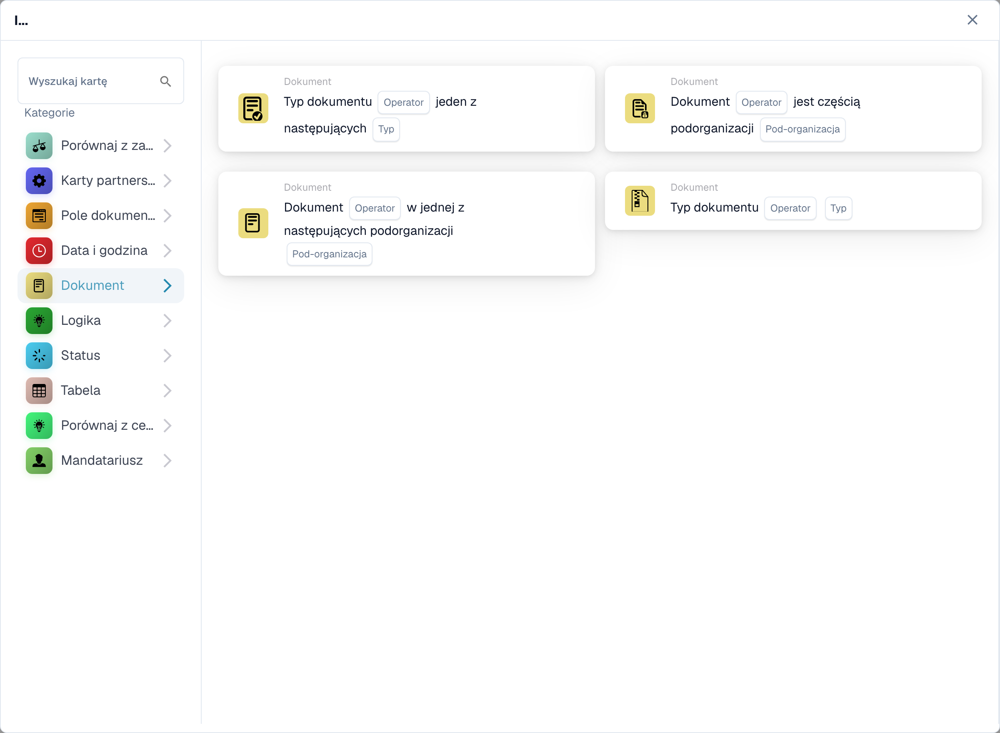
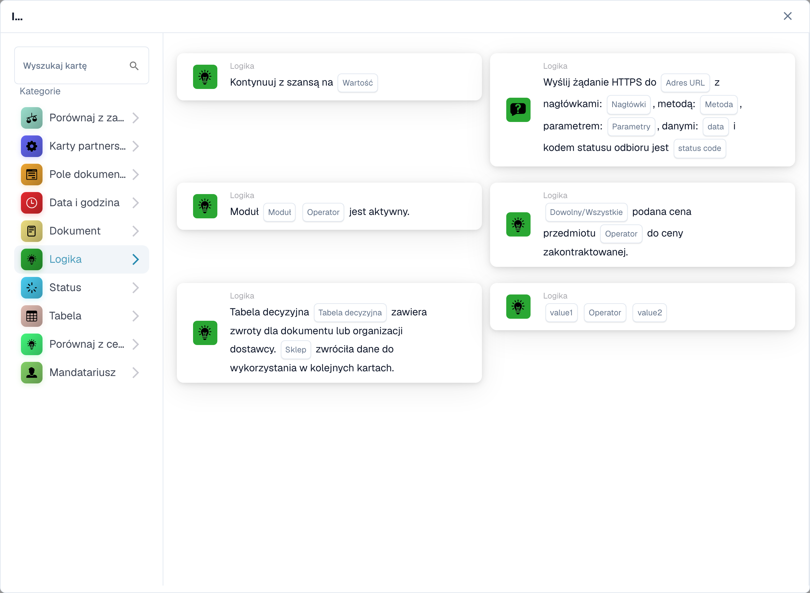
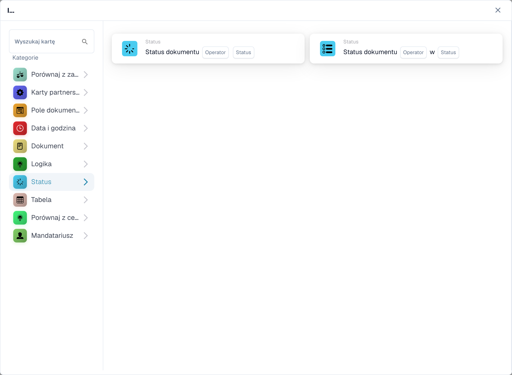
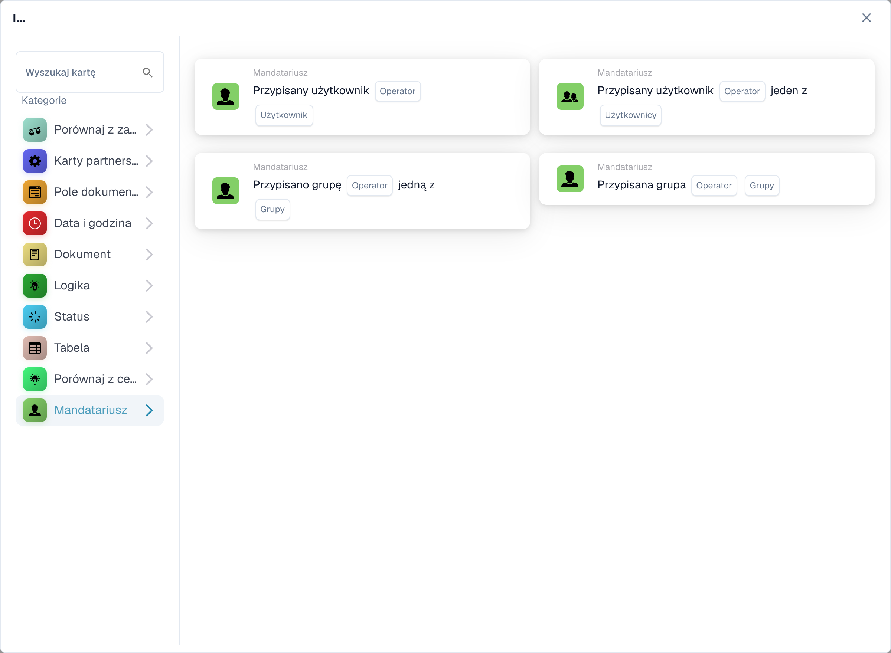

# I

Użyj karty **I**, aby zdecydować, czy przepływ pracy powinien być kontynuowany po wyzwoleniu **Kiedy**. Dodaj potrzebne kontrole przed akcją **Wtedy**. Na każdej karcie znajdują się pola do wypełnienia, takie jak **Operatora**, **Nazwa pola** lub **Wartość**; zrzuty ekranu pokazują dostępne szablony kart, a nie gotowe zasady.

W **Kreatorze przepływu pracy** wybierz **Dodaj kartę** w obszarze **I...**. Wybierz kategorię po lewej stronie lub wpisz nazwę karty w polu **Wyszukaj kartę**. Wybierz podgląd karty, aby dodać ją do przepływu pracy. Możesz przewijać listę podglądu, aby zobaczyć więcej kart. Użyj **×**, aby zamknąć selektor bez wybierania kolejnej karty. Po skonfigurowaniu kart zapisz przepływ pracy. Zobacz [Workflow](..), aby zapoznać się z otaczającymi krokami **Kiedy**, **I** i **Wtedy**.

## Porównaj z zamówieniem zakupu

Użyj tych kart, aby porównać dane zamówienia lub faktury z zamówieniem zakupu, takie jak cena jednostkowa, obiecany termin dostawy, opłaty lub ilość. Wybierz pola, operator i tolerancję, o jaką prosi wybrana karta. Aby poznać poszczególne karty, zobacz [Porównaj z zamówieniem](compare-with-purchase-order).

<figure><figcaption>
Karty dostępne w wybranej kategorii. Uzupełnij pola przed użyciem. Niektóre etykiety tej wersji interfejsu nie są jeszcze przetłumaczone lub mają nieprawidłowe tłumaczenie. Objaśnienia na tej stronie używają właściwych terminów; obraz przedstawia rzeczywisty interfejs.
</figcaption></figure>

## Pole dokumentu

Wybierz tę kategorię, aby sprawdzić pole wyboru lub stan pola, porównać pole z wartością lub porównać dwa pola. Wypełnij symbole zastępcze **Nazwa pola** i **Operatora** na wybranej karcie. Niektóre porównania wymagają również tolerancji. Zobacz [Pole dokumentu](document-field).

<figure><figcaption>
Karty dostępne w wybranej kategorii. Uzupełnij pola przed użyciem. Niektóre etykiety tej wersji interfejsu nie są jeszcze przetłumaczone lub mają nieprawidłowe tłumaczenie. Objaśnienia na tej stronie używają właściwych terminów; obraz przedstawia rzeczywisty interfejs.
</figcaption></figure>

## Data i godzina

Użyj **Data i godzina**, aby porównać datę lub godzinę z zakresem, lub porównaj **Dzisiaj** z wybraną datą. Wybierz **Operatora** i wartości daty na karcie. Zobacz [Data i godzina](date-and-time).

<figure><figcaption>
Karty dostępne w wybranej kategorii. Uzupełnij pola przed użyciem. Niektóre etykiety tej wersji interfejsu nie są jeszcze przetłumaczone lub mają nieprawidłowe tłumaczenie. Objaśnienia na tej stronie używają właściwych terminów; obraz przedstawia rzeczywisty interfejs.
</figcaption></figure>

## Dokument

Użyj tych kart, gdy przepływ pracy powinien zależeć od **typu dokumentu** lub **podorganizacji**. Wybierz typ lub organizację wymienioną na karcie. Zobacz [Dokument](document).

<figure><figcaption>
Karty dostępne w wybranej kategorii. Uzupełnij pola przed użyciem. Niektóre etykiety tej wersji interfejsu nie są jeszcze przetłumaczone lub mają nieprawidłowe tłumaczenie. Objaśnienia na tej stronie używają właściwych terminów; obraz przedstawia rzeczywisty interfejs.
</figcaption></figure>

## Logika

Ta kategoria obejmuje kontrole z wykorzystaniem tabeli decyzyjnej, odpowiedzi HTTPS, dostępności modułu, podanej ceny przedmiotu, wartości przypadkowej lub dwóch wartości. Otwórz konkretną kartę i wypełnij jej nazwane symbole zastępcze; na przykład karta HTTPS prosi o adres URL, metodę i zaakceptowany kod stanu. Zobacz [Logika](logic).

<figure><figcaption>
Karty dostępne w wybranej kategorii. Uzupełnij pola przed użyciem. Niektóre etykiety tej wersji interfejsu nie są jeszcze przetłumaczone lub mają nieprawidłowe tłumaczenie. Objaśnienia na tej stronie używają właściwych terminów; obraz przedstawia rzeczywisty interfejs.
</figcaption></figure>

## Stan

Użyj **Stan**, aby sprawdzić, czy dokument ma wybrany status lub czy jego status znajduje się w wybranym zestawie. Wybierz **Operatora** i **Stan** na karcie. Zobacz [Status](status).

<figure><figcaption>
Karty dostępne w wybranej kategorii. Uzupełnij pola przed użyciem. Niektóre etykiety tej wersji interfejsu nie są jeszcze przetłumaczone lub mają nieprawidłowe tłumaczenie. Objaśnienia na tej stronie używają właściwych terminów; obraz przedstawia rzeczywisty interfejs.
</figcaption></figure>

## Tabela

Karty te sprawdzają wiersze tabeli dokumentów. Widoczne opcje obejmują sprawdzanie dat, wzorce tekstu, okres przydatności do spożycia i porównania między kolumnami. Wybierz **Nazwa tabeli** i **Nazwa kolumny** przed wybraniem operatora lub wzorca. Zobacz [Tabela](table).

<figure><figcaption>
Karty dostępne w wybranej kategorii. Uzupełnij pola przed użyciem. Niektóre etykiety tej wersji interfejsu nie są jeszcze przetłumaczone lub mają nieprawidłowe tłumaczenie. Objaśnienia na tej stronie używają właściwych terminów; obraz przedstawia rzeczywisty interfejs.
</figcaption></figure>

## Porównaj z ceną ofertową

Użyj tych kart, aby porównać przedmiot z podanymi danymi cenowymi. Widoczne opcje obejmują identyfikator artykułu, typ dostawcy, identyfikator artykułu dostawcy, cenę jednostkową i jednostkę miary. **Operatora** i obiekty zastępcze danych zależą od wybranej karty.

<figure><figcaption>
Karty dostępne w wybranej kategorii. Uzupełnij pola przed użyciem. Niektóre etykiety tej wersji interfejsu nie są jeszcze przetłumaczone lub mają nieprawidłowe tłumaczenie. Objaśnienia na tej stronie używają właściwych terminów; obraz przedstawia rzeczywisty interfejs.
</figcaption></figure>

## Osoba przypisana

Użyj **Osoba przypisana**, gdy warunek zależy od przypisanego użytkownika lub grupy. Wybierz, czy chcesz porównać z jednym użytkownikiem, grupą, czy wybranym zestawem. Zobacz [Cesjonat](assignee).

<figure><figcaption>
Karty dostępne w wybranej kategorii. Uzupełnij pola przed użyciem. Niektóre etykiety tej wersji interfejsu nie są jeszcze przetłumaczone lub mają nieprawidłowe tłumaczenie. Objaśnienia na tej stronie używają właściwych terminów; obraz przedstawia rzeczywisty interfejs.
</figcaption></figure>

[Szczegółowe karty porównawcze ofert i zachowanie Dowolne/Wszystkie](../cards-overview/quote-comparison-guide.md).
