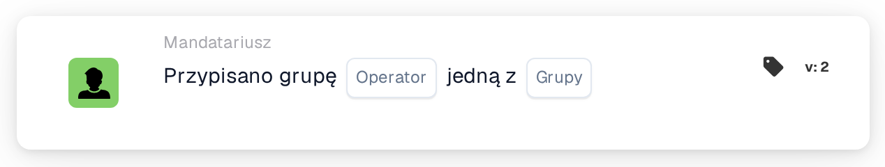

# Przypisany warunek grupy

<figure><figcaption>
Wersja 2
</figcaption></figure>

**Cel:**

Ta karta przepływu pracy wykonuje operacje w zależności od tego, czy zadanie lub dokument jest przypisane do określonej grupy lub zestawu grup. Wykorzystuje logikę warunkową, aby wyzwalać lub blokować określone akcje w zależności od przypisania grupy, co czyni ją idealną dla przepływów pracy wymagających obsługi specyficznej dla grupy.

**Komponenty karty:**

1. **Operatora**
   * **Opis:** Definiuje warunek logiczny stosowany do przypisania grupy.
   * **Opcje:**
     * **IS:** Wyzwala operację, jeśli przypisana grupa dokumentu lub zadania odpowiada jednej z grup z określonej listy.
     * **NIE JEST:** Wyzwala operację, jeśli przypisana grupa dokumentu lub zadania nie odpowiada żadnej z grup z określonej listy.
2. **Lista grup**
   * **Opis:** Lista lub wybór grup do porównania z przypisaną grupą.
   * **Szczegóły:** Lista ta może zawierać jedną lub wiele grup, umożliwiając karcie skuteczną obsługę zarówno pojedynczych, jak i wielu warunków grupowych.

**Funkcjonalność:**

* **Identyfikacja przypisania grupy:** Automatycznie identyfikuje grupę lub grupy przypisane do określonego zadania lub dokumentu w systemie.
* **Ocena warunku:**
  * Przy operatorze **IS** karta sprawdza, czy przypisana grupa jest jedną z grup wymienionych na liście Groups List.
  * Przy operatorze **NIE JEST** karta zapewnia, że przypisana grupa nie należy do grup z listy.
* **Wykonanie akcji:**
  * **Warunek prawdziwy:** Jeśli przypisanie grupy spełnia warunek (**IS** lub **NIE JEST**), wyzwalane są odpowiednie akcje, takie jak powiadomienia, inicjowanie zadań, zatwierdzenia lub inne kroki przepływu pracy.
  * **Warunek fałszywy:** Jeśli warunek nie jest spełniony, przepływ pracy nie będzie kontynuowany.

**Interakcje użytkownika:**

* **Konfiguracja:** Użytkownicy konfigurują kartę, wybierając operator i wskazując odpowiednie grupy z listy Groups List. Konfiguracja powinna być przyjazna i intuicyjna, aby uwzględnić wybory z potencjalnie dużych baz grup.
* **Monitorowanie i raportowanie:**\
  System powinien zapewniać funkcjonalność monitorowania i raportowania operacji wyzwalanych przez tę kartę, dostarczając informacji o dokładności przypisań i efektywności procesu.
* **Obsługa błędów i powiadomienia:**\
  Użytkownicy powinni mieć możliwość otrzymywania alertów lub powiadomień w przypadku problemów z przypisaniami, takich jak nieprzypisane zadania lub błędy w wyborze grupy.

**Podsumowanie:**\
Karta przepływu pracy "Assigned Group Condition" jest niezbędna do zarządzania przepływami pracy dokumentów i zadań zależnymi od przypisań grup. Pozwalając na warunki oparte na tym, czy zadanie lub dokument jest przypisane do określonych grup, zapewnia, że przepływy pracy są wyzwalane tylko przez odpowiednie interakcje grup, poprawiając odpowiedzialność i zarządzanie zadaniami w zespołach.

<!-- workflow-card-practical-example-20261021 -->

## Praktyczny przykład

**Kiedy używać:** Zastosuj tę samą zasadę do dwóch zespołów recenzujących.

**Konfiguracja:** Wybierz jest-jedną z i skonfigurowane grupy `Demo Finance` i `Demo Procurement`.

**Oczekiwany wynik i kontrprzykład:** Dokument przypisany do którejkolwiek z wybranych grup przechodzi pomyślnie. Dokument przypisany tylko do `Demo Support` kończy się niepowodzeniem.

To jest ilustracyjna konfiguracja i oczekiwany wynik. Korzystaj z pól, użytkowników i grup skonfigurowanych w Twojej organizacji testowej; nie jest to twierdzenie, że ten przykład został wykonany.
