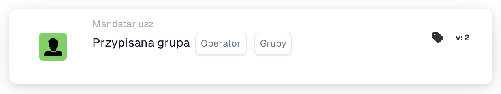

# Warunek pojedynczej przypisanej grupy

<figure><figcaption>
Wersja 2
</figcaption></figure>

**Cel:**\
Ta karta przepływu pracy wykonuje operacje w zależności od tego, czy zadanie lub dokument jest przypisane do określonej grupy. Wykorzystuje prosty warunek, aby wyzwalać lub blokować akcje na podstawie przypisania grupy.

**Komponenty karty:**

1. **Operatora**
   * **Opis:** Definiuje warunek logiczny stosowany do przypisania grupy.
   * **Opcje:**
     * **IS:** Wyzwala operację, jeśli przypisana grupa dokumentu lub zadania odpowiada określonej grupie.
     * **NIE JEST:** Wyzwala operację, jeśli przypisana grupa dokumentu lub zadania nie odpowiada określonej grupie.
2. **Grupa**
   * **Opis:** Określa grupę do porównania z przypisaną grupą.
   * **Szczegóły:** To pole umożliwia wybór pojedynczej grupy do porównania przypisania.

**Funkcjonalność:**

* **Identyfikacja przypisania grupy:** Automatycznie identyfikuje grupę przypisaną do określonego zadania lub dokumentu.
* **Ocena warunku:**
  * Przy operatorze **IS** karta sprawdza, czy przypisana grupa odpowiada określonej grupie.
  * Przy operatorze **NIE JEST** karta zapewnia, że przypisana grupa nie odpowiada określonej grupie.
* **Wykonanie akcji:**
  * **Warunek prawdziwy:** Jeśli przypisanie grupy spełnia warunek (**IS** lub **NIE JEST**), wyzwalane są odpowiednie akcje, takie jak powiadomienia, inicjowanie zadań, zatwierdzenia lub inne kroki przepływu pracy.
  * **Warunek fałszywy:** Jeśli warunek nie jest spełniony, dokument lub zadanie może przejść przez inną ścieżkę routingu lub można określić alternatywne akcje.

**Interakcje użytkownika:**

* **Konfiguracja:**\
  Użytkownicy konfigurują kartę, wybierając operator i wskazując odpowiednią grupę. Konfiguracja powinna być prosta i intuicyjna.
* **Monitorowanie i raportowanie:**\
  System powinien zapewniać funkcjonalność monitorowania i raportowania operacji wyzwalanych przez tę kartę, dostarczając informacji o dokładności przypisań i efektywności procesu.
* **Obsługa błędów i powiadomienia:**\
  Użytkownicy powinni mieć możliwość otrzymywania alertów lub powiadomień w przypadku problemów z przypisaniami, takich jak nieprzypisane zadania lub błędy w wyborze grupy.

**Podsumowanie:**\
Karta przepływu pracy "Assigned Group Condition" jest niezbędna do zarządzania przepływami pracy dokumentów i zadań opartymi na przypisaniach grup. Pozwalając na warunki oparte na tym, czy zadanie lub dokument jest przypisane do określonej grupy, zapewnia, że przepływy pracy są wyzwalane tylko przez odpowiednie interakcje grup, poprawiając zarządzanie zadaniami i efektywność przepływu pracy.

<!-- workflow-card-practical-example-20261021 -->

## Praktyczny przykład

**Kiedy używać:** Zastosuj regułę do kolejki przeglądu finansowego.

**Konfiguracja:** Wybierz operator równości i grupę `Demo Finance`.

**Oczekiwany wynik i kontrprzykład:** Dokument przypisany do `Demo Finance` przechodzi pomyślnie. Samo przypisanie do indywidualnego użytkownika nie powoduje przynależności do wybranej grupy przypisań dokumentów.

To jest ilustracyjna konfiguracja i oczekiwany wynik. Korzystaj z pól, użytkowników i grup skonfigurowanych w Twojej organizacji testowej; nie jest to twierdzenie, że ten przykład został wykonany.
