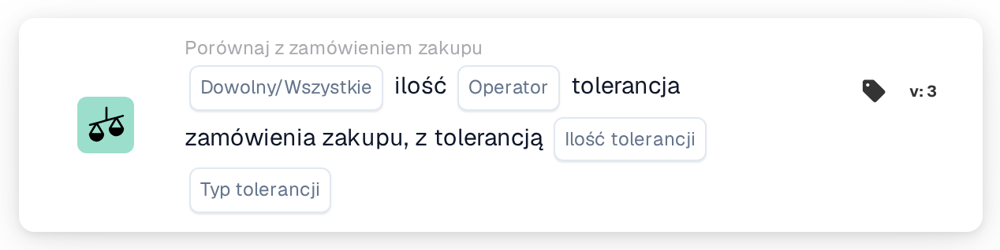
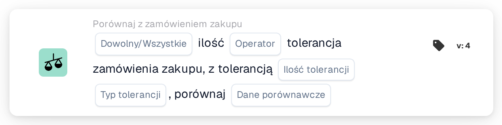

# Dowolna/wszystkie ilości

<figure><figcaption>
Wersja 2
</figcaption></figure>

<figure><figcaption>
Wersja 3
</figcaption></figure>

<figure><figcaption>
Wersja 4
</figcaption></figure>

## **Cel:**

Ta karta przepływu pracy służy do porównywania ilości w dokumencie z tolerancją określoną w zamówieniu. Pozwala użytkownikom ocenić, czy ilość spełnia określone warunki, takie jak równość lub przekroczenie określonej tolerancji. W wersji 4 karta rozszerza funkcjonalność o możliwość porównywania wielu podmiotów, w tym zamówienia zakupu, otrzymanych ilości i ilości dokumentów, oferując większą elastyczność w obsłudze różnych scenariuszy.

## **Elementy karty:**

1. **Dowolny / Wszystkie:**
   * **Opis**: Określa, w jaki sposób należy zastosować porównanie w przypadku wielu elementów lub warunków.
   * **Opcje**:
     * **Any**: Przynajmniej jeden z warunków musi być spełniony, aby akcja została wyzwolona.
     * **All**: Wszystkie warunki muszą być spełnione, aby akcja była kontynuowana.
2. **Operator:**
   * **Opis**: Definiuje warunek, który zostanie zastosowany w celu porównania ilości dokumentów z określoną tolerancją.
   * **Opcje**:
     * **Równa się (=)**: Sprawdza, czy ilość odpowiada określonej wartości tolerancji.
     * **Nie równa się (≠)**: Zapewnia, że ilość różni się od określonej wartości tolerancji.
     * **Większy niż (>)**: Sprawdza, czy ilość jest większa niż określona tolerancja.
     * **Większy lub równy (≥)**: Sprawdza, czy ilość jest większa lub równa określonej tolerancji.
     * **Mniejszy niż (<)**: Sprawdza, czy ilość jest mniejsza niż określona tolerancja.
     * **Mniejszy lub równy (≤)**: Sprawdza, czy ilość jest mniejsza lub równa określonej tolerancji.
3. **Kwota tolerancji:**
   * **Opis**: Określa wartość tolerancji, z którą będzie porównywana ilość dokumentów.
   * **Szczegół**: Ta wartość jest numeryczna i reprezentuje próg dozwolonej wariancji ilości
4. **Typ tolerancji:**
   * **Opis**: Określa typ tolerancji, który zostanie zastosowany.
   * **Opcje**:
     * **Procent**: Tolerancja jest obliczana jako procent ilości zamówienia.
     * **Wartość**: Tolerancja jest określona jako stała wartość liczbowa.

## **Dodatkowe komponenty w wersji 4:**

* **Typ porównania**: Wybiera elementy do porównania, zapewniając większą elastyczność w sposobie oceniania ilości w wersji 4.
  * **Zamówienie zakupu do dokumentu**: Porównuje ilość w zamówieniu z ilością w powiązanym dokumencie.
  * **Odebrano do dokumentu**: Porównuje otrzymaną ilość z ilością w dokumencie.
  * **Zamówienie zakupu do otrzymanego**: Porównuje ilość zamówienia zakupu z ilością otrzymaną.

## **Funkcjonalność:**

* **Ocena stanu:** System porównuje ilość w dokumencie z tolerancją w zamówieniu w oparciu o wybranego operatora i kwotę/rodzaj tolerancji. W wersji 4 **Typ porównania** umożliwia porównanie różnych ilości, np. zamówienia zakupu z otrzymanym lub udokumentowania zamówienia zakupu, zapewniając bardziej dynamiczne porównanie.
* **Wykonanie akcji:**
  * **Prawda Warunek**: Jeśli wynik porównania jest prawdziwy (np. ilość dokumentów mieści się w akceptowalnym zakresie tolerancji), przepływ pracy będzie kontynuowany.
  * **Fałsz Warunek**: Jeśli wynik porównania jest fałszywy (np. ilość nie spełnia tolerancji), przepływ pracy nie będzie kontynuowany.

## **Instalacja i konfiguracja:**

**Wersja 3:**

* Użytkownicy konfigurują kartę poprzez wybór ilości dokumentu, określenie wielkości tolerancji i rodzaju tolerancji oraz wybór odpowiedniego operatora, który porówna ilość z tolerancją. Karta ocenia, czy ilość mieści się w progu tolerancji i na podstawie wyniku podejmuje akcję „Prawda” lub „Fałsz”.

**Wersja 4:**

* Oprócz konfiguracji w wersji 3, użytkownicy mogą wybrać **Typ porównania**, umożliwiając porównania pomiędzy różnymi podmiotami, takimi jak:
  * **Zamówienie zakupu do udokumentowania**
  * **Odebrano do dokumentu**
  * **Zamówienie zakupu do otrzymania**

## **Przykładowy scenariusz:**

Faktura wskazuje, że dostarczono 100 jednostek, ale zamówienie autoryzowało jedynie 90 jednostek. Wielkość tolerancji jest ustawiona na 10 jednostek, a typ tolerancji jest bezwzględny.

* **Wersja 3**: Karta porównuje 100 jednostek w dokumencie z tolerancją zamówienia wynoszącą 90 jednostek. Jeśli ilość przekracza tolerancję, karta zaznacza rozbieżność w celu dalszego sprawdzenia.
* **Wersja 4**: Karta może porównać **ilość zamówienia** (90 sztuk) z **otrzymaną ilością** (100 sztuk) lub **ilością dokumentu** (100 sztuk). W zależności od wybranego **Typu porównania** sprawdza, czy różnica między dwoma elementami przekracza tolerancję i uruchamia odpowiednią akcję.

## **Konkluzja:**

* **Wersja 3**: Ta karta przepływu pracy porównuje ilość dokumentu z tolerancją zamówienia, pomagając zapewnić, że rozbieżności w ilościach zostaną oznaczone i odpowiednio obsługiwane.
* **Wersja 4**: Rozszerza tę funkcjonalność, umożliwiając użytkownikom porównywanie różnych jednostek, takich jak zamówienie zakupu z otrzymanym lub udokumentowanie zamówienia zakupu, zapewniając większą elastyczność w obsłudze bardziej złożonych scenariuszy. Wersja 4 zapewnia większą kontrolę nad procesami zaopatrzenia i odbioru, oferując bardziej dynamiczne porównania i działania w oparciu o wybrany typ porównania.

Zobacz [kierunek porównania, podstawę tolerancji i wersje zapisanej karty](../../cards-overview/po-comparison-versions-guide.md) przed zmianą stron porównania.
