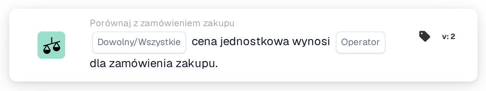
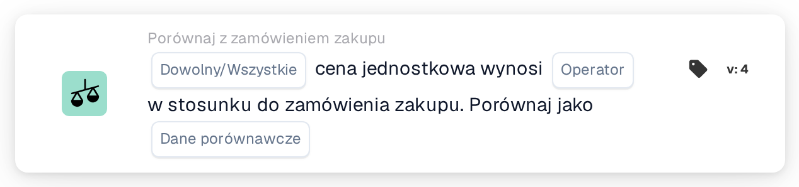
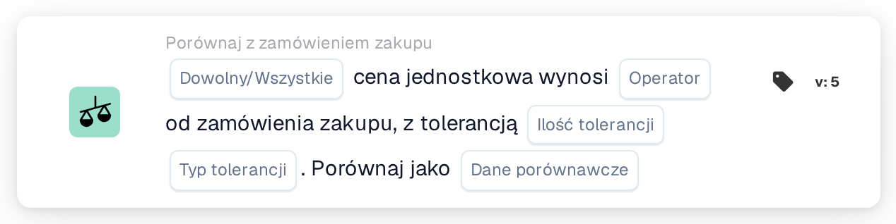

# Cena jednostkowa dowolna/wszystkie

<figure><figcaption>
Wersja 2
</figcaption></figure>

<figure><figcaption>
Wersja 3
</figcaption></figure>

<figure><figcaption>
Wersja 4
</figcaption></figure>

<figure><figcaption>
Wersja 5
</figcaption></figure>

## **Cel:**

Ta karta przepływu pracy służy do porównywania ceny jednostkowej w dokumencie z ceną jednostkową w zamówieniu zakupu, zapewniając zgodność cen w ramach określonych poziomów tolerancji. Porównanie może wywołać działania, jeśli cena jednostkowa nie spełnia oczekiwań. **Wersja 4** zapewnia większą elastyczność, umożliwiając użytkownikom wybór różnych podmiotów do porównania, zapewniając głębszy poziom kontroli nad procesami cenowymi i zakupowymi.

## **Elementy karty:**

1. **Dowolny / Wszystkie:**
   * **Opis**: Określa, czy warunek ma zastosowanie do jednego czy wszystkich przypadków porównywania ceny jednostkowej.
   * **Opcje**:
     * **Any**: Warunek jest spełniony, jeśli jakakolwiek cena jednostkowa spełnia określony warunek porównania.
     * **All**: Warunek jest spełniony tylko wtedy, gdy wszystkie ceny jednostkowe spełniają określony warunek porównania.
2. **Operator:**
   * **Opis**: Definiuje warunek porównania ceny jednostkowej z określoną wartością.
   * **Opcje**:
     * **Równa się (=)**: Sprawdza, czy cena jednostkowa odpowiada określonej wartości.
     * **Nie równa się (≠)**: Zapewnia, że cena jednostkowa różni się od określonej wartości.
     * **Większy niż (>)**: Sprawdza, czy cena jednostkowa jest większa niż określona wartość.
     * **Większy lub równy (≥)**: Sprawdza, czy cena jednostkowa jest większa lub równa określonej wartości.
     * **Mniejszy niż (<)**: Sprawdza, czy cena jednostkowa jest niższa od określonej wartości.
     * **Mniejszy lub równy (≤)**: Sprawdza, czy cena jednostkowa jest mniejsza lub równa określonej wartości.

## **Dodatkowe komponenty w wersji 4:**

**Typ porównania:**

* **Opis**: Umożliwia użytkownikom wybór, jakie podmioty będą porównywane oprócz ceny jednostkowej.
* **Opcje**:
  * **Zamówienie zakupu do dokumentu**: Porównuje cenę jednostkową w zamówieniu z ceną jednostkową w dokumencie.
  * **Odebrano do dokumentu**: Porównuje kwotę po stronie otrzymanej uzyskaną z dopasowanego zamówienia zakupu z kwotą po stronie dokumentu.
  * **Zamówienie zakupu do otrzymanego**: Porównuje stronę zamówienia zakupu z uzyskaną kwotą po stronie otrzymania.

## **Funkcjonalność:**

* **Ocena Warunku:** System porównuje cenę jednostkową w dokumencie z ceną jednostkową w zamówieniu (lub innej wybranej jednostce, w Wersji 4) na podstawie wybranego operatora. Jeśli porównanie jest prawdziwe, przepływ pracy przebiega według kolejnych kroków, uruchamiając zatwierdzenie lub zatrzymując proces.
* **Wykonanie akcji:**
  * **True Warunek**: Jeśli warunek ma wartość true (np. cena jednostkowa w dokumencie jest większa niż podana wartość), przepływ pracy będzie kontynuowany z prawdziwą akcją (np. zatwierdzenie, przetwarzanie dokumentu).
  * **Fałsz Warunek**: Jeśli warunek ma wartość fałszywą (np. cena jednostkowa w dokumencie nie spełnia porównania), przepływ pracy nie będzie kontynuowany.

## **Instalacja i konfiguracja:**

* **Wersja 3 Konfiguracja:** Użytkownicy konfigurują kartę, wybierając cenę jednostkową w dokumencie, wybierając odpowiedni operator w celu określenia sposobu porównywania ceny jednostkowej z określoną wartością i ustawiając wartość do porównania. Ponadto użytkownicy wybierają, czy warunek dotyczy jednego lub wszystkich wystąpień porównania cen jednostkowych.
* **Konfiguracja wersji 4:** W wersji 4 użytkownicy mają dodatkową opcję wyboru typu porównania. Umożliwia to zdefiniowanie jednostek do porównania, takich jak Zamówienie zakupu z dokumentem, Otrzymane z dokumentem lub Zamówienie zakupu z otrzymanym. Zwiększa to elastyczność karty w zakresie porównywania cen jednostkowych w bardziej złożonych scenariuszach.

## **Przykładowy scenariusz:**

*   **Wersja 3 Przykład:**

    Na fakturze widnieje cena jednostkowa wynosząca 50 dolarów. Powiązane zamówienie ma cenę jednostkową wynoszącą 45 USD. Karta porównuje dwie ceny jednostkowe za pomocą operatora „Większe niż”. Ponieważ cena jednostkowa w dokumencie (50 USD) jest wyższa niż cena jednostkowa w zamówieniu (45 USD), przepływ pracy uruchomi warunek prawdziwy (np. wyślij dokument do przeglądu).
* **Wersja 4 Przykład:**\
  Na fakturze widnieje cena jednostkowa wynosząca 50 USD, a w powiązanym zamówieniu autoryzowana jest cena jednostkowa wynosząca 45 USD. Dodatkowo otrzymana ilość to 60 sztuk. Karta porównuje otrzymaną ilość z ceną jednostkową dokumentu za pomocą operatora „Większe niż”. Ponieważ otrzymana ilość (60) jest większa niż cena jednostkowa (50 USD), przepływ pracy wyzwala warunek prawdziwy, a dokument zostaje oznaczony do dalszej analizy.

## **Konkluzja:**

Wersja 3 karty przepływu pracy „Porównanie cen jednostkowych” ma na celu zapewnienie zgodności cen jednostkowych w dokumentach z cenami w zamówieniach, uruchamiając działania w oparciu o zdefiniowane warunki. Wersja 4 rozszerza tę funkcjonalność, wprowadzając bardziej złożone opcje porównań, takie jak porównywanie zamówień zakupu z dokumentami, otrzymanych ilości z dokumentami i zamówień zakupu z otrzymanymi ilościami. Ta dodatkowa elastyczność pozwala organizacjom radzić sobie z bardziej wyrafinowanymi scenariuszami dotyczącymi cen i zakupów, poprawiając kontrolę i dokładność przepływów pracy.

## Wersja 5 i kierunek porównania

Wersja 5 zawiera opcję Dowolne/Wszystkie, operator, wielkość tolerancji, typ tolerancji i wybór strony porównawczej. Nowsze wersje oferują oba kierunki dokumentu, porównania zamówień i otrzymanych danych. Strona odniesienia określa podstawę tolerancji procentowej. Zobacz [Wersje porównawcze PO](../../cards-overview/po-comparison-versions-guide.md) dla wszystkich sześciu opcji, migracji zapisanych kart i przykładów testowych.
