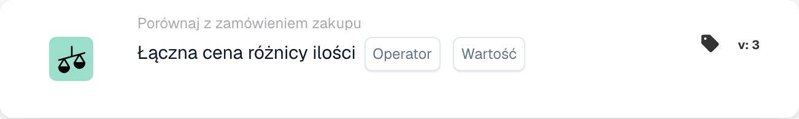
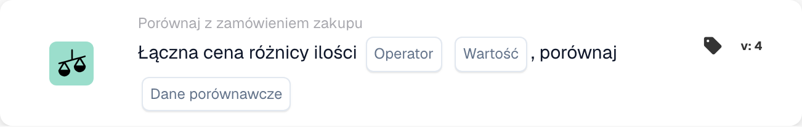

# Łączna cena różnicy ilościowej

<figure><figcaption>
Pola karty w pokazanej wersji. Pola nie są jeszcze skonfigurowane.
</figcaption></figure>

<figure><figcaption>
Pola karty w pokazanej wersji. Pola nie są jeszcze skonfigurowane.
</figcaption></figure>

## **Cel**:

Ta karta przepływu pracy ocenia łączną cenę różnicy ilościowej, porównując ją z określoną wartością. Pomaga zautomatyzować działania w oparciu o rozbieżności cenowe i ilościowe w powiązanych dokumentach, usprawniając przepływy pracy związane z zaopatrzeniem i odbiorem. **Wersja 4** rozszerza tę funkcjonalność, umożliwiając porównania pomiędzy różnymi jednostkami, takimi jak zamówienie zakupu, otrzymane ilości i sam dokument, dodając większą elastyczność i kontrolę do przepływu pracy.

## **Elementy Karty**:

1. **Operatora**:
   * **Opis:** Warunek porównania ceny łącznej z określoną wartością.
   * **Opcje:**
     * **Równa się (=)**: Sprawdza, czy łączna cena odpowiada określonej wartości.
     * **Nie równa się (≠)**: Zapewnia, że łączna cena różni się od określonej wartości.
     * **Większe niż (>)**: Sprawdza, czy łączna cena jest większa niż określona wartość.
     * **Większy lub równy (≥)**: Sprawdza, czy łączna cena jest większa lub równa określonej wartości.
     * **Mniejszy niż (<)**: Sprawdza, czy łączna cena jest niższa od określonej wartości.
     * **Mniejszy lub Równy (≤)**: Sprawdza, czy łączna cena jest mniejsza lub równa określonej wartości
2. **Wartość**:
   * **Opis:** Określa wartość, z którą będzie porównywana łączna cena lub wartość ilościowa.
   * **Szczegóły:** Wartość musi być wartością numeryczną.

## **Dodatkowe komponenty w wersji 4**:

* **Typ porównania**: Wybiera elementy do porównania. Opcje obejmują:
  * **Zamówienie zakupu z dokumentem**: Porównuje ilości i ceny pomiędzy zamówieniem zakupu a powiązanym dokumentem.
  * **Odebrano do dokumentu**: Porównuje otrzymane ilości z ilościami w dokumencie.
  * **Zamówienie zakupu do otrzymanego**: Porównuje ilości zamówienia zakupu z ilościami otrzymanymi.

## **Funkcjonalność**:

* **Ocena stanu**: Oblicza łączną cenę poprzez pomnożenie różnicy ilościowej przez cenę jednostkową i porównanie jej z określoną wartością przy użyciu wybranego operatora.\
  **Wersja 4** dodaje opcję porównywania dodatkowych jednostek w oparciu o konfigurację użytkownika, np. zamówienie zakupu do otrzymania lub zamówienie zakupu do udokumentowania.
* **Wykonanie akcji**: W zależności od tego, czy łączna cena spełnia określony warunek, przepływ pracy będzie kontynuowany z warunkami prawda lub fałsz, aby uruchomić działania lub zatrzymać przepływ pracy. **Wersja 4** pozwala także na bardziej dynamiczną realizację akcji, gdzie rodzaj warunku (np. otrzymanie zamówienia) wpływa na kolejny krok.

## **Instalacja i konfiguracja**:

* **Wersja 3**: Użytkownicy konfigurują kartę, wybierając pola dokumentu dotyczące różnicy ilościowej i ceny jednostkowej. Następnie wybierany jest operator, który definiuje, w jaki sposób łączna cena będzie porównywana z określoną wartością. Na koniec użytkownicy ustawiają warunek kontynuacji (prawda lub fałsz), który wyznacza następny krok w przepływie pracy.
* **Wersja 4**: Oprócz konfiguracji w **Wersja 3**, użytkownicy mają dodatkową opcję konfiguracji **Typu porównania**. Określa, jakie jednostki będą porównywane, np. **Zamówienie zakupu z Dokumentem**, **Odebrane z Dokumentem** lub **Zamówienie zakupu z Otrzymanym**.

## **Przykładowy scenariusz**:

* Faktura pokazuje 50 jednostek produktu po 100 dolarów za sztukę, co daje łączną kwotę 5000 dolarów. Powiązane zamówienie upoważniało do zakupu 4500 dolarów za 45 jednostek. Różnica ilościowa wynosi 5 jednostek, a łączna cena różnicy wynosi 500 USD. Karta porównuje ilość zamówienia (45 sztuk) z ilością otrzymaną (50 sztuk) i sprawdza, czy łączna cena jest większa niż 400 dolarów (określona wartość). Korzystając z operatora **Większy niż (>)**, karta identyfikuje rozbieżność i flaguje ją do sprawdzenia przez zespół finansowy.

## **Wniosek**:

**Wersja 3** karty przepływu pracy „Łączna cena różnicy ilościowej” oferuje proste podejście do porównywania rozbieżności ilościowych i wyzwalania działań w oparciu o progi cenowe.\
**Wersja 4** rozszerza tę funkcjonalność, umożliwiając porównania pomiędzy różnymi podmiotami (zamówienie zakupu, otrzymane, dokument), zapewniając większą elastyczność i kontrolę nad przepływem pracy. Organizacje mogą teraz automatyzować bardziej złożone scenariusze i egzekwować ściślejszą kontrolę nad procesami zaopatrzenia i odbioru.

Zobacz [kierunek porównania, podstawę tolerancji i wersje zapisanej karty](../../cards-overview/po-comparison-versions-guide.md) przed zmianą stron porównania.
