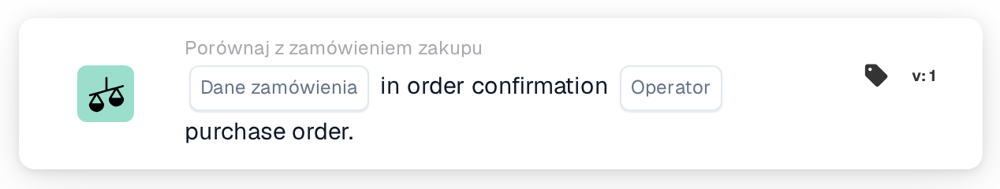
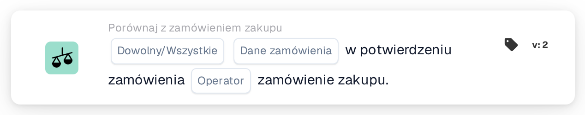
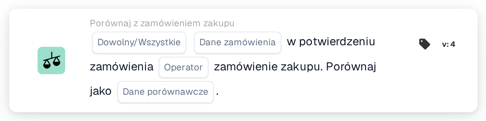

# Porównaj potwierdzenie zamówienia z zamówieniem zakupu

<figure><figcaption>
Wersja 1
</figcaption></figure>

<figure><figcaption>
Wersja 2
</figcaption></figure>

<figure><figcaption>
Wersja 3
</figcaption></figure>

<figure><figcaption>
Wersja 4
</figcaption></figure>

## Cel:

Ta karta DocBits służy do porównywania określonego pola danych zamówienia – takiego jak ilość, rabat lub cena jednostkowa – pomiędzy potwierdzeniem zamówienia a zamówieniem zakupu. Umożliwiając ukierunkowane porównanie jednego pola na raz, zapewnia precyzję walidacji kluczowych punktów danych, zachowując dokładność zamówienia. **Wersja 4** rozszerza tę funkcjonalność, umożliwiając porównania pomiędzy różnymi jednostkami, takimi jak zamówienie zakupu, otrzymane ilości i sam dokument, dodając większą elastyczność i kontrolę do przepływu pracy.

## Składniki karty:

1. **Dowolny/Wszystkie**
   * **Opis:** Określa, czy warunek dotyczy jednej lub wszystkich linii potwierdzenia zamówienia.\
     **Opcje:**
     * **Any**: Porównanie zostanie uruchomione, jeśli wybrana wartość pola w dowolnym wierszu potwierdzenia zamówienia odpowiada odpowiedniej wartości w zamówieniu.
     * **All**: Porównanie zostanie uruchomione tylko wtedy, gdy wybrana wartość pola we wszystkich wierszach potwierdzenia zamówienia odpowiada odpowiedniej wartości w zamówieniu.
2. **Pole danych zamówienia**
   * **Opis**: Określa pole danych, które ma zostać porównane pomiędzy potwierdzeniem zamówienia a zamówieniem zakupu.
   * **Szczegół**: Użytkownicy mogą wybrać jedno z następujących pól do porównania:
     * **Ilość**: Porównuje zamówioną ilość z potwierdzoną ilością.
     * **Rabat**: Sprawdza, czy rabat na potwierdzeniu jest zgodny z zamówieniem.
     * **Cena jednostkowa**: Zapewnia, że cena jednostkowa na potwierdzeniu jest zgodna z zamówieniem.
3. **Operatora**
   * **Opis**: Definiuje warunek zastosowany do porównania wybranego pola danych.
   * **Opcje**:
     * **Równa się (=)**: Potwierdza, że wartość jest zgodna z zamówieniem.
     * **Nie równa się (≠)**: Zapewnia, że wartość różni się od zamówienia.
     * **Większy niż (>)**: Sprawdza, czy wartość przekracza wartość zamówienia.
     * **Większy lub równy (≥)**: Potwierdza, że wartość jest równa lub przekracza wartość zamówienia.
     * **Mniej niż (<)**: Sprawdza, czy wartość jest niższa od wartości zamówienia.
     * **Mniejszy lub równy (≤)**: Potwierdza, że wartość jest niższa lub równa wartości zamówienia.

## **Dodatkowe komponenty w wersji 4**:

* **Typ porównania**: Wybiera elementy do porównania. Opcje obejmują:
  * **Zamówienie zakupu z dokumentem**: Porównuje dane zamówienia zakupu z powiązanym dokumentem.
  * **Odebrano do dokumentu**: Porównuje otrzymane dane (np. otrzymane ilości) z dokumentem.
  * **Zamówienie zakupu do otrzymanego**: Porównuje dane zamówienia zakupu z otrzymanymi ilościami.

## Funkcjonalność:

* **Porównanie pola**: System porównuje wybrane pole danych zamówienia (Cena jednostkowa, Rabat lub Ilość) z potwierdzenia zamówienia z odpowiednią wartością w zamówieniu zakupu.
* **Wykonanie akcji**: W oparciu o wynik porównania i stan operatora, karta może wywołać dalsze działania, takie jak powiadomienia lub alerty.

## Przykładowy scenariusz:

* Potwierdzenie zamówienia określa **cenę jednostkową** wynoszącą 50 USD, podczas gdy zamówienie zakupu podaje 45 USD. Korzystając z operatora „Większe niż”, karta oznacza rozbieżność, umożliwiając zespołowi ds. zakupów zajęcie się nią przed przetworzeniem.

## Wniosek:

Karta ta upraszcza weryfikację pól danych poszczególnych zamówień, zapewniając zgodność z warunkami zamówienia. Izolując jedno pole na raz do porównania, wspiera ukierunkowane przeglądy i zapobieganie błędom w przetwarzaniu zamówień.

Zobacz [kierunek porównania, podstawę tolerancji i wersje zapisanej karty](../../cards-overview/po-comparison-versions-guide.md) przed zmianą stron porównania.
