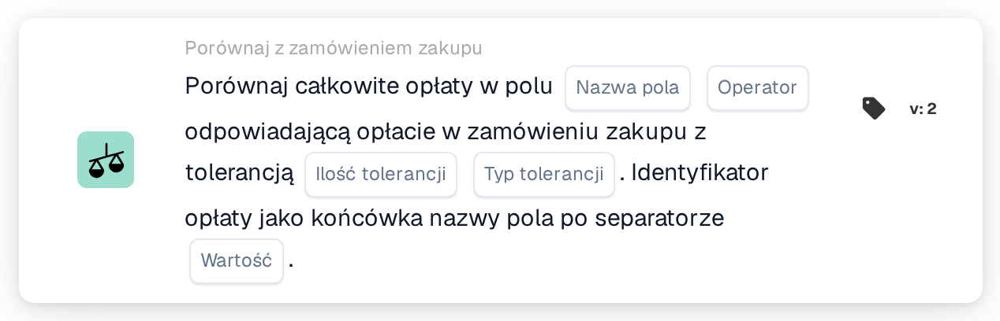

# Porównaj całkowite opłaty

<figure><figcaption>
Wersja 2
</figcaption></figure>

## **Cel:**

Ta karta przepływu pracy porównuje całkowite opłaty w polu dokumentu z odpowiadającymi im opłatami w zamówieniu zakupu. Karta pomaga zapewnić, że opłaty w dokumencie są zgodne z tymi w zamówieniu zakupu, uwzględniając określone poziomy tolerancji. Porównanie może wyzwalać akcje w przypadku wykrycia rozbieżności, takie jak oznaczanie rozbieżności do przeglądu lub odpowiednie korygowanie opłat.

## **Komponenty karty:**

1. **Nazwa pola:**
   * **Opis**: Określa pole dokumentu zawierające wartości całkowitych opłat do porównania z opłatami w zamówieniu zakupu.
   * **Szczegóły**: Wartość w tym polu reprezentuje całkowite opłaty zastosowane w dokumencie (np. fakturze) i zostanie porównana z opłatą zamówienia zakupu.
2. **Operator:**
   * **Opis**: Definiuje warunek, który zostanie zastosowany do porównania między całkowitą opłatą w dokumencie a opłatą w zamówieniu zakupu.
   * **Opcje**:
     * **Równa się (=)**: Weryfikuje, czy całkowita opłata w dokumencie odpowiada opłacie w zamówieniu zakupu.
     * **Nie równa się (≠)**: Zapewnia, że całkowita opłata w dokumencie różni się od opłaty w zamówieniu zakupu.
     * **Większe niż (>)**: Weryfikuje, czy całkowita opłata w dokumencie jest większa niż opłata w zamówieniu zakupu.
     * **Większy lub równy (≥)**: Weryfikuje, czy całkowita opłata w dokumencie jest większa lub równa opłacie w zamówieniu zakupu.
     * **Mniejszy niż (<)**: Weryfikuje, czy całkowita opłata w dokumencie jest mniejsza niż opłata w zamówieniu zakupu.
     * **Mniejszy lub równy (≤)**: Weryfikuje, czy całkowita opłata w dokumencie jest mniejsza lub równa opłacie w zamówieniu zakupu.
3. **Kwota tolerancji**
   * **Opis**: Określa próg tolerancji do porównania całkowitych opłat.
   * **Szczegóły**: Ta wartość liczbowa reprezentuje dozwoloną zmienność opłat między dokumentem a zamówieniem zakupu.
4. **Typ tolerancji:**
   * **Opis**: Określa typ tolerancji, który zostanie zastosowany.
   * **Opcje**:
     * **Percentage**: Tolerancja jest stosowana jako procent opłaty zamówienia zakupu.
     * **Wartość**: Tolerancja jest stosowana jako stała kwota liczbowa.
5. **Separator:**
   * **Opis**: Określa separator używany do odróżnienia Charge ID na końcu nazwy pola.
   * **Szczegóły**: Separator oddziela pole opłaty od unikalnego Charge ID, który zostanie użyty do powiązania opłaty dokumentu z odpowiadającą jej opłatą w zamówieniu zakupu.

## **Funkcjonalność:**

* **Ocena warunku:** System porównuje całkowitą opłatę w polu dokumentu z odpowiadającą jej opłatą w zamówieniu zakupu na podstawie operatora i tolerancji. Tolerancja jest stosowana w celu określenia, czy różnica między dwiema opłatami mieści się w akceptowalnym zakresie.
* **Wykonanie akcji:**
  * **Warunek prawdziwy**: Jeśli opłaty są zgodne (z uwzględnieniem tolerancji), a warunek jest prawdziwy, przepływ pracy będzie kontynuowany ze zdefiniowaną akcją, taką jak zatwierdzenie dokumentu lub dalsze przetwarzanie.
  * **Warunek fałszywy**: Jeśli warunek jest fałszywy (tj. opłaty nie są zgodne w ramach tolerancji), przepływ pracy nie będzie kontynuowany.

## **Konfiguracja:**

* Użytkownicy zaczynają od wybrania pola dokumentu zawierającego wartość całkowitej opłaty. Następnie wybierają operator definiujący sposób porównania opłaty z opłatą zamówienia zakupu. Potem użytkownicy ustawiają kwotę tolerancji i typ tolerancji (procent lub bezwzględny). Na koniec określają separator i Charge ID, które zostaną użyte do porównania.

## **Przykładowy scenariusz:**

Faktura wymienia opłatę 500 USD w polu "total charges". Odpowiadająca opłata zamówienia zakupu wynosi 480 USD, a tolerancja jest ustawiona na 20 USD (tolerancja bezwzględna). Karta porównuje opłatę dokumentu z opłatą zamówienia zakupu:

* Całkowita opłata w dokumencie mieści się w tolerancji 20 USD zamówienia zakupu, a przepływ pracy jest kontynuowany bez problemu.
* Jeśli opłata przekracza tolerancję, przepływ pracy oznacza rozbieżność do przeglądu.

## **Podsumowanie:**

Karta przepływu pracy "Compare Total Charges" zapewnia, że opłaty w dokumentach są zgodne z tymi w zamówieniach zakupu, uwzględniając określone poziomy tolerancji. Pomaga to organizacjom zautomatyzować proces weryfikacji, wcześnie identyfikować rozbieżności i utrzymywać lepszą kontrolę nad procesami związanymi z opłatami.
