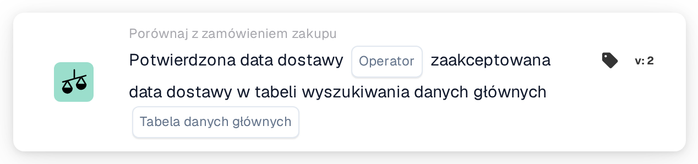
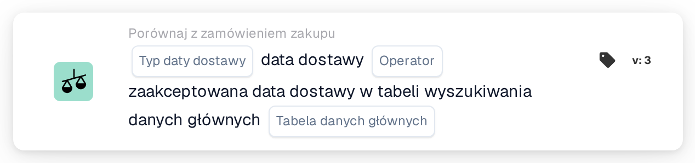

# Potwierdzona data dostawy

<figure><figcaption>
Wersja 2
</figcaption></figure>

<figure><figcaption>
Wersja 3
</figcaption></figure>

## **Cel**

Ta karta przepływu pracy służy do weryfikacji, czy potwierdzone daty dostawy na fakturach lub dokumentach wysyłkowych są zgodne z zaakceptowanymi datami dostawy zdefiniowanymi w tabeli wyszukiwania danych podstawowych. Porównując te daty, pomaga zapewnić zgodność z uzgodnionymi harmonogramami dostaw i zwiększa niezawodność łańcucha dostaw.

## **Komponenty karty**

1. **Operatora**
   * **Opis:** Definiuje warunek porównania potwierdzonej daty dostawy z zaakceptowaną datą dostawy.
   * **Opcje:**
     * **Is:** Potwierdza, że data dostawy odpowiada zaakceptowanej dacie dostawy w danych podstawowych.
     * **Nie jest:** Zapewnia, że data dostawy nie odpowiada zaakceptowanej dacie dostawy w danych podstawowych.
2. **Przeszukiwanie tabeli danych głównych**
   * **Opis:** Określa tabelę referencyjną zawierającą zaakceptowane daty dostawy do porównania.
   * **Szczegóły:** Tabela jest definiowana przez parametr **Tabela danych podstawowych** i może zawierać dodatkowe metadane, takie jak numery zamówień lub regiony dostawy.

## **Funkcjonalność**

* **Porównanie dat:** System porównuje potwierdzoną datę dostawy z faktury lub dokumentu wysyłkowego z zaakceptowaną datą dostawy w określonej tabeli wyszukiwania danych podstawowych.
* **Wykonanie akcji:** Na podstawie wyniku porównania karta może wyzwalać kolejne akcje, takie jak powiadomienia.

## **Konfiguracja**

* Aby skonfigurować tę kartę, użytkownicy wybierają pole reprezentujące potwierdzoną datę dostawy w dokumencie i określają tabelę wyszukiwania danych podstawowych zawierającą zaakceptowane daty dostawy. Następnie wybierany jest operator definiujący sposób porównania obu dat (np. **Is** lub **Nie jest**).

## **Przykładowy scenariusz**

* Faktura wymienia potwierdzoną datę dostawy 10 czerwca, podczas gdy tabela wyszukiwania danych podstawowych określa zaakceptowaną datę dostawy 15 czerwca. Przy użyciu operatora **Nie jest** karta oznacza rozbieżność do przeglądu, umożliwiając zespołowi logistycznemu zbadanie przyczyny i odpowiednie dostosowanie harmonogramów.

## **Podsumowanie**

Karta przepływu pracy **„Potwierdzona data dostawy a zaakceptowana data dostawy”** pomaga organizacjom utrzymać zgodność z uzgodnionymi harmonogramami dostaw, automatyzując porównanie potwierdzonych i zaakceptowanych dat dostawy. To proaktywne podejście do zarządzania dostawami zwiększa efektywność operacyjną, redukuje opóźnienia i sprzyja lepszej współpracy w całym łańcuchu dostaw.
