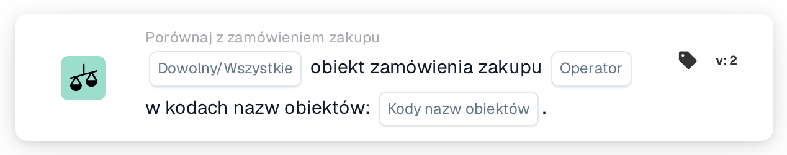

# Obiekt zamówienia zakupu

<figure><figcaption>
Wersja 2
</figcaption></figure>

## Cel:

Ta karta przepływu pracy sprawdza obiekt zamówień zakupu dopasowanych do dokumentu względem listy kodów obiektów. Można jej używać, aby różnie obsługiwać dokumenty w zależności od obiektu (lokalizacji), dla którego złożono zamówienie, na przykład aby kierować je do zespołu odpowiedzialnego za ten obiekt.

Dopasowanie zamówienia zakupu powinno zostać wykonane przed tą kartą. Bez dopasowanego zamówienia zakupu karta zgłasza brakujące dane.

## Komponenty karty:

1. **Dowolny/Wszystkie**
   * **Opis:** Jak kody obiektów dopasowanych zamówień zakupu są oceniane względem listy.
   * **Opcje:**
     * **Każdy:** Co najmniej jedno dopasowane zamówienie zakupu spełnia warunek operatora.
     * **Wszystko:** Każde dopasowane zamówienie zakupu z obiektem spełnia warunek operatora. Jeśli nie ustawiono żadnej wartości, karta używa **Wszystko**.
2. **Operator**
   * **Opis:** Czy obiekt powinien znajdować się na liście, czy nie.
   * **Opcje:**
     * **Jest**
     * **Nie jest**
3. **Kody nazw obiektów**
   * **Opis:** Kody obiektów, z którymi porównywany jest obiekt zamówienia zakupu.
   * **Szczegóły:** Można wprowadzić kilka kodów oddzielonych przecinkami.

## Funkcjonalność:

* **Ocena warunku:** Karta odczytuje numery zamówień zakupu dopasowanych do dokumentu, wczytuje te zamówienia zakupu i zbiera obiekt (lokalizację) każdego z nich. Zamówienia zakupu bez obiektu są pomijane. Zebrane kody obiektów są następnie porównywane z wartościami **Kody nazw obiektów** na karcie.
  * Kod obiektu jest uznawany za znajdujący się na liście, gdy w całości jest równy jednemu z wprowadzonych kodów. Wielkość liter i spacje wokół wpisów są ignorowane, więc `wh01` pasuje do `WH01`, ale `WH` nie pasuje do `WH01`.
  * Przy **Jest** zamówienie zakupu spełnia warunek, gdy jego kod obiektu znajduje się na liście. Przy **Nie jest** spełnia warunek, gdy jego kod obiektu nie znajduje się na liście.
  * Przy **Każdy** warunek jest spełniony, gdy spełnia go co najmniej jedno zamówienie zakupu; przy **Wszystko**, gdy spełnia go każde zamówienie zakupu z obiektem.
  * Jeśli żadne z dopasowanych zamówień zakupu nie ma obiektu, **Wszystko** jest spełnione, a **Każdy** nie.
* **Wykonanie akcji:**
  * **Warunek prawdziwy:**\
    Jeśli warunek jest spełniony, przepływ pracy jest kontynuowany, na przykład krokiem przeznaczonym dla wymienionych obiektów.
  * **Warunek fałszywy:**\
    Jeśli warunek nie jest spełniony, przepływ pracy zatrzymuje się na niespełnionym warunku.
* **Brakujące dane:** Jeśli na karcie nie wprowadzono kodów obiektów lub dokument nie ma dopasowanego zamówienia zakupu, karta nie ocenia warunku i zgłasza brakujące dane w dzienniku przepływu pracy.

## Instalacja i konfiguracja:

* Kartę można dodać jako warunek And po dopasowaniu zamówienia zakupu, z kategorii **Porównaj z zamówieniem zakupu**. Następnie można ustawić **Każdy** lub **Wszystko**, operator oraz kody obiektów oddzielone przecinkami. Wielkość liter nie ma znaczenia, ale każdy kod powinien zostać wprowadzony w całości, ponieważ części kodu nie są dopasowywane.
* Aby wypróbować konfigurację na istniejącym dokumencie, można użyć opcji **Karta testowa** w menu karty w Workflow Builder. Dziennik karty wymienia dopasowane zamówienia zakupu, znalezione w nich kody obiektów oraz kody, które nie zostały dopasowane.

## Podsumowanie:

Karta przepływu pracy „Facility of Purchase Order” udostępnia obiekt zamówionych towarów jako warunek przepływu pracy. Dzięki temu jeden przepływ pracy może różnie traktować dokumenty dla różnych obiektów na podstawie danych zamówienia zakupu, a nie tego, co jest wydrukowane na dokumencie.
