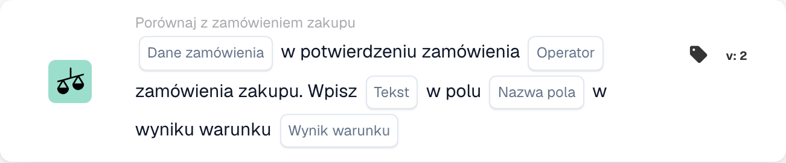
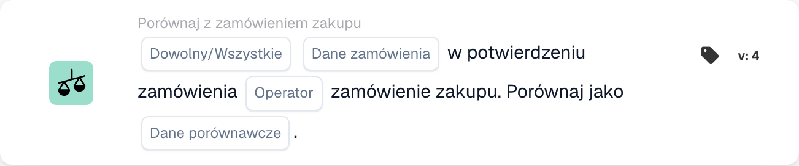

# Porównanie potwierdzenia zamówienia z zamówieniem zakupu

Użyj karty **Porównaj z zamówieniem zakupu** w Konstruktorze przepływu pracy, gdy potwierdzenie zamówienia musi zostać sprawdzone względem swojego zamówienia zakupu. Dodaj kartę w grupie **I...**, a następnie wybierz dane zamówienia, operator i to, co ma się stać z wynikiem. Poniższe zrzuty ekranu pokazują dwie dostępne wersje karty w polskim interfejsie. Ich pola są jeszcze symbolami zastępczymi; ustaw je dla własnego przepływu pracy przed zapisaniem.

## Zapisz wynik w polu

<figure><figcaption>
Pola karty w pokazanej wersji. Pola nie są jeszcze skonfigurowane.
</figcaption></figure>

Wybierz **Dane zamówienia** z potwierdzenia zamówienia i **Operatora** do porównania z zamówieniem zakupu. Wpisz **Tekst** do zapisania, wybierz **Nazwę pola** i wskaż **Wynik warunku**, który ma wywołać zapis.

## Porównaj dane

<figure><figcaption>
Pola karty w pokazanej wersji. Pola nie są jeszcze skonfigurowane.
</figcaption></figure>

Wybierz **Dowolny/Wszystkie**, aby zdecydować, czy jedna, czy wszystkie wybrane warunki muszą być spełnione. Następnie wybierz **Dane zamówienia**, **Operatora** i **Dane porównawcze** do porównania z zamówieniem zakupu.

Opis kroków otaczających tę kartę znajdziesz w sekcjach [Przepływ pracy](../..) oraz [Porównaj z zamówieniem zakupu](.).

<!-- workflow-card-practical-example-20261021 -->

## Praktyczny przykład

**Kiedy używać:** Sprawdź potwierdzenie zamówienia względem powiązanego z nim zamówienia zakupu.

**Konfiguracja:** Użyj zamówienia demonstracyjnego i potwierdzenia u tego samego dostawcy, numeru artykułu i porównanych wartości. Wybierz zamierzony kierunek porównania i pola, które oferuje ta wersja.

**Oczekiwany wynik i kontrprzykład:** Pasujące porównanie przebiega pomyślnie. Zmień jedną wartość porównywanego elementu w oddzielnym przypadku testowym i sprawdź, czy została wykryta; brakujące połączone zamówienie to odrębny problem z danymi.

To jest ilustracyjna konfiguracja i oczekiwany wynik. Korzystaj z pól, użytkowników i grup skonfigurowanych w Twojej organizacji testowej; nie jest to twierdzenie, że ten przykład został wykonany.
