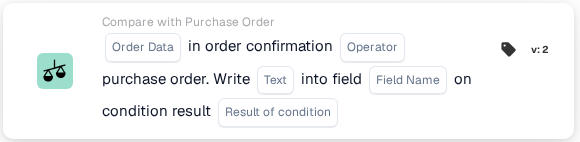
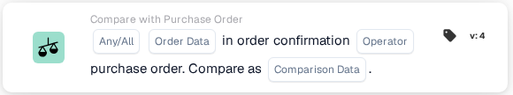

# Porównanie potwierdzenia zamówienia z zamówieniem zakupu

Użyj **Compare with Purchase Order** w Workflow Builder, gdy potwierdzenie zamówienia trzeba sprawdzić względem jego zamówienia zakupu. Dodaj kartę pod **And...**, a następnie wybierz dane zamówienia, operator i to, co ma się stać z wynikiem. Poniższe zrzuty ekranu pokazują dwie dostępne wersje karty w angielskim interfejsie. Ich pola są nadal polami zastępczymi; ustaw je dla swojego przepływu pracy przed zapisaniem.

## Zapisz wynik w polu

<figure><figcaption>Wersja 2: zapisz tekst w polu na podstawie wyniku warunku.</figcaption></figure>

Wybierz **Order Data** z potwierdzenia zamówienia oraz **Operator** porównania z zamówieniem zakupu. Wpisz **Text** do zapisania, wybierz **Field Name** i wskaż **Result of condition**, który ma wywołać zapis.

## Porównaj dane

<figure><figcaption>Wersja 4: porównaj wybrane dane potwierdzenia zamówienia z danymi zamówienia zakupu.</figcaption></figure>

Wybierz **Any/All**, aby zdecydować, czy ma pasować jeden, czy wszystkie wybrane warunki. Następnie wybierz **Order Data**, **Operator** i **Comparison Data** dla porównania z zamówieniem zakupu.

Informacje o otaczających krokach znajdziesz w [Workflow](../../README.md) i [Compare with Purchase Order](README.md).
