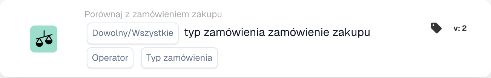

# Typ zamówienia zakupu

<figure><figcaption>
Pola karty w pokazanej wersji. Pola nie są jeszcze skonfigurowane.
</figcaption></figure>

## **Cel**:

Ta karta DocBits umożliwia weryfikację typu zamówienia w zamówieniu zakupu, zapewniając, że jest on zgodny z określonymi kryteriami.

## **Funkcjonalność**:

* **Order Type Comparison**: Ta karta porównuje typ zamówienia w zamówieniu zakupu z określoną wartością, umożliwiając użytkownikom weryfikację, czy typ zamówienia spełnia określone warunki.
* **Dowolny/wszystki wybór**: Użytkownicy mogą zdecydować się na zastosowanie porównania do **any** (przynajmniej jeden wybrany typ zamówienia jest zgodny) lub **all** (wszystkie wybrane typy zamówień są zgodne) określonych typów zamówień.
* **Operatora**: Użytkownicy mogą ustawić warunki porównania typu zamówienia w zamówieniu zakupu. Dostępne operatory obejmują:
  * **Równa się (=)**: Potwierdza, że typ zamówienia w zamówieniu zakupu odpowiada określonemu typowi.
  * **Nierówne (≠)**: Zapewnia, że typ zamówienia w zamówieniu zakupu nie odpowiada określonemu typowi.

## **Zastosowanie**:

Ta karta jest szczególnie cenna dla zespołów zakupowych, planistów zapasów i menedżerów operacyjnych, którzy muszą dokładnie kategoryzować i priorytetyzować zamówienia. Zapewniając, że typy zamówień odpowiadają zamierzonym klasyfikacjom, użytkownicy mogą usprawnić obsługę zamówień, zoptymalizować alokację zasobów i przestrzegać umów o poziomie usług.

## **Przykładowy scenariusz**:

* Zamówienie zakupu jest sklasyfikowane jako "IGR". System używa operatora "Equals", aby zweryfikować, że ten typ zamówienia jest zgodny z zamierzoną klasyfikacją do przetwarzania.

Korzystając z karty "Compare with Purchase Order: Order Type", organizacje mogą zautomatyzować walidację typów zamówień, zapewniając spójność priorytetów przetwarzania i redukując ręczne błędy klasyfikacji.
