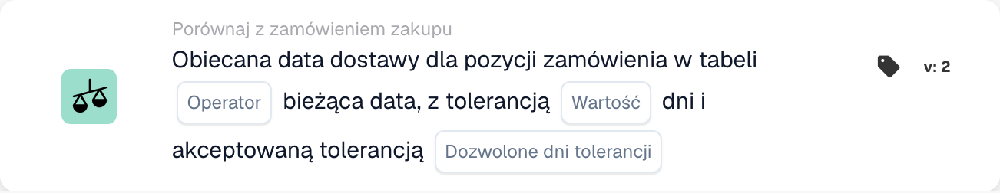
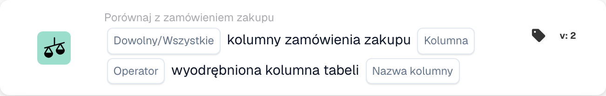
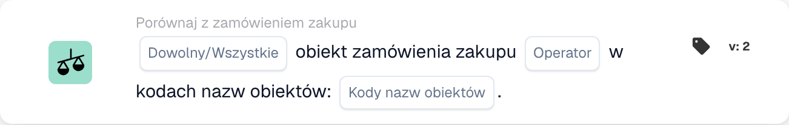
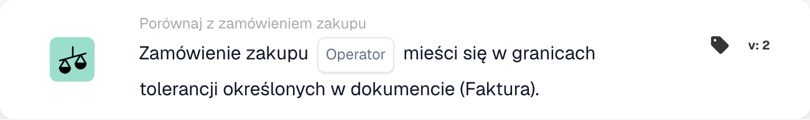
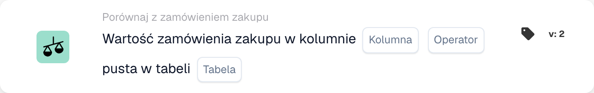
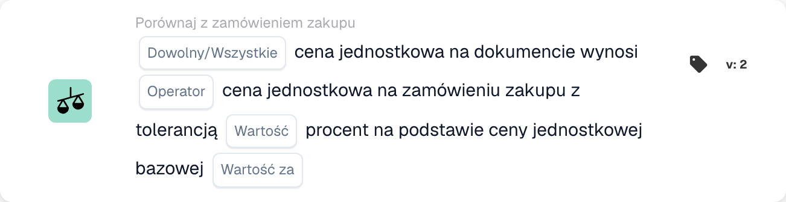
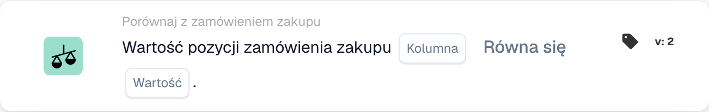

# Karty dopasowywania PO - kompletny przewodnik

## Karty dopasowania zamówienia zakupu (PO) — kompletny przewodnik

**Stan:** Obejmuje 15 kart porównawczych PO ze szczegółowymi obliczeniami

***

Karty porównania zamówień zakupu na tej stronie znajdują się w grupie **I** Kreatora przepływu pracy — porównują dane faktury z dopasowanym zamówieniem przed uruchomieniem akcji Następnie:

<figure><figcaption><p>Niezapisany przykład z kartami Kiedy, I oraz Wtedy. Uzupełnij wszystkie pola przed uruchomieniem. Niektóre etykiety tej wersji interfejsu nie są jeszcze przetłumaczone lub mają nieprawidłowe tłumaczenie. Objaśnienia na tej stronie używają właściwych terminów; obraz przedstawia rzeczywisty interfejs.</p></figcaption></figure>

***

### 📌 Informacje o wersji

**Najbardziej rozwinięta karta:** CONDITION\_DOC\_TO\_PO\_UNIT\_PRICE (5 wersji, najnowsza wersja 5) **Inne karty złożone:** CONDITION\_OC\_TO\_PO\_ITEMS (v4), CONDITION\_LESS\_THAN\_TOLERANCE\_AS\_VALUE\_OF\_ORDERED\_QUANTITY (v4)

**Kluczowe wzorce:**

* **v2 → v3+:** Dodanie parametrów tolerancji dla elastycznego dopasowania
* **v3 → v4:** Dodanie parametrów trybu porównania
* **v4 → v5:** Zwiększona tolerancja z wieloma jednostkami (%, EUR, $ itp.)

📖 [Pełna historia wersji](../../release.md) | [Wersje kart i zachowanie](../../cards-overview/card-versions-guide.md)

***

### Zrozumienie dopasowywania PO

Otrzymana faktura powinna być zgodna z wcześniej złożonym zamówieniem (PO). Karty dopasowujące PO automatycznie sprawdzają, czy dane na fakturze zgadzają się z danymi PO.

**Ogólny obraz:**

```
PO Placed     Invoice Arrives     PO Matching     Decision
(€100)    →   (€103)          →   (Check if       → Approve/Reject
Qty: 100      Qty: 100            within tolerance)
```

***

## 1. Pełne dopasowanie zamówienia zakupu

### Cel

Sprawdza, czy cała faktura pasuje idealnie do zamówienia lub mieści się w tolerancji

### Kiedy stosować

* Przed zatwierdzeniem faktury
* Jako wstępna kontrola jakości
* Aby wcześnie zidentyfikować problemy

### Jak to działa

System porównuje:

* Ilości na fakturze a ilości na PO
* Ceny na fakturze vs ceny PO
* Pozycje na fakturze a pozycje PO
* Suma faktury vs suma zamówienia

### Wynik

* **TRUE** (Pełny mecz): Wszystko pasuje, kontynuuj
* **FALSE** (Niedopasowanie): Coś nie pasuje, wymaga sprawdzenia

### Przykład

```
PO:
- Item ABC: Qty 100, Unit Price €50 = €5000
- Item XYZ: Qty 50, Unit Price €20 = €1000
- Total: €6000

Invoice:
- Item ABC: Qty 100, Unit Price €50 = €5000
- Item XYZ: Qty 50, Unit Price €20 = €1000
- Total: €6000

Result: ✅ FULL MATCH
```

***

## 2. Porównanie cen jednostkowych (dokument vs zamówienie)

### Cel

Porównuje cenę jednostkową na fakturze z ceną jednostkową na PO

### Parametry

* **Tolerancja ceny jednostkowej**: Zezwól na różnicę do tej kwoty
* **Typ tolerancji**: Procent (%) lub bezwzględny (€/$)
* **Operatora**: Jest równy, Jest większy niż, Jest mniejszy niż itp.

### Jak to działa (tolerancja procentowa)

**Wzór:**

```
Variance % = |(Invoice Price - PO Price)| / PO Price × 100

Check: Is Variance % ≤ Tolerance %?
```

**Przykład krok po kroku:**

```
Step 1: Get prices
  PO Unit Price: €100.00
  Invoice Unit Price: €103.00

Step 2: Calculate difference
  Difference = |€103.00 - €100.00| = €3.00

Step 3: Calculate percentage
  Percentage = (€3.00 / €100.00) × 100 = 3%

Step 4: Check tolerance (5% allowed)
  Is 3% ≤ 5%? YES ✅

Result: PASS - Within tolerance
```

### Przykłady ze świata rzeczywistego

#### Przykład 1: Mały wzrost (zaakceptowany)

```
PO Price: €50.00
Invoice Price: €51.50
Tolerance: ±3%

Calculation:
  Variance = |(€51.50 - €50.00)| / €50.00 × 100
  Variance = €1.50 / €50.00 × 100 = 3%

Is 3% ≤ 3%? YES ✅ ACCEPT
```

#### Przykład 2: Duża podwyżka (odrzucona)

```
PO Price: €50.00
Invoice Price: €55.00
Tolerance: ±3%

Calculation:
  Variance = |(€55.00 - €50.00)| / €50.00 × 100
  Variance = €5.00 / €50.00 × 100 = 10%

Is 10% ≤ 3%? NO ❌ REJECT - NEEDS REVIEW
```

#### Przykład 3: Rabat (również sprawdzony)

```
PO Price: €100.00
Invoice Price: €97.00
Tolerance: ±5%

Calculation:
  Variance = |(€97.00 - €100.00)| / €100.00 × 100
  Variance = €3.00 / €100.00 × 100 = 3%

Is 3% ≤ 5%? YES ✅ ACCEPT (Discount is within tolerance)
```

#### Przykład 4: Tolerancja wartości bezwzględnej

```
PO Price: €10.00
Invoice Price: €10.50
Tolerance: ±€1.00 (absolute, not %)

Calculation:
  Variance = |€10.50 - €10.00| = €0.50

Is €0.50 ≤ €1.00? YES ✅ ACCEPT
```

### Co zrobić z wynikami

**Jeśli PASS ✅:**

* Przejdź do następnej kontroli
* Lub zatwierdź fakturę
* Lub kontynuuj eksport

**W przypadku niepowodzenia ❌:**

* Oznacz do ręcznego sprawdzenia
* Poproś dostawcę o wyjaśnienia
* Skontaktuj się z zespołem ds. zakupów
* Zatwierdź z dopiskiem, jeśli jest to dopuszczalne

***

## 3. Porównanie ilości

### Cel

Sprawdza, czy zamówiona ilość odpowiada ilości zafakturowanej

### Parametry

* **Tolerancja**: Kwota lub %, które mogą się różnić
* **Operatora**: Równa się, Większe niż, Mniejsze niż
* **Typ ilości**: Zamówiona, Otrzymana, Otwarta

### Przykład obliczeń

**Tolerancja procentowa:**

```
Formula:
  Quantity Variance % = |(Invoice Qty - PO Qty)| / PO Qty × 100

Example:
  PO Quantity: 100 units
  Invoice Quantity: 103 units
  Tolerance: ±5%

  Variance = |(103 - 100)| / 100 × 100
  Variance = 3 / 100 × 100 = 3%

  Is 3% ≤ 5%? YES ✅ ACCEPT
```

**Tolerancja absolutna:**

```
Formula:
  Quantity Variance = |Invoice Qty - PO Qty|

Example:
  PO Quantity: 100 units
  Invoice Quantity: 102 units
  Tolerance: ±5 units

  Variance = |102 - 100| = 2 units

  Is 2 units ≤ 5 units? YES ✅ ACCEPT
```

### Scenariusze ze świata rzeczywistego

#### Nadmierna dostawa (więcej niż zamówiono)

```
Ordered: 100 units
Invoiced: 110 units
Tolerance: ±5%

Variance = |(110-100)|/100 × 100 = 10%

Is 10% ≤ 5%? NO ❌

Decision: Contact supplier - more delivered than ordered
Possible reason: Error by supplier, partial shipment already received
```

#### Niedostarczenie (mniej niż zamówiono)

```
Ordered: 100 units
Invoiced: 95 units
Tolerance: ±5%

Variance = |(95-100)|/100 × 100 = 5%

Is 5% ≤ 5%? YES ✅

Decision: Accept - within tolerance
Possible reason: Partial shipment, rest to follow
```

***

## 4. Łączna cena różnicy ilościowej

### Cel

W przypadku różnic w ilościach oblicza, czy łączna różnica w cenie jest akceptowalna

### Dlaczego to ma znaczenie

```
Scenario: You ordered 100 units but received 110
- Quantity is 10% over (bad)
- BUT: You're only charged for 10% extra
- Combined effect might be acceptable
```

### Obliczenia

**Wzór:**

```
Combined Variance = Quantity Variance × Price Variance

If both are within tolerance, combined is usually acceptable
```

**Przykład:**

```
PO:
- Unit Price: €100
- Quantity: 100
- Total: €10,000

Invoice:
- Unit Price: €102 (2% higher)
- Quantity: 105 (5% higher)
- Total: €10,710

Analysis:
- Price variance: 2% ✅
- Quantity variance: 5% ✅
- Combined effect: 1.02 × 1.05 = 1.071 = 7.1% total increase

Is combined variance acceptable? Usually YES ✅
```

***

## 5. Porównanie identyfikatora pozycji/numeru pozycji dostawcy

### Cel

Sprawdza, czy pozycje na fakturze są zgodne z pozycjami w zamówieniu zakupu

### Jak to działa

**Dokładne dopasowanie (najprostsze):**

```
PO Item ID: ABC-123
Invoice Item ID: ABC-123
Result: ✅ MATCH
```

**Numer pozycji dostawcy (częściej spotykany):**

```
PO Item: ABC-123 (Our internal code)
Supplier Item: SUPP-456 (Their code for same item)
System matches these as same item
Result: ✅ MATCH
```

### Scenariusz: co się stanie, jeśli nie będzie pasować?

```
PO Item: ABC-123 (Copper Wire, 2mm)
Invoice Item: ABC-124 (Steel Wire, 2mm)

Result: ❌ NO MATCH

Actions:
1. Is this a substitution? Check with procurement
2. Is this an error? Contact supplier
3. Is the description similar? Verify manually
```

***

## 6. Weryfikacja rodzaju zamówienia

### Cel

Sprawdza, czy typ zamówienia zakupu jest poprawny

### Typy zamówień

* **Zamówienie standardowe**: Regularny zakup
* **Zamówienie pilne**: Pilne, może mieć wersję premium
* **Umowa Ramowa**: Umowa długoterminowa
* **Zamówienie ogólne**: Umowa na czas nieokreślony
* **Przesyłka**: Nie płacisz aż do wykorzystania

### Sprawdź przykład

```
PO Order Type: Standard Order
Invoice Order Type: Standard Order
Result: ✅ MATCH

If mismatch: Could affect terms, payment, pricing
```

***

## 7. Weryfikacja daty dostawy

### Cel

Sprawdza, czy data dostawy jest zgodna z datą obiecaną w PO

### Obliczenia

**Opóźniona dostawa:**

```
Formula:
  Days Late = Invoice Delivery Date - PO Promised Date

Example:
  PO Promised: 2025-10-15
  Actual Delivery: 2025-10-22
  Days Late = 7 days

If tolerance is ±3 days:
  Is 7 ≤ 3? NO ❌ LATE
```

**Wczesna dostawa:**

```
Formula:
  Days Early = PO Promised Date - Invoice Delivery Date

Example:
  PO Promised: 2025-10-15
  Actual Delivery: 2025-10-10
  Days Early = 5 days

Early delivery is usually OK ✅
Unless you need it at specific time
```

### Ustawienia tolerancji

```
±3 days: Allow 3 days late or early
±5 days: Allow up to 5 days variance
0 days: Must match exactly
```

***

## 8. Weryfikacja opłat (podatki, wysyłka itp.)

### Cel

Sprawdza, czy dodatkowe opłaty (podatki, wysyłka, obsługa) odpowiadają PO

### Wspólne opłaty

```
- Shipping: €50
- Handling: €10
- Packaging: €5
- Insurance: €15
- Taxes: €300
```

### Obliczenia

**Przykład: Kontrola kosztów wysyłki**

```
PO Shipping: €50.00
Invoice Shipping: €51.00
Tolerance: ±3%

Variance = |€51.00 - €50.00| / €50.00 × 100 = 2%

Is 2% ≤ 3%? YES ✅ ACCEPT
```

**Przykład: wielokrotne ładowanie**

```
PO Total Charges:
  - Shipping: €50
  - Taxes: €300
  - Handling: €10
  Total: €360

Invoice Total Charges:
  - Shipping: €50
  - Taxes: €312 (11% tax)
  - Handling: €10
  Total: €372

Difference: €12
Check if within tolerance ✅ or ❌
```

***

## 9. Weryfikacja podatkowa

### Cel

Sprawdza, czy kwoty podatku zostały obliczone prawidłowo

### Obliczenia

**Wzór:**

```
Tax Amount = Subtotal × Tax Rate

Example:
  Subtotal: €1000
  Tax Rate: 19%
  Expected Tax: €1000 × 0.19 = €190

Invoice Tax: €190
Match? YES ✅
```

**Częste problemy:**

```
1. Tax rate changed (region-based)
2. Tax applied to wrong amount (before/after discounts)
3. Multiple tax rates (some items 7%, others 19%)
4. Tax exempt items (0% tax)
```

**Przykład: opodatkowanie wielostawkowe**

```
Item A: €100 @ 19% tax = €119
Item B: €100 @ 7% tax = €107
Item C: €100 @ 0% tax = €100
Total: €326

Invoice shows €325 (€1 error)

Check: Within tolerance or needs attention?
```

***

## 10. Dopasowanie obiektu/centrum kosztów

### Cel

Zapewnia, że faktura dotyczy właściwego obiektu/centrum kosztów

### Przykład

```
PO is for:
- Facility: Berlin Plant
- Cost Center: CC-2025

Invoice should have:
- Facility: Berlin Plant ✅
- Cost Center: CC-2025 ✅

If different facility: May need different approval
```

***

## 11. Potwierdzenie statusu dostawcy

### Cel

Sprawdza, czy dostawca jest nadal zatwierdzony/aktywny

### Typy statusu

```
✅ ACTIVE: Approved, can do business
⚠️ ON HOLD: Temporarily blocked
❌ INACTIVE: No longer doing business
⚠️ CONDITIONAL: Only for specific items
```

### Sprawdź przykład

```
Supplier: ABC Corp
Status in Database: ACTIVE
Status when creating PO: ACTIVE
Status when invoice arrives: INACTIVE

Alert: Supplier status changed! Investigate why.
```

***

## Którą tolerancję powinienem zastosować?

### Ścisłe tolerancje (mniejsze ryzyko, więcej pracy ręcznej)

```
Use for:
- High-value items
- Items where exactness matters
- Regulated industries

Settings:
- Unit Price: ±1%
- Quantity: ±1%
- Delivery Date: ±1 day
- Charges: ±1%
```

### Umiarkowane tolerancje (zrównoważone)

```
Use for:
- Most business transactions
- Standard items
- Normal purchasing

Settings:
- Unit Price: ±3-5%
- Quantity: ±3-5%
- Delivery Date: ±3 days
- Charges: ±5%
```

### Luźne tolerancje (wyższe ryzyko, mniej pracy ręcznej)

```
Use for:
- Low-value items
- Bulk purchases
- Supplier agreements with flexibility

Settings:
- Unit Price: ±10%
- Quantity: ±10%
- Delivery Date: ±7 days
- Charges: ±10%
```

***

## Przykład przepływu pracy dopasowywania PO

```
Invoice Arrives
    ↓
Condition: "Is amount > €5000?" → YES
    ↓
Check: Full Match? → NO (10% price difference)
    ↓
Check: Unit Price within 5%? → NO (12% difference)
    ↓
Check: Quantity within 5%? → YES (2% difference)
    ↓
Decision: FAIL - Price variance too high
    ↓
Flag for: Manual review / Buyer approval
    ↓
Wait for: Buyer comment
    ↓
If Approved: Continue to Export
If Rejected: Return to Supplier
```

***

## Rozwiązywanie problemów z dopasowaniem PO

### „Nie znaleziono PO”

```
Cause: Invoice PO number doesn't exist in system
Fix:
1. Verify PO number spelling
2. Check if PO was created
3. Verify PO is in correct organization
4. Ask supplier for PO reference
```

### „Elementy nie pasują”

```
Cause: Invoice items are different from PO items
Possible Reasons:
1. Substitution approved by procurement
2. Different item numbers for same item
3. Error by supplier
Fix: Contact procurement or supplier
```

### „Cena wyższa niż w PO”

```
Cause: Invoice price > PO price
Possible Reasons:
1. Price increase approved
2. Supplier error
3. Currency difference
4. Additional services included
Fix: Verify with procurement
```

### „Błędna data dostawy”

```
Cause: Invoice dated after promised delivery
Possible Reasons:
1. Shipment was delayed
2. Receiving date different from invoice date
3. Partial shipment
Fix: Check shipping documents or contact supplier
```

***

## Tabela podsumowująca

| Karta           | Co sprawdza        | Główne obliczenia     | Wspólna tolerancja |
| -------------- | --------------------- | -------------------- | ---------------- |
| Pełny mecz     | Wszystko            | Wszystkie kontrole           | Różnie           |
| Cena jednostkowa     | Cena za jednostkę        | % lub € różnicy    | ±3-5%            |
| Ilość       | Zamówiona ilość        | % lub różnica jednostkowa | ±3-5%            |
| Łączna cena | Razem ze zmianą ilości | Ilość × cena          | ±5-10%           |
| Identyfikator przedmiotu        | Właściwe przedmioty           | Dopasowanie ciągu         | Dokładne            |
| Typ zamówienia     | Rodzaj zakupu      | Dopasowanie ciągu         | Dokładne            |
| Data dostawy  | Kiedy przybył          | Różnica dnia       | ± 3 dni          |
| Opłaty        | Dodatkowe opłaty            | % lub € różnicy    | ±5%              |
| Podatek            | Kwota podatku            | Obliczanie % podatku    | ±1%              |
| Obiekt       | Centrum kosztów           | Dopasowanie ciągu         | Dokładne            |
| Dostawca       | Zatwierdzone?             | Kontrola stanu         | Tylko aktywne      |

***

## Powiązana dokumentacja

* Pełny przepływ pracy można znaleźć w przewodniku „Weryfikacja faktury”.
* Aby zapoznać się z zalecanymi wartościami według branży, zobacz „Ustawienia tolerancji”.
* Zobacz „Obsługa wyjątków”, aby dowiedzieć się, co zrobić w przypadku błędów
* Aby uzyskać szczegółowe zasady tolerancji, skontaktuj się z zespołem zaopatrzenia

<!-- workflow-card-example-condition_promised_delivery_date_to_current-20261021 -->

### Obiecana data dostawy w stosunku do daty referencyjnej

<figure><figcaption><p>Pola karty w pokazanej wersji. Pola nie są jeszcze skonfigurowane.</p></figcaption></figure>

`CONDITION_PROMISED_DELIVERY_DATE_TO_CURRENT` · wersja 2

Załóżmy, że datą referencyjną jest `2026-10-21` i obiecaną datą dostawy linii `2026-10-23`. Wybierz porównanie z datą późniejszą i tolerancję dnia zerowego. Przyszła data spełnia to porównanie; `2026-10-20` nie. Celowo skonfiguruj opcje Dowolne/Wszystkie i zaakceptowane dni tolerancji i osobno przetestuj brakującą datę.

<!-- workflow-card-example-condition_po_extracted_table_column-20261021 -->

### Kolumna zamówienia zakupu względem wyodrębnionej kolumny

<figure><figcaption><p>Pola karty w pokazanej wersji. Pola nie są jeszcze skonfigurowane.</p></figcaption></figure>

`CONDITION_PO_EXTRACTED_TABLE_COLUMN` · wersja 2

Porównaj dopasowaną kolumnę artykułu PO z wyodrębnioną kolumną `article_number`, używając równości i All. Pasujące wartości `DEMO-A` spełniają; wyodrębniona wartość `DEMO-B` kończy się niepowodzeniem. Wybierz tabelę przeglądową tylko wtedy, gdy wymagana jest udokumentowana zamiana identyfikatora na wartość; sprawdź to mapowanie przed porównaniem.

<!-- workflow-card-example-condition_check_facility_in_po-20261021 -->

### Dozwolone możliwości składania zamówień

<figure><figcaption><p>Pola karty w pokazanej wersji. Pola nie są jeszcze skonfigurowane.</p></figcaption></figure>

`CONDITION_CHECK_FACILITY_IN_PO` · wersja 2

Wybierz Wszystko, porównanie jest w trakcie i skonfigurowany kod obiektu `DEMO-NORTH`. Dopasowane linie zamówienia zakupu w tej przepustce do obiektu; linia w `DEMO-SOUTH` nie działa. Używaj kodów obiektu z danych zamówienia zakupu, zamiast zakładać, że etykieta wyświetlacza jest jego kodem.

<!-- workflow-card-example-condition_purchase_order_full_match-20261021 -->

### Kompletne dopasowanie zamówienia

<figure><figcaption><p>Pola karty w pokazanej wersji. Pola nie są jeszcze skonfigurowane.</p></figcaption></figure>

`CONDITION_PURCHASE_ORDER_FULL_MATCH` · wersja 2

Użyj całkowicie dopasowanej faktury demonstracyjnej i zamówienia zakupu z ilością `2` i ceną jednostkową `100` po obu stronach oraz skonfigurowanymi tolerancjami ilości/ceny. Wybierz warunek pełnego dopasowania: przechodzi. Następnie przetestuj cenę poza skonfigurowaną tolerancją. Brak danych porównawczych lub brak zamówienia zakupu nie oznacza udanego pełnego dopasowania. Dowód dostawy zawiera porównanie wyłącznie ilościowe; nie zakładaj, że obowiązują go zasady dotyczące cen na fakturze.

<!-- workflow-card-example-condition_po_update_empty_column_check-20261021 -->

### Pusta kolumna bazy danych zamówień

<figure><figcaption><p>Pola karty w pokazanej wersji. Pola nie są jeszcze skonfigurowane.</p></figcaption></figure>

`CONDITION_PO_UPDATE_EMPTY_COLUMN_CHECK` · wersja 2

Wybierz prawidłową tabelę i kolumnę PO oferowaną przez kartę i operatora is-pusty. W przypadku istniejącego pasującego rekordu zamówienia zakupu z pustą wartością warunek zostaje spełniony; wypełnienie wartości kończy się niepowodzeniem. Najpierw sprawdź odwołanie do zamówienia i mapowanie tabeli/kolumny. Wartość logiczna `false` jest nadal aktualną wartością logiczną; brakujący rekord zamówienia zakupu jest odrębnym błędem danych.

<!-- workflow-card-example-condition_compare_unit_price_percent_per-20261021 -->

### Procentowa tolerancja na podstawie ceny

<figure><figcaption><p>Pola karty w pokazanej wersji. Pola nie są jeszcze skonfigurowane.</p></figcaption></figure>

`CONDITION_COMPARE_UNIT_PRICE_PERCENT_PER` · wersja 2

Przykład: Cena jednostkowa PO `200`, cena bazowa `100` i skonfigurowana tolerancja `1` dają efektywną stawkę `(200 / 100) * (1 / 100) = 0.02` lub `2%`. Pasmo porównania to `196–204`. Równość w granicach tolerancji akceptuje cenę dokumentową `203` i odrzuca `210`. Nie zakładaj, że ta karta jest taka sama, jak stała tolerancja 1%.

<!-- workflow-card-example-condition_compare_po_line_value-20261021 -->

### Wartość wiersza zamówienia zakupu w odniesieniu do odniesienia

<figure><figcaption><p>Pola karty w pokazanej wersji. Pola nie są jeszcze skonfigurowane.</p></figcaption></figure>

`CONDITION_COMPARE_PO_LINE_VALUE` · wersja 2

Wybierz dopasowaną kolumnę PO `item_number`, równość i wartość `DEMO-A`. Linia z przejazdami `DEMO-A`; `DEMO-B` kończy się niepowodzeniem. Używaj tylko operatorów obsługiwanych dla wybranego typu danych i oddzielnie testuj brakujące dane dopasowanej linii.
