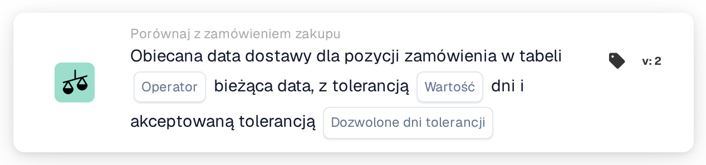

# Obiecana data dostawy dla pozycji w tabeli z obiecaną datą dostawy

<figure><figcaption>
Wersja 2
</figcaption></figure>

Sposób obliczania okna tolerancji, wraz z przykładami takimi jak „dziś lub jutro”, wyjaśniono na stronie [Date Tolerances](../../date-tolerances.md).

## Cel:

Ta karta przepływu pracy służy do walidacji **przyrzeczonej daty dostawy pozycji** względem **przyrzeczonej daty dostawy w zamówieniu zakupu**, przy użyciu operatorów porównania i konfigurowalnych reguł tolerancji. Umożliwia przepływom pracy automatyczne wykrywanie zgodnych, wcześniejszych lub opóźnionych dat dostawy i odpowiednie reagowanie.

## Komponenty karty:

1. **Operatora**
   * **Opis:**\
     Określa, w jaki sposób przyrzeczona data dostawy pozycji jest porównywana z przyrzeczoną datą dostawy w zamówieniu zakupu.
   * **Opcje:**
     * **Równa się (=):** Data pozycji musi mieścić się w oknie tolerancji.
     * **Nie równa się (≠):** Data pozycji musi znajdować się poza oknem tolerancji.
     * **Większy niż (>):** Data pozycji musi przypadać po oknie tolerancji.
     * **Większe lub równe (≥):** Data pozycji musi przypadać w dniu lub po rozpoczęciu okna tolerancji.
     * **Mniejszy niż (<):** Data pozycji musi przypadać przed oknem tolerancji.
     * **Mniejszy lub równy (≤):** Data pozycji musi przypadać w dniu lub przed końcem okna tolerancji. 
2. **Dni Tolerancji**
   * **Opis:**\
     Określa liczbę dni używaną do obliczenia akceptowalnego okna tolerancji wokół przyrzeczonej daty dostawy w zamówieniu zakupu.
   * **Szczegóły:**\
     Wartość ta jest liczbą całkowitą i definiuje, ile dni przed i po dacie zamówienia zakupu jest uwzględnianych podczas walidacji. 
3. **Dozwolone dni tolerancji**
   * **Opis:**\
     Określa, które dni tygodnia są liczone przy obliczaniu dni tolerancji.
   * **Szczegóły:**\
     Użytkownicy mogą wybrać konkretne dni tygodnia (na przykład od poniedziałku do piątku). Tylko wybrane dni są uwzględniane przy obliczaniu okna tolerancji.

### Funkcjonalność:

* **Ocena warunku:** System oblicza okno tolerancji wokół przyrzeczonej daty dostawy w zamówieniu zakupu na podstawie skonfigurowanych wartości **Dni Tolerancji** i **Dozwolone Dni Tolerancji**.\
  Przyrzeczona data dostawy każdej pozycji jest następnie porównywana z tym oknem przy użyciu wybranego operatora.
* Wykonanie akcji:
  * **Warunek prawdziwy:** Jeśli różnica daty dostawy mieści się w zakresie tolerancji i spełnia warunek ustawiony przez operatora, przepływ pracy jest kontynuowany.
  * **Warunek fałszywy:** Jeśli warunek nie jest spełniony, przepływ pracy nie będzie kontynuowany.

### Konfiguracja:

* Wybierz odpowiedni operator porównania.
* Wprowadź liczbę dni tolerancji.
* Wybierz, które dni tygodnia mają być liczone jako dni tolerancji.

### Podsumowanie:

Karta przepływu pracy **Porównaj z Zamówieniem zakupu – Obiecana data dostawy dla pozycji zamówienia** zapewnia elastyczny sposób egzekwowania reguł dotyczących dat dostawy. Łącząc operatory z obsługą tolerancji uwzględniającą dni tygodnia, umożliwia precyzyjną walidację zobowiązań dostawy, jednocześnie redukując ręczne kontrole i wyjątki.
