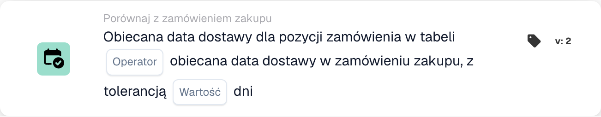

# Obiecana data dostawy w zamówieniu

<figure><figcaption>
Pola karty w pokazanej wersji. Pola nie są jeszcze skonfigurowane.
</figcaption></figure>

## **Cel**

Ta karta DocBits służy do ułatwienia precyzyjnego porównania przyrzeczonych dat dostawy w zamówieniach zakupu z datami dostawy określonymi dla pozycji w tabeli. Dzięki integracji wartości tolerancji karta zapewnia elastyczność w monitorowaniu terminów dostaw, pomagając utrzymać dokładność planowania zapasów i zadowolenie klientów.

## **Komponenty karty**

1. **Operatora**
   * **Opis:** Definiuje warunek stosowany do porównania dat dostawy.
   * **Opcje:**
     * **Równa się (=):** Sprawdza, czy przyrzeczona data dostawy pozycji odpowiada dacie dostawy w zamówieniu zakupu.
     * **Nierówne (≠):** Zapewnia, że przyrzeczona data dostawy pozycji nie odpowiada dacie w zamówieniu zakupu.
     * **Większy niż (>):** Weryfikuje, czy przyrzeczona data dostawy pozycji jest późniejsza niż data dostawy w zamówieniu zakupu.
     * **Większe lub równe (≥):** Sprawdza, czy przyrzeczona data dostawy pozycji jest równa lub późniejsza niż data dostawy w zamówieniu zakupu.
     * **Less Than (<):** Potwierdza, czy przyrzeczona data dostawy pozycji jest wcześniejsza niż data dostawy w zamówieniu zakupu.
     * **Mniejszy lub równy (≤):** Weryfikuje, czy przyrzeczona data dostawy pozycji jest równa lub wcześniejsza niż data dostawy w zamówieniu zakupu.
2. **Wartość**
   * **Opis:** Określa dopuszczalny margines błędu w porównaniu dat dostawy.
   * **Szczegóły:** Użytkownicy definiują liczbę dni, o którą data dostawy pozycji może różnić się od przyrzeczonej daty dostawy.

## **Funkcjonalność**

* **Ocena warunku:**\
  Karta oblicza różnicę między przyrzeczoną datą dostawy w zamówieniu zakupu a datami dostawy dla pozycji w tabeli. Następnie stosowany jest wybrany operator w celu określenia, czy warunek jest spełniony.
* **Wykonanie akcji:**
  * **Warunek prawdziwy:** Jeśli różnica daty dostawy mieści się w zakresie tolerancji i spełnia warunek ustawiony przez operatora, przepływ pracy jest kontynuowany.
  * **Warunek fałszywy:** Jeśli warunek nie jest spełniony, przepływ pracy nie będzie kontynuowany.

## **Konfiguracja**

* Wybierany jest operator definiujący pożądany warunek porównania, taki jak równy, większy niż lub mniejszy niż. Na koniec użytkownicy określają wartość tolerancji w dniach, która umożliwia niewielkie różnice w porównaniu bez wyzwalania alertów.

## **Przykładowy scenariusz**

* Zamówienie zakupu określa przyrzeczoną datę dostawy 1 grudnia. Pozycja w tabeli ma przyrzeczoną datę dostawy 3 grudnia. Przy wartości tolerancji ustawionej na 2 dni i wybranym operatorze **Equals (≥)** karta uznaje datę dostawy za mieszczącą się w akceptowalnym zakresie. Żaden alert nie jest wyzwalany, co zapewnia tolerowanie drobnych różnic bez zakłócania operacji.

## **Podsumowanie**

Karta "Promised Delivery Date Comparison" pomaga usprawnić operacje łańcucha dostaw, umożliwiając precyzyjne monitorowanie terminów dostaw. Dzięki możliwości uwzględnienia tolerancji i elastycznych operatorów porównania zapewnia przestrzeganie oczekiwań dotyczących dostaw, jednocześnie unikając niepotrzebnych alertów przy drobnych odchyleniach. Zwiększa to zarządzanie dostawcami i ogólną efektywność przepływu pracy.
