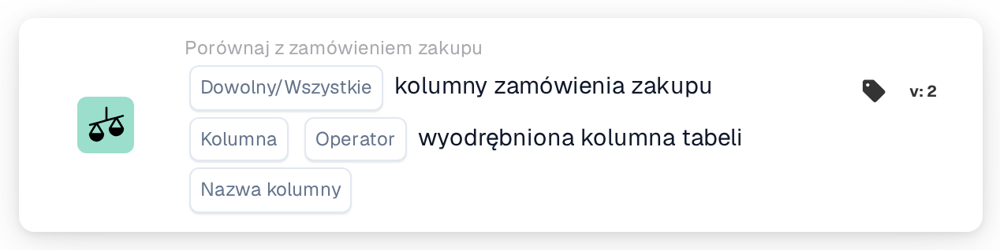
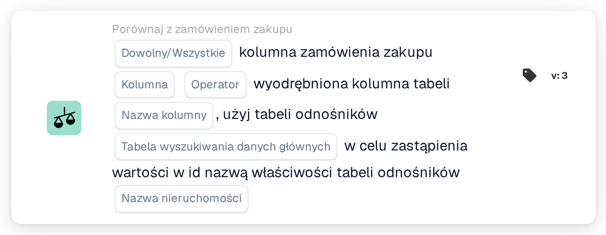

# Kolumna zamówienia zakupu i kolumna wyodrębnionej tabeli

<figure><figcaption>
Wersja 2
</figcaption></figure>

<figure><figcaption>
Wersja 3
</figcaption></figure>

## Cel:

Ta karta przepływu pracy porównuje kolumnę dopasowanych pozycji zamówienia zakupu z kolumną wyodrębnionej tabeli pozycji w dokumencie. Dla każdego wiersza dokumentu, który dopasowanie zamówienia zakupu sparowało z pozycją zamówienia zakupu, wartość w wybranej kolumnie zamówienia zakupu jest porównywana z wartością w wybranej kolumnie tabeli tego wiersza. Poszczególne wyniki są następnie łączone za pomocą ustawienia **Dowolny/Wszystkie** w jeden wynik karty.

Wersja 3 może dodatkowo przed porównaniem przetłumaczyć wartość zamówienia zakupu za pomocą tabeli wyszukiwania danych głównych, co pomaga, gdy zamówienie zakupu i dokument używają różnych kodów dla tej samej rzeczy, na przykład różnych kodów jednostek.

Dopasowanie zamówienia zakupu powinno zostać wykonane przed tą kartą. Bez dopasowanego zamówienia zakupu karta zgłasza brakujące dane.

## Komponenty karty:

1. **Dowolny/Wszystkie**
   * **Opis:** Jak porównania poszczególnych wierszy są łączone w wynik karty.
   * **Opcje:**
     * **Każdy:** Co najmniej jeden porównany wiersz spełnia warunek.
     * **Wszystko:** Każdy porównany wiersz spełnia warunek. Jeśli nie ustawiono żadnej wartości, karta używa **Wszystko**.
2. **Kolumna**
   * **Opis:** Kolumna pozycji zamówienia zakupu, której wartość jest porównywana.
   * **Szczegóły:** Wartość jest odczytywana z pozycji zamówienia zakupu, która została dopasowana do wiersza dokumentu.
3. **Operator**
   * **Opis:** Jak wartość zamówienia zakupu jest porównywana z wartością dokumentu. Wartość zamówienia zakupu znajduje się po lewej stronie porównania, dlatego **Większy niż** oznacza, że wartość zamówienia zakupu jest większa niż wartość dokumentu.
   * **Opcje:**
     * **Równa się**
     * **Nie równe**
     * **Większy niż**
     * **Większy lub równy**
     * **Mniej niż**
     * **Mniej lub Równe**
4. **Nazwa kolumny**
   * **Opis:** Kolumna wyodrębnionej tabeli w dokumencie, która jest porównywana z kolumną zamówienia zakupu.
   * **Szczegóły:** Karta używa pierwszej wyodrębnionej tabeli dokumentu.
5. **Tabela wyszukiwania danych głównych (tylko wersja 3)**
   * **Opis:** Opcjonalna tabela wyszukiwania używana do przetłumaczenia wartości zamówienia zakupu przed porównaniem.
   * **Szczegóły:** Wartość zamówienia zakupu, zamieniona na wielkie litery, jest wyszukiwana we właściwości tabeli wyszukiwania **codevalue**. Jeśli zostanie znaleziony rekord, który ma wartość dla wybranej **Nazwa nieruchomości**, wartość zamówienia zakupu zostaje zastąpiona oczyszczoną wartością tej właściwości. Jeśli nie znaleziono rekordu ani wartości, używana jest wartość zamówienia zakupu zapisana wielkimi literami. Wartość dokumentu nie jest tłumaczona.
6. **Nazwa nieruchomości (tylko wersja 3)**
   * **Opis:** Właściwość rekordu tabeli wyszukiwania, której wartość zastępuje wartość zamówienia zakupu.
   * **Szczegóły:** **Tabela wyszukiwania danych głównych** i **Nazwa nieruchomości** mogą obie pozostać puste; w takim przypadku karta porównuje wartości bez tłumaczenia. Jeśli ustawiono tylko jedno z dwóch pól, karta zgłasza brakujące dane.

## Funkcjonalność:

* **Ocena warunku:** Dla każdej dopasowanej pozycji zamówienia zakupu karta wyszukuje sparowany z nią wiersz tabeli dokumentu (lub, w wersji 3, wiersze) i porównuje obie wartości za pomocą wybranego operatora.
  * Jeśli obie wartości są liczbami, są porównywane jako liczby.
  * W przeciwnym razie są porównywane jako tekst. Przy **Równa się** różnice w wielkości liter nie mają znaczenia. W wersji 3 obie wartości są przed porównaniem zamieniane na wielkie litery; wartość pobrana z tabeli wyszukiwania jest używana w takiej postaci, w jakiej jest tam zapisana. Operatory **Większy** i **Mniej** porównują tekst według zwykłej kolejności znaków, dlatego są przydatne głównie dla kolumn liczbowych.
* **Wykonanie akcji:**
  * **Warunek prawdziwy:**\
    Przy **Wszystko** każdy porównany wiersz spełnia operator; przy **Każdy** spełnia go co najmniej jeden. Przepływ pracy jest kontynuowany.
  * **Warunek fałszywy:**\
    Jeśli połączony wynik nie jest spełniony, przepływ pracy zatrzymuje się na niespełnionym warunku.
* **Brakujące dane:** Karta nie ocenia warunku i zgłasza brakujące dane w dzienniku przepływu pracy, gdy:
  * dokument nie ma dopasowanego zamówienia zakupu lub dane dopasowanego zamówienia zakupu nie są dostępne,
  * dokument nie ma wyodrębnionej tabeli,
  * kolumna zamówienia zakupu porównywanej pozycji jest pusta (wartość liczbowa 0 również jest traktowana jako pusta),
  * kolumna tabeli porównywanego wiersza jest pusta lub nie istnieje,
  * nie udało się porównać żadnego wiersza,
  * wymagane pole nie jest ustawione (w wersji 3 również wtedy, gdy ustawiono tylko jedno z dwóch pól wyszukiwania).

## Instalacja i konfiguracja:

* Kartę można dodać jako warunek And po dopasowaniu zamówienia zakupu, z kategorii **Porównaj z zamówieniem zakupu**. Następnie można wybrać **Dowolny/Wszystkie**, **Kolumna** zamówienia zakupu, **Operator** oraz **Nazwa kolumny** tabeli dokumentu. W wersji 3 można dodać **Tabela wyszukiwania danych głównych** oraz **Nazwa nieruchomości**, jeśli zamówienie zakupu używa innych kodów niż dokument.
* Aby sprawdzić konfigurację, można użyć opcji **Karta testowa** w menu karty w Workflow Builder na istniejącym dokumencie. Dziennik karty wymienia każde porównanie z obiema wartościami i jego wynikiem.

## Podsumowanie:

Karta przepływu pracy „Purchase Order Column and Extracted Table Column” sprawdza pojedynczą kolumnę pozycji względem dopasowanego zamówienia zakupu, wiersz po wierszu. Można jej używać dla dowolnej kolumny istniejącej po obu stronach, a wersja 3 obejmuje również przypadki, w których obie strony używają różnych kodów dla tej samej wartości.
