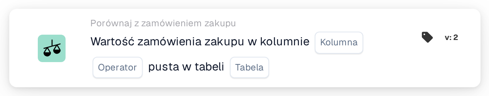

# Pusta kolumna zamówienia zakupu

<figure><figcaption>
Wersja 2
</figcaption></figure>

## Cel:

Ta karta przepływu pracy sprawdza, czy kolumna danych zamówienia zakupu jest pusta. Sprawdza bezpośrednio zapisane zamówienie zakupu, jego pozycje lub jego opłaty rozłożone i może być używana na przykład do wstrzymywania dokumentów, których zamówieniu zakupu brakuje informacji potrzebnych w dalszych krokach.

## Komponenty karty:

1. **Kolumna**
   * **Opis:** Sprawdzana kolumna zamówienia zakupu.
   * **Szczegóły:** Lista zawiera kolumny nagłówka zamówienia zakupu, pozycji zamówienia zakupu i opłat rozłożonych, na przykład **ID dostawcy**, **Cena jednostkowa**, **Ilość** lub **Typ opłaty**. Kolumna powinna należeć do tabeli wybranej w polu **Tabela**.
2. **Operator**
   * **Opis:** Czy kolumna powinna być pusta, czy nie.
   * **Opcje:**
     * **Jest:** Warunek jest spełniony, jeśli kolumna jest pusta w co najmniej jednym sprawdzanym rekordzie.
     * **Nie jest:** Warunek jest spełniony, jeśli kolumna ma wartość w każdym sprawdzanym rekordzie.
3. **Tabela**
   * **Opis:** Tabela zamówienia zakupu, z której odczytywana jest kolumna.
   * **Opcje:**
     * **Zamówienie zakupu:** Nagłówek zamówienia zakupu (jeden rekord).
     * **Linia zamówienia zakupu:** Wszystkie pozycje zamówienia zakupu.
     * **Opłata rozłożona na zamówienie zakupu:** Wszystkie opłaty rozłożone zamówienia zakupu.

## Funkcjonalność:

* **Używane zamówienie zakupu:** Jeśli przebieg przepływu pracy zawiera własne zamówienie zakupu, sprawdzane jest to zamówienie zakupu. W przeciwnym razie karta używa zamówienia zakupu pierwszej dopasowanej pozycji dokumentu lub, jeśli żadna pozycja nie jest dopasowana, pierwszego zamówienia zakupu wczytanego dla dokumentu.
* **Ocena warunku:** Karta odczytuje wszystkie rekordy wybranej tabeli należące do zamówienia zakupu i sprawdza wybraną kolumnę w każdym z nich. Kolumna jest uznawana za pustą, jeśli nie ma wartości, zawiera pusty tekst lub wartość liczbową 0. Wartość tak/nie jest zawsze uznawana za wypełnioną, również gdy wynosi „nie”.
* **Kolumna spoza tabeli:** Jeśli wybrana kolumna nie istnieje w wybranej tabeli, karta nie zgłasza błędu. Przy **Jest** warunek jest traktowany jako spełniony, przy **Nie jest** jako niespełniony.
* **Wykonanie akcji:**
  * **Warunek prawdziwy:**\
    Przy **Jest** kolumna jest pusta w co najmniej jednym rekordzie; przy **Nie jest** ma wartość w każdym rekordzie. Przepływ pracy jest kontynuowany.
  * **Warunek fałszywy:**\
    W przeciwnym razie przepływ pracy zatrzymuje się na niespełnionym warunku.
* **Brakujące dane:** Karta nie ocenia warunku i zgłasza brakujące dane w dzienniku przepływu pracy, gdy żadne zamówienie zakupu nie jest dostępne (ani z przebiegu przepływu pracy, ani dopasowane do dokumentu), gdy **Kolumna** lub **Tabela** nie jest ustawiona albo gdy dla zamówienia zakupu nie istnieje żaden rekord wybranej tabeli.

## Instalacja i konfiguracja:

* Kartę można dodać jako warunek And z kategorii **Porównaj z zamówieniem zakupu**. Następnie można wybrać **Kolumna**, operator oraz **Tabela**. Wybór kolumny należącej do wybranej tabeli pozwala uniknąć opisanego powyżej wyniku bez komunikatu.
* Aby wypróbować kartę na istniejącym dokumencie, można użyć opcji **Karta testowa** w menu karty w Workflow Builder.

## Podsumowanie:

Karta przepływu pracy „Purchase Order Column Empty” sprawdza kompletność samych danych zamówienia zakupu. Pomaga wcześnie zatrzymać dokumenty, gdy w zamówieniu zakupu brakuje wartości, od której zależy zatwierdzenie, eksport lub inne kroki przepływu pracy.
