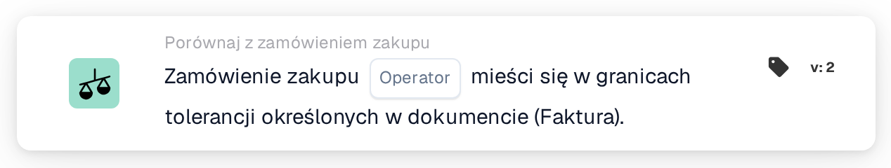

# Pełne dopasowanie zamówienia zakupu

<figure><figcaption>
Wersja 2
</figcaption></figure>

## Cel:

Ta karta przepływu pracy sprawdza, czy dopasowane zamówienie zakupu jako całość zgadza się z dokumentem w granicach tolerancji. Ilość, cena jednostkowa i opłaty dodatkowe każdej dopasowanej pozycji są sprawdzane w jednym kroku, dzięki czemu jedna karta może zdecydować, czy dokument może zostać przetworzony bez ręcznej weryfikacji.

Dopasowanie zamówienia zakupu powinno zostać wykonane przed tą kartą. Bez dopasowanego zamówienia zakupu karta zgłasza brakujące dane.

## Komponenty karty:

1. **Operator**
   * **Opis:** Czy zamówienie zakupu powinno być w pełni zgodne z dokumentem, czy nie.
   * **Opcje:**
     * **Jest:** Warunek jest spełniony, jeśli każda kontrola mieści się w tolerancji.
     * **Nie jest:** Warunek jest spełniony, jeśli co najmniej jedna kontrola wykracza poza tolerancję.

## Funkcjonalność:

* **Ocena warunku:** Karta przechodzi przez każdą dopasowaną pozycję zamówienia zakupu (łącznie z podpozycjami) i korzysta z danych porównawczych, które dopasowanie zamówienia zakupu dla niej zapisało:
  * **Ilość:** Ilość z dokumentu jest porównywana z ilością z zamówienia zakupu w granicach tolerancji ilości dla danej pozycji.
  * **Cena jednostkowa:** Cena jednostkowa z dokumentu jest porównywana z ceną jednostkową z zamówienia zakupu w granicach tolerancji ceny jednostkowej dla danej pozycji. Jeśli pozycja nie zawiera ceny jednostkowej w swoich danych porównawczych, a jedynie w ogólnych informacjach o dopasowaniu, karta używa tolerancji ceny jednostkowej skonfigurowanej dla typu dokumentu zamiast tolerancji zapisanej w pozycji; tolerancja procentowa jest wtedy liczona od ceny z zamówienia zakupu.
  * **Opłaty dodatkowe:** Dla każdej opłaty dodatkowej pozycji stawka opłaty, cena jednostkowa i kwota są osobno porównywane z zamówieniem zakupu w granicach ich tolerancji.
  * W przypadku dokumentów dostawy, które nie zawierają cen, porównywana jest tylko ilość.
* Wszystkie kontrole wszystkich pozycji są łączone: zamówienie zakupu jest w pełni zgodne tylko wtedy, gdy każda pojedyncza kontrola mieści się w tolerancji.
* **Wykonanie akcji:**
  * **Warunek prawdziwy:**\
    Przy **Jest** każda kontrola mieści się w tolerancji; przy **Nie jest** co najmniej jedna się nie mieści. Przepływ pracy jest kontynuowany.
  * **Warunek fałszywy:**\
    W przeciwnym razie przepływ pracy zatrzymuje się na niespełnionym warunku.
* **Brakujące dane:** Karta nie ocenia warunku i zgłasza brakujące dane w dzienniku przepływu pracy, gdy dokument nie ma dopasowanego zamówienia zakupu lub gdy w dopasowanej pozycji brakuje części danych potrzebnych do jej kontroli, na przykład ilości, ceny jednostkowej, wartości opłaty dodatkowej lub tolerancji którejś z nich (w tym brakującej lub nieużytecznej tolerancji ceny jednostkowej w typie dokumentu, jeśli jest potrzebna). Brakująca tolerancja nie jest traktowana jako tolerancja 0. Dotyczy to również **Nie jest**: brakujące dane są zgłaszane jako brakujące dane, a nie jako niezgodność.

## Instalacja i konfiguracja:

* Kartę można dodać jako warunek And po dopasowaniu zamówienia zakupu, z kategorii **Porównaj z zamówieniem zakupu**. Następnie można wybrać operator (**Jest** lub **Nie jest**). Same tolerancje nie są ustawiane na karcie; pochodzą z dopasowania zamówienia zakupu i ustawień typu dokumentu.
* Aby wypróbować kartę na istniejącym dokumencie, można użyć opcji **Karta testowa** w menu karty w Workflow Builder. Dziennik karty wymienia każde porównanie ilości, ceny jednostkowej i opłaty z wartościami dokumentu i zamówienia zakupu.

## Podsumowanie:

Karta przepływu pracy „Purchase Order Full Match” podsumowuje porównanie dokumentu z zamówieniem zakupu w jednym warunku. Dokumenty zgodne ze swoim zamówieniem zakupu w każdej pozycji mogą przejść automatycznie, natomiast każda różnica wykraczająca poza tolerancje jest zgłaszana jako niespełniony warunek, a brakujące dane porównawcze jako brakujące dane, nigdy jako zgodność.
