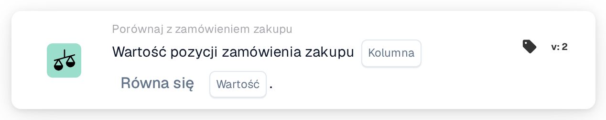

# Wartość pozycji zamówienia zakupu

<figure><figcaption>
Wersja 2
</figcaption></figure>

## Cel:

Ta karta przepływu pracy porównuje kolumnę dopasowanych pozycji zamówienia zakupu ze stałą wartością. Można jej używać do sprawdzania właściwości zamówionych pozycji, która nie jest wydrukowana na dokumencie, na przykład statusu, kodu jednostki lub metody dostawy, i odpowiedniego obsłużenia dokumentu.

Dopasowanie zamówienia zakupu powinno zostać wykonane przed tą kartą. Bez dopasowanego zamówienia zakupu karta zgłasza brakujące dane.

## Komponenty karty:

1. **Kolumna**
   * **Opis:** Kolumna pozycji zamówienia zakupu, której wartość jest porównywana.
2. **Operator**
   * **Opis:** Jak wartość pozycji zamówienia zakupu jest porównywana z wartością na karcie. Wartością domyślną jest **Równa się**.
   * **Opcje:**
     * **Równa się:** Wartość pozycji jest równa wartości. W przypadku tekstu wielkość liter jest ignorowana.
     * **Nie równe:** Wartość pozycji różni się od wartości. W przypadku tekstu wielkość liter ma znaczenie.
     * **Większy niż**, **Większy lub równy**, **Mniej niż**, **Mniej lub Równe:** Przydatne głównie dla kolumn liczbowych.
     * **Zawiera:** Wartość pozycji jest dokładnie jednym z wpisów w polu **Wartość**, z uwzględnieniem wielkości liter. Częściowe dopasowania nie są uwzględniane.
     * **Nie zawiera:** Wartość pozycji nie jest żadnym z wpisów w polu **Wartość** (porównanie odbywa się w ten sam dokładny sposób).
3. **Wartość**
   * **Opis:** Wartość, z którą porównywana jest wartość pozycji zamówienia zakupu.
   * **Szczegóły:** Przy **Zawiera** i **Nie zawiera** można wprowadzić kilka wpisów oddzielonych przecinkami. Przy operatorach **Większy** i **Mniej** lista wartości nie jest obsługiwana.

## Funkcjonalność:

* **Ocena warunku:** Dla każdej dopasowanej pozycji zamówienia zakupu (łącznie z podpozycjami) karta odczytuje wartość wybranej kolumny i porównuje ją z polem **Wartość** przy użyciu operatora. Jeśli obie wartości są liczbami, są porównywane jako liczby, w przeciwnym razie jako tekst.
* Każda porównana pozycja powinna spełniać warunek; na tej karcie nie ma opcji **Dowolny/Wszystkie**.
* **Wykonanie akcji:**
  * **Warunek prawdziwy:**\
    Jeśli każda porównana pozycja spełnia warunek, przepływ pracy jest kontynuowany.
  * **Warunek fałszywy:**\
    Jeśli co najmniej jedna pozycja go nie spełnia, przepływ pracy zatrzymuje się na niespełnionym warunku.
* **Brakujące dane:** Karta nie ocenia warunku i zgłasza brakujące dane w dzienniku przepływu pracy, gdy **Kolumna** lub **Wartość** nie jest ustawiona, gdy dokument nie ma dopasowanego zamówienia zakupu lub jego dane nie są dostępne, gdy wybrana kolumna dopasowanej pozycji jest pusta (wartość liczbowa 0 również jest traktowana jako pusta) lub gdy nie udało się porównać żadnej pozycji.
* **Błąd konfiguracji:** Jeśli pole **Wartość** zawiera przecinek i wybrano jeden z operatorów **Większy** lub **Mniej**, karta zatrzymuje się z błędem konfiguracji.

## Instalacja i konfiguracja:

* Kartę można dodać jako warunek And po dopasowaniu zamówienia zakupu, z kategorii **Porównaj z zamówieniem zakupu**. Następnie można ustawić **Kolumna** pozycji zamówienia zakupu, operator oraz **Wartość**. Do sprawdzenia względem kilku dozwolonych wartości można użyć **Zawiera** z listą oddzieloną przecinkami.
* Aby wypróbować kartę na istniejącym dokumencie, można użyć opcji **Karta testowa** w menu karty w Workflow Builder. Dziennik karty wymienia każdą porównaną wartość pozycji wraz z operatorem i użytą wartością.

## Podsumowanie:

Karta przepływu pracy „Purchase Order Line Value” wprowadza dane pozycji zamówienia zakupu do przepływu pracy jako prosty warunek. Pozwala przepływowi pracy reagować na to, jak zamówiono towary, nawet jeśli ta informacja nie pojawia się w samym dokumencie.
