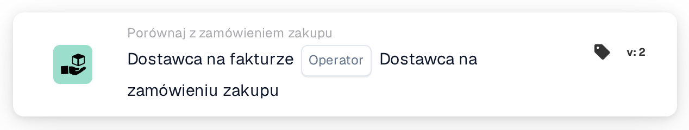

# Dostawca na fakturze

<figure><figcaption>
Wersja 2
</figcaption></figure>

## **Cel:**

Ta karta przepływu pracy służy do porównania informacji o dostawcy na fakturze z informacjami o dostawcy na powiązanym zamówieniu zakupu. Karta zapewnia, że dostawca na fakturze odpowiada dostawcy na zamówieniu zakupu. Porównanie to pomaga zweryfikować, czy właściwy dostawca wystawia fakturę za zamówienie, i może wyzwalać akcje na podstawie wszelkich rozbieżności.

## **Komponenty karty:**

1. **Operator:**
   * **Opis**: Definiuje warunek porównania dostawcy na fakturze z dostawcą na zamówieniu zakupu.
   * **Opcje**:
     * **Is**: Sprawdza, czy dostawca na fakturze odpowiada dostawcy na zamówieniu zakupu.
     * **Nie jest**: Zapewnia, że dostawca na fakturze nie odpowiada dostawcy na zamówieniu zakupu.

## **Funkcjonalność:**

* **Ocena warunku:** System porównuje dostawcę na fakturze z dostawcą na zamówieniu zakupu na podstawie wybranego operatora. Jeśli warunek porównania jest prawdziwy (np. dostawca jest taki sam lub inny, zgodnie z wymaganiem), przepływ pracy będzie kontynuowany odpowiednio.
* **Wykonanie akcji:**
  * **Warunek prawdziwy**: Jeśli warunek jest prawdziwy (np. dostawca na fakturze odpowiada dostawcy na zamówieniu zakupu), przepływ pracy jest kontynuowany bez wyzwalania błędów.
  * **Warunek fałszywy**: Jeśli warunek jest fałszywy (np. dostawca na fakturze nie odpowiada dostawcy na zamówieniu zakupu), przepływ pracy nie będzie kontynuowany.

## **Konfiguracja:**

* Użytkownicy wybierają odpowiedni operator ("Is" lub "Is Not"), aby zdefiniować sposób porównania dostawców.

## **Przykładowy scenariusz:**

* Faktura wymienia dostawcę o ID "SUP123", a powiązane zamówienie zakupu również wymienia "SUP123" jako dostawcę. Przy użyciu operatora "Is" karta porównuje dostawców i stwierdza, że są tacy sami, więc przepływ pracy jest kontynuowany bez problemu.

## **Podsumowanie:**

Karta przepływu pracy "Supplier Comparison" zapewnia, że właściwy dostawca wystawia fakturę za zamówienie zakupu, pomagając zapobiegać rozbieżnościom i błędom w procesie zakupowym. Automatycznie weryfikując informacje o dostawcy, organizacje mogą usprawnić proces zatwierdzania faktur i zmniejszyć ryzyko oszustwa lub błędów w rozliczeniach dostawców.
