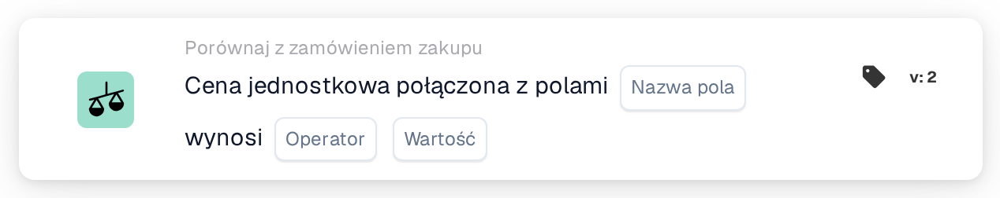

# Cena jednostkowa w połączeniu z polami

<figure><figcaption>
Wersja 2
</figcaption></figure>

<figure><figcaption>
Wersja 3
</figcaption></figure>

## **Cel:**

Ta karta przepływu pracy służy do oceny, czy cena jednostkowa w połączeniu z wartością określonego pola (taką jak ilość, rabat lub dodatkowe opłaty) spełnia zdefiniowany warunek. Karta porównuje cenę jednostkową i wartość pola z określonym progiem, aby pomóc zapewnić zgodność cen z oczekiwaniami. Porównanie to może wyzwalać akcje na podstawie określonych warunków, takie jak oznaczanie rozbieżności lub automatyzacja procesów zatwierdzania w przepływach pracy zakupów lub przyjęć.

## **Komponenty karty:**

1. **Nazwa pola**
   * **Opis:** Określa pole dokumentu zawierające wartość do połączenia z ceną jednostkową.
   * **Szczegóły:** Musi to odpowiadać dokładnemu identyfikatorowi pierwszego pola w dokumencie.
2. **Operatora**
   * **Opis:** Definiuje warunek, który zostanie zastosowany do porównania między łączną wartością a określoną wartością.
   * **Opcje:**
     * **Równa się (=):** Sprawdza, czy łączna wartość ceny jednostkowej i pola odpowiada określonej wartości.
     * **Nie równa się (≠):** Zapewnia, że łączna wartość ceny jednostkowej i pola różni się od określonej wartości.
     * **Większy niż (>):** Weryfikuje, czy łączna wartość jest większa niż określona wartość.
     * **Większe lub równe (≥):** Sprawdza, czy łączna wartość jest większa lub równa określonej wartości.
     * **Mniejszy niż (<):** Weryfikuje, czy łączna wartość jest mniejsza niż określona wartość.
     * **Mniejszy lub równy (≤):** Sprawdza, czy łączna wartość jest mniejsza lub równa określonej wartości.
3. **Wartość**
   * **Opis:** Określa wartość, z którą porównywana będzie łączna wartość ceny jednostkowej i pola.
   * **Szczegóły:** Wartość musi być wartością liczbową.

## **Funkcjonalność:**

* **Ocena warunku:** System ocenia łączną wartość ceny jednostkowej i pola na podstawie wybranego operatora i porównuje ją z określoną wartością. Wynik tej oceny określa, czy warunek jest prawdziwy, czy fałszywy.
* **Wykonanie akcji:**
  * **Warunek prawdziwy:** Jeśli porównanie daje wynik prawdziwy (np. łączna wartość przekracza określoną wartość), przepływ pracy jest kontynuowany z warunkiem prawdziwym. Może to wyzwolić akcje, takie jak zatwierdzenie, routing dokumentu lub zastosowanie reguł przetwarzania.
  * **Warunek fałszywy:** Jeśli porównanie daje wynik fałszywy (np. łączna wartość nie spełnia warunku), przepływ pracy jest kontynuowany z warunkiem fałszywym. Może to wyzwolić powiadomienie, wysłać dokument do ręcznego przeglądu lub zatrzymać przepływ pracy.

## **Konfiguracja:**

* Użytkownicy zaczynają od wybrania pola(pól) dokumentu zawierającego wartość(wartości) do połączenia z ceną jednostkową. Po wybraniu pola wybierają odpowiedni operator definiujący sposób porównania łącznej wartości z określoną wartością. Następnie mogą ustawić wartość.

## **Przykładowy scenariusz:**

* Faktura wymienia 50 jednostek produktu po 20 USD każda, co daje łącznie 1000 USD. Powiązany dokument ma pole ilości o wartości 10. Przy użyciu operatora "Greater Than" karta porównuje łączną wartość ceny jednostkowej (20 USD) i ilości (10), co równa się 200 USD. Karta sprawdza, czy łączna wartość jest większa niż 150 USD (określona wartość). Ponieważ łączna wartość 200 USD jest większa niż próg 150 USD, przepływ pracy kontynuuje wyzwolenie zatwierdzenia dokumentu.

## **Podsumowanie:**

Karta przepływu pracy "Unit Price Combined with Fields" zapewnia spełnienie warunków cenowych poprzez ocenę łącznej wartości ceny jednostkowej i określonego pola. Automatyzując to porównanie, organizacje mogą zapewnić spójność i oznaczać rozbieżności w cenach lub ilościach przed kontynuowaniem zatwierdzenia, pomagając usprawnić procesy zakupowe i finansowe.
