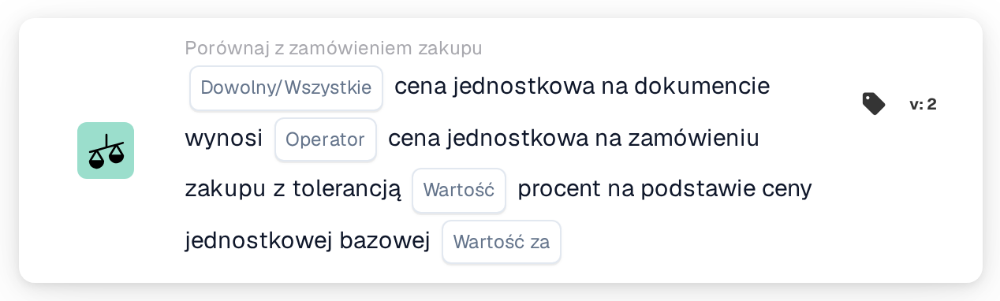

# Tolerancja ceny jednostkowej na cenę bazową

<figure><figcaption>
Wersja 2
</figcaption></figure>

## Cel:

Ta karta przepływu pracy porównuje ceny jednostkowe w dokumencie z cenami jednostkowymi dopasowanych pozycji zamówienia zakupu, stosując tolerancję procentową, która rośnie wraz z ceną z zamówienia zakupu. Tolerancja jest wprowadzana jako procent na bazową cenę jednostkową, dzięki czemu droższe pozycje otrzymują większą tolerancję procentową niż tańsze.

Dla stałej tolerancji można użyć karty **Any / All Unit Price is**.

Dopasowanie zamówienia zakupu powinno zostać wykonane przed tą kartą. Bez dopasowanego zamówienia zakupu karta zgłasza brakujące dane.

## Komponenty karty:

1. **Dowolny/Wszystkie**
   * **Opis:** Jak porównania poszczególnych pozycji są łączone w wynik karty.
   * **Opcje:**
     * **Każdy:** Co najmniej jedna pozycja spełnia porównanie.
     * **Wszystko:** Każda porównana pozycja spełnia porównanie. Jeśli nie ustawiono żadnej wartości, karta używa **Wszystko**.
2. **Operator**
   * **Opis:** Jak cena jednostkowa z dokumentu jest porównywana z ceną jednostkową z zamówienia zakupu z uwzględnieniem tolerancji.
   * **Opcje:**
     * **Równa się:** Cena z dokumentu mieści się w zakresie tolerancji wokół ceny z zamówienia zakupu.
     * **Nie równe:** Cena z dokumentu leży poza zakresem tolerancji.
     * **Większy niż:** Cena z dokumentu leży powyżej zakresu tolerancji.
     * **Większy lub równy:** Cena z dokumentu mieści się w zakresie tolerancji lub leży powyżej niego.
     * **Mniej niż:** Cena z dokumentu leży poniżej zakresu tolerancji.
     * **Mniej lub Równe:** Cena z dokumentu mieści się w zakresie tolerancji lub leży poniżej niego.
3. **Wartość**
   * **Opis:** Tolerancja w procentach obowiązująca przy bazowej cenie jednostkowej.
   * **Szczegóły:** Liczba, na przykład `1` dla 1 procenta.
4. **Wartość za**
   * **Opis:** Bazowa cena jednostkowa, do której odnosi się procent tolerancji.
   * **Szczegóły:** Liczba większa od 0, na przykład `100`.

## Funkcjonalność:

* **Obliczanie tolerancji:** Dla każdej pozycji procent tolerancji jest skalowany stosunkiem ceny jednostkowej z zamówienia zakupu do bazowej ceny jednostkowej:\
  tolerancja % = **Wartość** × (cena jednostkowa z zamówienia zakupu ÷ **Wartość za**)\
  Zakres tolerancji to cena jednostkowa z zamówienia zakupu plus i minus ten procent.\
  Przykład dla **Wartość** 1 i **Wartość za** 100: cena z zamówienia zakupu 50 daje tolerancję 0,5 %, więc zakres wynosi od 49,75 do 50,25. Cena z zamówienia zakupu 200 daje 2 %, więc zakres wynosi od 196 do 204.
* **Ocena warunku:** Dla każdej dopasowanej pozycji zamówienia zakupu cena jednostkowa z dokumentu jest porównywana z ceną jednostkową pozycji zamówienia zakupu przy użyciu operatora i obliczonego zakresu. Dopasowane wpisy bez pozycji zamówienia zakupu są pomijane. Wyniki są łączone za pomocą **Dowolny/Wszystkie**.
* **Wykonanie akcji:**
  * **Warunek prawdziwy:**\
    Jeśli połączony wynik jest spełniony, przepływ pracy jest kontynuowany.
  * **Warunek fałszywy:**\
    Jeśli połączony wynik nie jest spełniony, przepływ pracy zatrzymuje się na niespełnionym warunku. Dzieje się tak również wtedy, gdy nie udało się porównać żadnej pozycji.
* **Brakujące dane:** Karta nie ocenia warunku i zgłasza brakujące dane w dzienniku przepływu pracy, gdy **Wartość** lub **Wartość za** nie jest ustawiona, gdy dokument nie ma dopasowanego zamówienia zakupu lub gdy w dokumencie albo w zamówieniu zakupu brakuje ceny jednostkowej porównywanej pozycji (pusta cena jednostkowa lub liczbowa cena jednostkowa 0 jest traktowana jako brakująca).
* **Błędy:** Karta zatrzymuje się z błędem, gdy **Wartość** lub **Wartość za** nie jest liczbą, gdy ceny jednostkowej nie można odczytać jako liczby, gdy **Wartość za** wynosi 0 lub gdy obliczona tolerancja dla pozycji jest niższa niż 0 % lub wyższa niż 100 %.

## Instalacja i konfiguracja:

* Kartę można dodać jako warunek And po dopasowaniu zamówienia zakupu, z kategorii **Porównaj z zamówieniem zakupu**. Następnie można wprowadzić **Dowolny/Wszystkie**, operator, procent tolerancji w polu **Wartość** oraz bazową cenę jednostkową w polu **Wartość za**. Bazową cenę jednostkową warto dobrać tak, aby obliczona tolerancja pozostawała między 0 % a 100 % dla zakresu cen pozycji.
* Aby wypróbować kartę na istniejącym dokumencie, można użyć opcji **Karta testowa** w menu karty w Workflow Builder. Dziennik karty pokazuje dla każdej pozycji obie ceny, obliczoną tolerancję w procentach i wynikowy zakres.

## Podsumowanie:

Karta przepływu pracy „Unit Price Tolerance per Base Price” stosuje tolerancję zależną od ceny przy porównaniu ceny jednostkowej z zamówieniem zakupu. Pozwala to jedną kartą stosować wąską tolerancję dla tanich pozycji i szerszą dla drogich.
