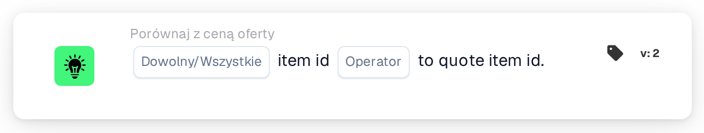

# Porównanie identyfikatora pozycji z identyfikatorem pozycji z oferty

<figure><figcaption>
Wersja 2
</figcaption></figure>

## Cel:

Ta karta przepływu pracy porównuje numer pozycji w każdym wierszu dokumentu z numerem pozycji zapisanym dla tej samej pozycji dostawcy w tabeli cen pozycji dostawcy. Można jej używać do wykrywania wierszy, w których dokument wskazuje inną pozycję niż ta, do której odnoszą się dane cenowe. W zależności od wyniku przepływ pracy jest kontynuowany zgodnie z warunkiem prawdziwym lub fałszywym.

## Komponenty karty:

1. **Dowolny/Wszystkie**
   * **Opis:** Określa, czy warunek powinien spełniać jeden wiersz, czy każdy porównany wiersz tabeli dokumentu.
   * **Opcje:**
     * **Każdy:** Warunek jest prawdziwy, jeśli co najmniej jeden porównany wiersz spełnia warunek.
     * **Wszystko:** Warunek jest prawdziwy tylko wtedy, gdy każdy porównany wiersz spełnia warunek.
2. **Operator**
   * **Opis:** Określa, jak numer pozycji w tabeli cen pozycji dostawcy jest porównywany z numerem pozycji w wierszu dokumentu.
   * **Opcje:**
     * **Równa się:** Numery pozycji są takie same. Numery pozycji, które oba można odczytać jako liczby, są porównywane jako liczby (na przykład „007” i „7” są równe); w przeciwnym razie są porównywane jako tekst bez rozróżniania wielkich i małych liter.
     * **Nie równe:** Numery pozycji się różnią. Numery pozycji, które oba można odczytać jako liczby, są porównywane jako liczby; w przeciwnym razie są porównywane jako tekst, przy czym tutaj wielkie i małe litery są rozróżniane.
     * **Większy niż, Większy lub równy, Mniej niż, Mniej lub Równe:** Również dostępne na karcie. Przy tych operatorach numery pozycji są zawsze porównywane jako tekst, znak po znaku, dlatego na przykład „10” jest uznawane za mniejsze niż „9”.

## Funkcjonalność:

* **Ocena warunku:** Dla każdego wiersza w tabeli dokumentu karta wyszukuje identyfikator pozycji dostawcy z wiersza (kolumna `SUPPLIER_ITEM_NUMBER`) w tabeli cen pozycji dostawcy i porównuje zapisany tam numer pozycji z numerem pozycji wiersza (kolumna `ITEM_NUMBER`). Wyniki wszystkich porównanych wierszy są następnie łączone za pomocą **Każdy** lub **Wszystko**.
* **Pominięte wiersze:** Wiersz jest wyłączany z porównania, jeśli tabela cen pozycji dostawcy nie ma wpisu dla jego identyfikatora pozycji dostawcy lub jeśli wpis nie ma numeru pozycji. Każdy pominięty wiersz jest odnotowywany w dzienniku przepływu pracy.
* **Daty ważności:** Jeśli wpis w tabeli cen pozycji dostawcy ma datę początkową lub końcową, a data dokumentu wykracza poza ten okres, karta odnotowuje to w dzienniku przepływu pracy. Ta uwaga nie zmienia wyniku karty.
* **Wykonanie akcji:**
  * **Warunek prawdziwy:**\
    Numery pozycji spełniają wybrany operator dla dowolnego lub wszystkich porównanych wierszy. Przepływ pracy jest kontynuowany zgodnie z warunkiem prawdziwym.
  * **Warunek fałszywy:**\
    Jeśli warunek nie jest spełniony, przepływ pracy jest kontynuowany zgodnie z warunkiem fałszywym, na przykład aby przesłać dokument do ręcznej weryfikacji. Warunek fałszywy jest używany również wtedy, gdy nie udało się porównać żadnego wiersza, ponieważ żaden wiersz nie miał numeru pozycji w tabeli cen pozycji dostawcy.
* **Brakujące dane:** Jeśli dokument nie ma tabeli, ma więcej niż jedną tabelę lub z tabeli nie udało się odczytać żadnych wierszy, karta nie ocenia warunku i zgłasza brakujące dane w dzienniku przepływu pracy. Jeśli nie ustawiono opcji **Dowolny/Wszystkie**, karta odnotowuje to w dzienniku i używa **Wszystko**.

## Instalacja i konfiguracja:

* Kartę można dodać z kategorii **Porównaj z ceną oferty**. Następnie można wybrać **Każdy** lub **Wszystko** oraz operator. Do sprawdzenia zgodności numerów pozycji zwykle wybiera się **Równa się** lub **Nie równe**. Na koniec ustawia się warunek kontynuacji (prawda lub fałsz), który określa następny krok przepływu pracy.
* Karta działa na dokumentach z dokładnie jedną tabelą, której wiersze zawierają identyfikator pozycji dostawcy oraz numer pozycji.

## Podsumowanie:

Karta przepływu pracy „Item ID to Quote Item ID” zapewnia, że pozycje w dokumencie odpowiadają pozycjom, do których odnosi się tabela cen pozycji dostawcy. Wiersze bez danych cenowych są pomijane, zamiast być liczone jako różnice, dzięki czemu wynik odzwierciedla tylko wiersze, które rzeczywiście można porównać.
