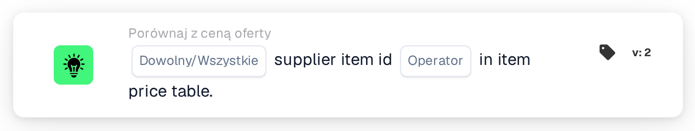

# Identyfikator pozycji dostawcy w tabeli cen pozycji

<figure><figcaption>
Wersja 2
</figcaption></figure>

## Cel:

Ta karta przepływu pracy sprawdza, czy identyfikatory pozycji dostawcy w wierszach dokumentu można znaleźć w tabeli cen pozycji dostawcy. Można jej używać, aby ustalić, czy DocBits przechowuje dane cenowe dla pozycji z oferty dla dostawcy dokumentu, zanim zostaną wykonane inne porównania z ofertą, lub aby kierować dokumenty z nieznanymi pozycjami do ręcznej kontroli. W zależności od wyniku przepływ pracy jest kontynuowany zgodnie z warunkiem prawdziwym lub fałszywym.

## Komponenty karty:

1. **Dowolny/Wszystkie**
   * **Opis:** Określa, czy warunek powinien spełniać jeden wiersz, czy każdy wiersz tabeli dokumentu.
   * **Opcje:**
     * **Każdy:** Warunek jest prawdziwy, jeśli co najmniej jeden wiersz spełnia warunek.
     * **Wszystko:** Warunek jest prawdziwy tylko wtedy, gdy każdy wiersz spełnia warunek.
2. **Operator**
   * **Opis:** Określa, czy identyfikator pozycji dostawcy powinien zostać znaleziony w tabeli cen pozycji dostawcy, czy nie.
   * **Opcje:**
     * **Jest:** Wiersz spełnia warunek, jeśli jego identyfikator pozycji dostawcy znajduje się w tabeli cen pozycji dostawcy.
     * **Nie jest:** Wiersz spełnia warunek, jeśli jego identyfikatora pozycji dostawcy nie ma w tabeli cen pozycji dostawcy.

## Funkcjonalność:

* **Ocena warunku:** Karta odczytuje identyfikator pozycji dostawcy (kolumna `SUPPLIER_ITEM_NUMBER`) każdego wiersza w tabeli dokumentu i sprawdza, czy tabela cen pozycji dostawcy zawiera dla niego wpis. Wyniki wszystkich wierszy są następnie łączone za pomocą **Każdy** lub **Wszystko**.
* **Daty ważności:** Jeśli wpis w tabeli cen pozycji dostawcy ma datę początkową lub końcową, a data dokumentu wykracza poza ten okres, karta odnotowuje to w dzienniku przepływu pracy. Ta uwaga nie zmienia wyniku karty.
* **Wykonanie akcji:**
  * **Warunek prawdziwy:**\
    Przy **Jest** identyfikatory pozycji dostawcy (dowolny lub wszystkie, zgodnie z wyborem) znajdują się w tabeli cen pozycji dostawcy. Przy **Nie jest** ich tam nie ma. Przepływ pracy jest kontynuowany zgodnie z warunkiem prawdziwym, na przykład aby przejść do porównania cen.
  * **Warunek fałszywy:**\
    Jeśli warunek nie jest spełniony, przepływ pracy jest kontynuowany zgodnie z warunkiem fałszywym, na przykład aby przesłać dokument do ręcznej weryfikacji.
* **Brakujące dane:** Jeśli dokument nie ma tabeli, ma więcej niż jedną tabelę, z tabeli nie udało się odczytać żadnych wierszy lub dokument w ogóle nie ma danych cenowych pozycji dostawcy, karta nie ocenia warunku i zgłasza brakujące dane w dzienniku przepływu pracy. Jeśli nie ustawiono opcji **Dowolny/Wszystkie**, karta odnotowuje to w dzienniku i używa **Wszystko**.
* **Błędy:** Karta kończy się błędem, jeśli wiersz tabeli nie ma kolumny `SUPPLIER_ITEM_NUMBER`. Jeśli nie ustawiono operatora, karta zgłasza błąd konfiguracji.

## Instalacja i konfiguracja:

* Kartę można dodać z kategorii **Porównaj z ceną oferty**. Następnie można wybrać **Każdy** lub **Wszystko** oraz operator (**Jest** lub **Nie jest**). Na koniec ustawia się warunek kontynuacji (prawda lub fałsz), który określa następny krok przepływu pracy.
* Karta działa na dokumentach z dokładnie jedną tabelą, której wiersze zawierają identyfikator pozycji dostawcy.

## Podsumowanie:

Karta przepływu pracy „Supplier Item ID in Item Price Table” pokazuje, czy pozycje z dokumentu są znane w tabeli cen pozycji dostawcy. Może służyć jako pierwsza kontrola w przepływie pracy dla ofert, tak aby późniejsze porównania ceny, numeru pozycji i jednostki miary były wykonywane tylko dla dokumentów, których pozycje mają dane cenowe.
