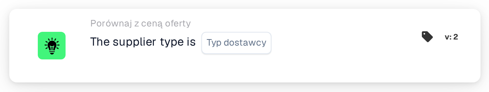

# Typ dostawcy

<figure><figcaption>
Wersja 2
</figcaption></figure>

## Cel:

Ta karta przepływu pracy sprawdza typ dostawcy pozycji w danych cen pozycji dostawcy dokumentu, na przykład czy pozycje są pozycjami kontraktowymi, czy zarządzanymi. Można jej używać do stosowania różnych reguł zatwierdzania w zależności od tego, jak zarządzane są pozycje dostawcy. W zależności od wyniku przepływ pracy jest kontynuowany zgodnie z warunkiem prawdziwym lub fałszywym.

## Komponenty karty:

1. **Typ dostawcy**
   * **Opis:** Typ dostawcy, względem którego sprawdzany jest dokument.
   * **Opcje:**
     * **Contract:** Odpowiada wpisom, których klasa zarządzania to „contract”.
     * **Managed:** Odpowiada wpisom, których klasa zarządzania to „managed”.
     * **NonManaged:** Odpowiada wpisom, których klasa zarządzania to „unmanaged”.

## Funkcjonalność:

* **Ocena warunku:** Karta odczytuje typ dostawcy (klasę zarządzania) każdego wpisu w danych cen pozycji dostawcy dokumentu i porównuje go z typem dostawcy wybranym na karcie. Porównanie nie rozróżnia wielkich i małych liter.
* **Wykonanie akcji:**
  * **Warunek prawdziwy:**\
    Każdy wpis w danych cen pozycji dostawcy ma wybrany typ dostawcy. Przepływ pracy jest kontynuowany zgodnie z warunkiem prawdziwym, na przykład aby zastosować reguły dla tego typu dostawcy.
  * **Warunek fałszywy:**\
    Jeśli co najmniej jeden wpis ma inny typ dostawcy lub nie ma klasy zarządzania, przepływ pracy jest kontynuowany zgodnie z warunkiem fałszywym.
* **Brakujące dane:** Jeśli na karcie nie wybrano typu dostawcy lub dokument nie ma danych cen pozycji dostawcy, karta nie ocenia warunku i zgłasza brakujące dane w dzienniku przepływu pracy.

## Instalacja i konfiguracja:

* Kartę można dodać z kategorii **Porównaj z ceną oferty**. Następnie w polu **Typ dostawcy** można wybrać typ dostawcy. Na koniec ustawia się warunek kontynuacji (prawda lub fałsz), który określa następny krok przepływu pracy.

## Podsumowanie:

Karta przepływu pracy „Supplier Type” pozwala rozgałęziać przepływ pracy dla ofert według typu dostawcy pozycji, dzięki czemu pozycje kontraktowe, zarządzane i niezarządzane mogą być obsługiwane według własnych reguł.
