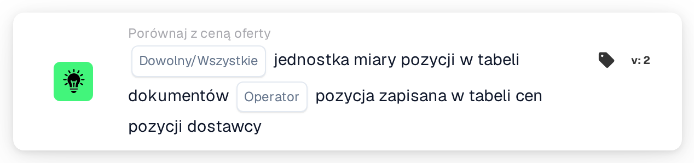
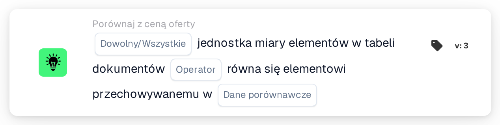

# Jednostka miary

<figure><figcaption>
Wersja 2
</figcaption></figure>

<figure><figcaption>
Wersja 3
</figcaption></figure>

## Cel:

Ta karta przepływu pracy porównuje jednostkę miary pozycji w tabeli dokumentu z jednostką miary zapisaną dla tych samych pozycji w innym miejscu. W wersji 2 porównanie odbywa się zawsze z tabelą cen pozycji dostawcy. Wersja 3 dodaje wybór między tabelą cen pozycji dostawcy a pozycjami dopasowanego zamówienia zakupu. Karty można używać do wykrywania wierszy, w których pozycja jest oferowana lub fakturowana w innej jednostce niż oczekiwana. W zależności od wyniku przepływ pracy jest kontynuowany zgodnie z warunkiem prawdziwym lub fałszywym.

## Komponenty karty:

1. **Dowolny/Wszystkie**
   * **Opis:** Określa, czy warunek powinien spełniać jeden wiersz, czy każdy porównany wiersz tabeli dokumentu.
   * **Opcje:**
     * **Każdy:** Warunek jest prawdziwy, jeśli co najmniej jeden porównany wiersz spełnia warunek.
     * **Wszystko:** Warunek jest prawdziwy tylko wtedy, gdy każdy porównany wiersz spełnia warunek.
2. **Operator**
   * **Opis:** Określa, czy jednostki miary powinny być równe, czy różne.
   * **Opcje:**
     * **Równa się:** Jednostka miary w wierszu dokumentu jest taka sama jak zapisana.
     * **Nie równe:** Jednostka miary w wierszu dokumentu różni się od zapisanej.
3. **Dane porównawcze** (tylko wersja 3)
   * **Opis:** Źródło, z którym porównywana jest jednostka miary dokumentu.
   * **Opcje:**
     * **cena podana przez dostawcę:** Jednostka miary zapisana dla pozycji dostawcy w tabeli cen pozycji dostawcy, tak jak w wersji 2.
     * **pozycja zamówienia zakupu:** Jednostka miary dopasowanej pozycji zamówienia zakupu.

## Funkcjonalność:

* **Ocena warunku:** Karta odczytuje jednostkę miary (kolumna `UNIT`) wierszy w pierwszej tabeli dokumentu i porównuje ją z wybranym źródłem. Porównanie nie rozróżnia wielkich i małych liter. Wyniki wszystkich porównanych wierszy są następnie łączone za pomocą **Każdy** lub **Wszystko**.
  * **cena podana przez dostawcę:** Porównywane są tylko wiersze powiązane z wpisem dopasowanych danych oferty. Dla każdego z tych wierszy używana jest jednostka miary zapisana dla jego pozycji dostawcy.
  * **pozycja zamówienia zakupu** (wersja 3): Porównywane są tylko wiersze dopasowane do pozycji zamówienia zakupu. Jednostka miary pozycji zamówienia zakupu jest najpierw tłumaczona za pomocą tabeli wyszukiwania jednostek miary (z jednostki EDI na jednostkę M3). Po obu stronach kilka zapisów jest traktowanych jako równoważne: „each” jako „ea”, a „lbs” i „lbp” jako „lb”.
* **Pominięte wiersze:** Wiersz jest wyłączany z porównania, jeśli źródło nie ma dla niego jednostki miary. Każdy pominięty wiersz jest odnotowywany w dzienniku przepływu pracy.
* **Wykonanie akcji:**
  * **Warunek prawdziwy:**\
    Jednostki miary spełniają wybrany operator dla dowolnego lub wszystkich porównanych wierszy. Przepływ pracy jest kontynuowany zgodnie z warunkiem prawdziwym.
  * **Warunek fałszywy:**\
    Jeśli warunek nie jest spełniony, przepływ pracy jest kontynuowany zgodnie z warunkiem fałszywym, na przykład aby przesłać dokument do ręcznej weryfikacji. Warunek fałszywy jest używany również wtedy, gdy żadnego wiersza nie udało się powiązać z wybranym źródłem, a w wersji 3 także wtedy, gdy nie wybrano żadnej opcji **Dane porównawcze**, ponieważ wtedy żaden wiersz nie jest porównywany.
* **Brakujące dane:** Karta nie ocenia warunku i zgłasza brakujące dane w dzienniku przepływu pracy, jeśli:
  * dokument nie ma tabeli,
  * używana jest opcja **cena podana przez dostawcę** (lub wersja 2), a dokument nie ma dopasowanych danych oferty lub danych cen pozycji dostawcy,
  * wybrano **pozycja zamówienia zakupu**, a dokument nie ma dopasowanego zamówienia zakupu,
  * porównywany wiersz ma pustą jednostkę miary w dokumencie,
  * nie udało się porównać żadnego wiersza, ponieważ każdy wiersz został pominięty.

  Jeśli nie ustawiono opcji **Dowolny/Wszystkie**, karta odnotowuje to w dzienniku i używa **Wszystko**.
* **Błędy:** Przy **pozycja zamówienia zakupu**, jeśli pozycja zamówienia zakupu jest podzielona na podpozycje z różnymi jednostkami miary, karta kończy się błędem.

## Instalacja i konfiguracja:

* Kartę można dodać z kategorii **Porównaj z ceną oferty**. Następnie można wybrać **Każdy** lub **Wszystko** oraz operator. W wersji 3 w polu **Dane porównawcze** można również wybrać źródło do porównania. Na koniec ustawia się warunek kontynuacji (prawda lub fałsz), który określa następny krok przepływu pracy.
* Tabela dokumentu powinna zawierać kolumnę `UNIT`. Do porównania z pozycjami zamówienia zakupu tabela wyszukiwania jednostek miary powinna zawierać przyporządkowania między jednostkami używanymi w dokumentach i w zamówieniach zakupu.

## Podsumowanie:

Karta przepływu pracy „Unit of Measure” zapewnia, że pozycje są oferowane lub fakturowane w oczekiwanej jednostce. Wiersze bez zapisanej jednostki miary są pomijane, zamiast być liczone jako różnice, a wersja 3 rozszerza kontrolę z tabeli cen pozycji dostawcy na pozycje zamówienia zakupu.
