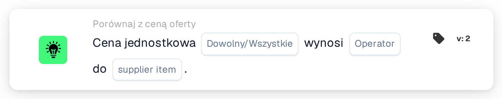

# Cena jednostkowa a cena pozycji dostawcy

<figure><figcaption>
Wersja 2
</figcaption></figure>

## Cel:

Ta karta przepływu pracy porównuje cenę jednostkową w każdym wierszu dokumentu z ceną z tabeli cen pozycji dostawcy: ceną zarządzaną albo ostatnią zapłaconą ceną za tę samą pozycję dostawcy. Można jej używać do sprawdzenia przed zatwierdzeniem dokumentu, czy cena z oferty jest zgodna ze znaną ceną, przekracza ją lub pozostaje poniżej niej. W zależności od wyniku przepływ pracy jest kontynuowany zgodnie z warunkiem prawdziwym lub fałszywym.

## Komponenty karty:

1. **Dowolny/Wszystkie**
   * **Opis:** Określa, czy warunek powinien spełniać jeden wiersz, czy każdy porównany wiersz tabeli dokumentu.
   * **Opcje:**
     * **Każdy:** Warunek jest prawdziwy, jeśli co najmniej jeden porównany wiersz spełnia warunek.
     * **Wszystko:** Warunek jest prawdziwy tylko wtedy, gdy każdy porównany wiersz spełnia warunek.
2. **Operator**
   * **Opis:** Określa, jak cena jednostkowa w dokumencie jest porównywana z wybraną ceną pozycji dostawcy.
   * **Opcje:**
     * **Równa się:** Cena jednostkowa jest taka sama jak cena pozycji dostawcy.
     * **Nie równe:** Cena jednostkowa różni się od ceny pozycji dostawcy.
     * **Większy niż:** Cena jednostkowa jest wyższa niż cena pozycji dostawcy.
     * **Większy lub równy:** Cena jednostkowa jest wyższa od ceny pozycji dostawcy lub taka sama.
     * **Mniej niż:** Cena jednostkowa jest niższa niż cena pozycji dostawcy.
     * **Mniej lub Równe:** Cena jednostkowa jest niższa od ceny pozycji dostawcy lub taka sama.
3. **supplier item**
   * **Opis:** Cena z tabeli cen pozycji dostawcy, z którą porównywana jest cena jednostkowa.
   * **Opcje:**
     * **ManagedPrice:** Cena zarządzana zapisana dla pozycji dostawcy.
     * **LastPrice:** Ostatnia cena zapłacona za pozycję dostawcy.

## Funkcjonalność:

* **Ocena warunku:** Dla każdego wiersza w tabeli dokumentu karta wyszukuje identyfikator pozycji dostawcy z wiersza (kolumna `SUPPLIER_ITEM_NUMBER`) w tabeli cen pozycji dostawcy i porównuje cenę jednostkową wiersza (kolumna `UNIT_PRICE`) z wybraną ceną. Obie ceny są porównywane jako liczby. Wyniki wszystkich porównanych wierszy są następnie łączone za pomocą **Każdy** lub **Wszystko**.
* **Pominięte wiersze:** Wiersz jest wyłączany z porównania, jeśli jego cena jednostkowa jest pusta lub nie można jej odczytać jako liczby albo jeśli dla jego pozycji dostawcy nie zapisano ceny wybranego rodzaju, na przykład dlatego, że pozycji dostawcy nie ma w tabeli cen pozycji dostawcy. Każdy pominięty wiersz jest odnotowywany w dzienniku przepływu pracy wraz ze stroną, po której zabrakło ceny.
* **Wykonanie akcji:**
  * **Warunek prawdziwy:**\
    Ceny jednostkowe spełniają wybrany operator dla dowolnego lub wszystkich porównanych wierszy. Przepływ pracy jest kontynuowany zgodnie z warunkiem prawdziwym, na przykład aby zatwierdzić dokument.
  * **Warunek fałszywy:**\
    Jeśli warunek nie jest spełniony, przepływ pracy jest kontynuowany zgodnie z warunkiem fałszywym, na przykład aby przesłać dokument do weryfikacji cen.
* **Brakujące dane:** Karta nie ocenia warunku i zgłasza brakujące dane w dzienniku przepływu pracy, jeśli:
  * na karcie nie wybrano ceny pozycji dostawcy,
  * dokument nie ma dopasowanych danych oferty,
  * dokument nie ma tabeli, ma więcej niż jedną tabelę lub z tabeli nie udało się odczytać żadnych wierszy,
  * nie udało się porównać żadnego wiersza, ponieważ każdy wiersz został pominięty.

  Jeśli nie ustawiono opcji **Dowolny/Wszystkie**, karta odnotowuje to w dzienniku i używa **Wszystko**.
* **Błędy:** Jeśli wiersz tabeli nie ma kolumny `SUPPLIER_ITEM_NUMBER` lub `UNIT_PRICE`, karta kończy się błędem.

## Instalacja i konfiguracja:

* Kartę można dodać z kategorii **Porównaj z ceną oferty**. Następnie można wybrać **Każdy** lub **Wszystko**, operator oraz, w polu **supplier item**, cenę do porównania. Na koniec ustawia się warunek kontynuacji (prawda lub fałsz), który określa następny krok przepływu pracy.
* Karta działa na dokumentach z dokładnie jedną tabelą, której wiersze zawierają identyfikator pozycji dostawcy oraz cenę jednostkową.

## Podsumowanie:

Karta przepływu pracy „Unit Price to Supplier Item Price” sprawdza ceny z oferty względem ceny zarządzanej lub ostatniej zapłaconej ceny. Wiersze bez ceny po którejkolwiek stronie są pomijane, dzięki czemu pojedynczy niekompletny wiersz nie przesądza o wyniku, a dokument bez żadnego porównywalnego wiersza jest zgłaszany jako brakujące dane.
