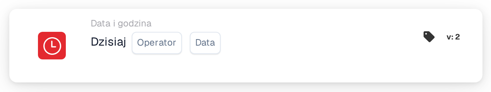

# Dzisiaj

<figure><figcaption>
Wersja 2
</figcaption></figure>

## Cel:

Ta karta przepływu pracy porównuje dzisiejszą datę z datą ustawioną na karcie. Może być używana do reguł, które powinny obowiązywać dopiero od określonej daty lub tylko do niej, na przykład zmiany procesu od planowanej daty rozpoczęcia.

## Komponenty karty:

1. **Operator**
   * **Opis:** Sposób porównania dzisiejszej daty z datą na karcie.
   * **Opcje:**
     * **Równa się:** Dzisiaj jest data z karty.
     * **Nie równe:** Dzisiaj jest dowolny inny dzień.
     * **Większy niż:** Dzisiaj jest po dacie z karty.
     * **Większy lub równy:** Dzisiaj jest data z karty lub dzień późniejszy.
     * **Mniej niż:** Dzisiaj jest przed datą z karty.
     * **Mniej lub równe:** Dzisiaj jest data z karty lub dzień wcześniejszy.
2. **Data**
   * **Opis:** Data, z którą porównywany jest dzisiejszy dzień.

## Funkcjonalność:

* **Ocena warunku:** Gdy przepływ pracy dociera do karty, karta pobiera bieżącą datę w UTC i porównuje ją z datą na karcie przy użyciu operatora. Porównywane są tylko daty; godziny są pomijane. Daty w dokumencie nie mają znaczenia.
* **Wykonanie akcji:**
  * **Warunek prawdziwy:**\
    Jeśli porównanie jest prawdziwe, przepływ pracy jest kontynuowany kolejnymi kartami.
  * **Warunek fałszywy:**\
    Jeśli nie jest prawdziwe, przepływ pracy zatrzymuje się z niespełnionym warunkiem.
* **Brakujące dane:** Jeśli na karcie nie ustawiono daty, karta nie ocenia warunku i zgłasza brakujące dane wejściowe w dzienniku przepływu pracy.

## Instalacja i konfiguracja:

* Kartę można dodać jako warunek And z kategorii **Data i godzina**. Następnie wybiera się operator i datę.
* **Przykład:** Z operatorem **Większy lub równy** i datą `2026-11-01` warunek karty jest spełniony od 1 listopada 2026 r. (UTC), a 31 października 2026 r. nie jest spełniony.
* Ponieważ data jest pobierana w UTC, około północy może się różnić od daty lokalnej: w Europie karta tuż po północy widzi jeszcze poprzedni dzień, a w Ameryce wieczorem widzi już następny dzień.

## Podsumowanie:

Karta przepływu pracy „Today” zamienia datę kalendarzową w warunek przepływu pracy. Reguły oparte na dacie, takie jak data rozpoczęcia lub zakończenia procesu, można skonfigurować raz, a następnie zaczynają obowiązywać automatycznie.
