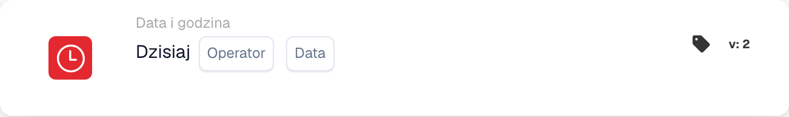

# Dzisiaj

<figure><figcaption>
Pola karty w pokazanej wersji. Pola nie są jeszcze skonfigurowane.
</figcaption></figure>

## **Cel:**

Ta karta DocBits porównuje dzisiejszą datę z określoną datą, umożliwiając przepływom pracy wykonanie na podstawie relacji między bieżącą datą a podaną datą. Jest szczególnie przydatna do automatyzacji opartej na czasie, zarządzania terminami lub wyzwalania zaplanowanych zadań.

## **Funkcjonalność:**

* **Porównanie dat:** Ta karta ocenia dzisiejszą datę względem określonej daty, używając następujących warunków:
  * **Równa się (=):** Sprawdza, czy dzisiejsza data odpowiada określonej dacie.
  * **Nie równa się (≠):** Zapewnia, że dzisiejsza data różni się od określonej daty.
  * **Większy niż (>):** Potwierdza, że dzisiejsza data jest po określonej dacie.
  * **Większe lub równe (≥):** Zapewnia, że dzisiejsza data jest w dniu lub po określonej dacie.
  * **Mniejszy niż (<):** Sprawdza, czy dzisiejsza data jest przed określoną datą.
  * **Mniejszy lub równy (≤):** Zapewnia, że dzisiejsza data jest w dniu lub przed określoną datą.
* **Wprowadzanie daty:** Użytkownicy podają datę do porównania z dzisiejszą datą.

## **Zastosowanie:**

Ta karta jest idealna dla przepływów pracy obejmujących terminy, przypomnienia lub warunki wrażliwe na czas, zapewniając podejmowanie lub ograniczanie akcji na podstawie bieżącej daty.

## **Przykładowy scenariusz:**

* Użytkownik konfiguruje kartę, aby sprawdzić, czy **dzisiaj jest większe niż (>) "2024-11-15"**. Jeśli warunek jest spełniony, przepływ pracy wyzwala powiadomienie uzupełniające dla zaległych zadań. Jeśli nie, przepływ pracy jest kontynuowany bez przerwy.

Korzystając z karty "Today's Date Validation", organizacje mogą zautomatyzować procesy oparte na czasie, efektywnie dotrzymywać terminów i utrzymywać dokładność przepływu pracy.
