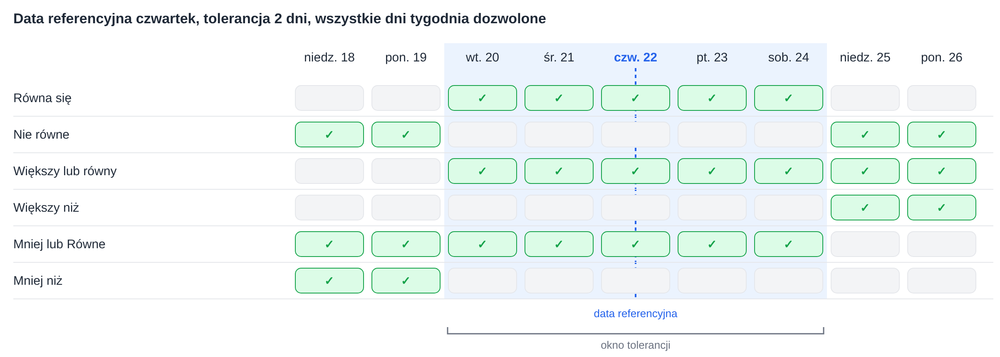
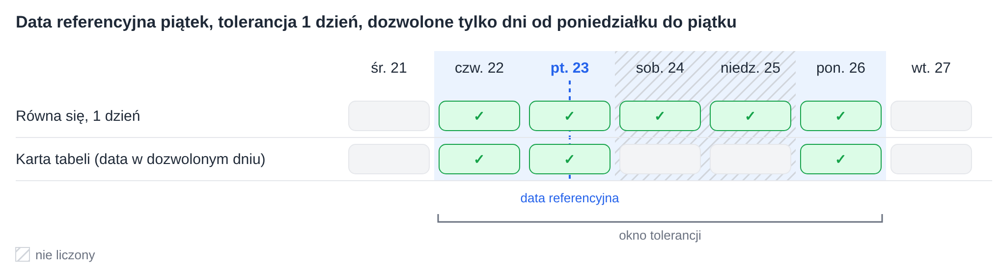
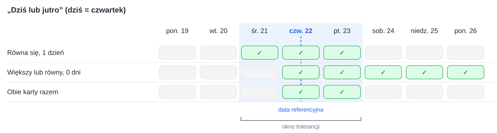

# Tolerancje dat

Kilka kart przepływu pracy porównuje datę z datą referencyjną i akceptuje tolerancję wynoszącą określoną liczbę dni. Wszystkie obliczają tolerancję w ten sam sposób. Ta strona wyjaśnia to obliczenie, znaczenie poszczególnych operatorów, działanie pola **Dozwolone dni tolerancji** oraz sposób łączenia dwóch kart dla zakresów takich jak „dziś lub jutro”.

Karty, które korzystają z tego obliczenia:

* [Table Date to Current Date](table/table-date-to-current-date.md) – data w tabeli dokumentu porównywana z bieżącą datą.
* [Promised delivery date for line items in table with promised delivery date](compare-with-purchase-order/promised-delivery-date-for-line-items-in-table-with-promised-delivery-date/README.md) – obiecane daty dostawy pozycji porównywane z bieżącą datą.
* [Promised Delivery Date on Purchase Order](compare-with-purchase-order/promised-delivery-date-on-purchase-order.md) – daty dostawy pozycji porównywane z datą dostawy w zamówieniu zakupu.

## Okno tolerancji

Od daty referencyjnej tolerancja jest odliczana do tyłu i do przodu. Wynikiem jest **okno tolerancji**: od daty początkowej do daty końcowej, obie włącznie.

* Przy tolerancji **0 dni** okno obejmuje tylko samą datę referencyjną.
* Przy tolerancji **2 dni** okno sięga 2 dni przed datą referencyjną i 2 dni po niej.
* **Bieżąca data** to data na serwerach DocBits, które działają w **UTC**.

Każdy operator porównuje datę z tym oknem:

| Operator | Prawda, gdy data jest … |
|---|---|
| **Równa się** | wewnątrz okna |
| **Nie równe** | poza oknem |
| **Większy lub równy** | w dniu **początku** okna lub później |
| **Większy niż** | po **końcu** okna |
| **Mniej lub Równe** | w dniu **końca** okna lub wcześniej |
| **Mniej niż** | przed **początkiem** okna |

Warto zauważyć, że tolerancja poszerza również **Większy lub równy** i **Mniej lub Równe**: przy 2 dniach **Większy lub równy** akceptuje już datę 2 dni przed datą referencyjną.

<figure><figcaption>
Data referencyjna czwartek 22, tolerancja 2 dni: okno trwa od wtorku 20 do soboty 24.
</figcaption></figure>

## Dozwolone dni tolerancji

Karty oferujące pole **Dozwolone dni tolerancji** przy obliczaniu okna liczą tylko wybrane dni tygodnia. Niewybrane dni tygodnia są pomijane przy liczeniu, ale pozostają wewnątrz okna.

**Przykład:** data referencyjna piątek, tolerancja 1 dzień, wybrane tylko dni od poniedziałku do piątku. Odliczanie do tyłu dochodzi do czwartku. Odliczanie do przodu pomija sobotę i niedzielę i dochodzi do poniedziałku. Okno obejmuje **od czwartku do poniedziałku**.

**Table Date to Current Date** dodaje jeszcze jedną kontrolę: data w tabeli powinna również przypadać na jeden z wybranych dni tygodnia. Sobota wewnątrz okna nie jest więc akceptowana przez tę kartę. Dwie pozostałe karty nie mają tej dodatkowej kontroli.

<figure><figcaption>
Liczone są tylko dni od poniedziałku do piątku, więc 1 dzień po piątku to poniedziałek.
</figcaption></figure>

## Przykład: dziś lub jutro

Pojedyncza karta nie może akceptować dokładnie zakresu „dziś lub jutro”, ponieważ okno zawsze sięga tej samej liczby dni w obu kierunkach. Mogą to zrobić dwie karty umieszczone jedna po drugiej:

1. **Równa się** z tolerancją **1 dzień** akceptuje wczoraj, dziś i jutro.
2. **Większy lub równy** z tolerancją **0 dni** akceptuje dziś i każdy późniejszy dzień.

Pozostają tylko daty, które przechodzą przez obie karty: **dziś i jutro**.

<figure><figcaption>
Dziś jest czwartek 22: razem obie karty akceptują czwartek 22 i piątek 23.
</figcaption></figure>

W ten sam sposób można tworzyć inne zakresy:

| Zakres | Pierwsza karta | Druga karta |
|---|---|---|
| Dziś lub jutro | **Równa się**, 1 dzień | **Większy lub równy**, 0 dni |
| Wczoraj lub dziś | **Równa się**, 1 dzień | **Mniej lub Równe**, 0 dni |
| Od dziś do 3 dni naprzód | **Równa się**, 3 dni | **Większy lub równy**, 0 dni |
| Nie dziś | **Nie równe**, 0 dni | – |
| Od pojutrza | **Większy niż**, 1 dzień | – |

Gdy jako **Dozwolone dni tolerancji** wybrano tylko dni od poniedziałku do piątku, „jutro” w piątek oznacza następny poniedziałek.

## Podsumowanie

Wszystkie karty dat z tolerancją używają jednego okna wokół daty referencyjnej. Znajomość początku i końca okna pozwala jasno określić, co akceptuje każdy operator, a dwie karty razem mogą obejmować zakresy, których pojedyncza karta nie obejmuje.
