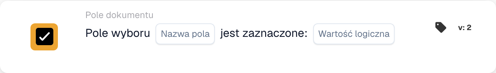

# Pole wyboru jest zaznaczone

<figure><figcaption>
Pola karty w pokazanej wersji. Pola nie są jeszcze skonfigurowane.
</figcaption></figure>

## Kiedy używać

Użyj tej karty, gdy dalsza akcja ma zależeć od stanu pola wyboru w dokumencie, na przykład od zaznaczenia zakończenia kontroli. Karta sprawdza warunek podczas wykonania workflow. Nie zmienia pola i nie uruchamia samodzielnie procesu; wyzwalacz oraz dalsze akcje konfiguruje się osobno.

**Gdzie:** Standardowy workflow → dodatkowe warunki (AND) → Pole dokumentu → warunek pola wyboru.

## Konfiguracja — wersja 2

| Ustawienie | Wartość w filmie |
| --- | --- |
| Nazwa pola | `validation_complete` — istniejące pole oznaczające zakończenie kontroli |
| Wartość logiczna | `true` — pole ma być zaznaczone |

Wpisz dokładny identyfikator pola i zatwierdź go klawiszem Enter, a następnie wybierz wartość porównania. Użyj pola rzeczywiście skonfigurowanego w Twojej organizacji. `validation_complete` jest identyfikatorem z przykładu, a nie obowiązkową nazwą pola.

Wybór `false` sprawdza pole niezaznaczone. Przed włączeniem reguły upewnij się, że wybrane pole jest polem logicznym. Dla istniejącego pola wartość `null` jest w wersji 2 traktowana jak `false`; brak całego pola jest odrębnym przypadkiem.

<!-- workflow-card-practical-example-20261021 -->

## Praktyczny przykład

Kontynuuj obsługę faktury dopiero po zaznaczeniu pola zakończenia kontroli. Dla konfiguracji `validation_complete` i `true`:

| Wartość dokumentu | Oczekiwany wynik |
| --- | --- |
| Istniejące pole ma wartość `true` — zaznaczone | Warunek spełniony |
| Istniejące pole ma wartość `false` — niezaznaczone | Warunek niespełniony |
| Istniejące pole ma wartość `null` | Warunek niespełniony — oceniane jako `false` |
| Pole nie istnieje w dokumencie | `NOT_FOUND_IN_DOCUMENT` — odrębny wynik błędu |

Są to oczekiwane wyniki przykładu. Brak pola nie potwierdza zakończenia kontroli i nie jest tym samym co istniejące niezaznaczone pole.

## Film z przykładem administratora

Kiedy używam karty, gdzie ją znaleźć i jak porównać stan pola wyboru. Przykłady pokazują oczekiwane wyniki.



[Otwórz film z polskimi napisami](https://docbits-videos.fra1.cdn.digitaloceanspaces.com/settings-assistant/workflow-card-checkbox-admin/v2/pl.html)

[Przeczytaj transkrypcję](https://docbits-videos.fra1.cdn.digitaloceanspaces.com/settings-assistant/workflow-card-checkbox-admin/v2/pl.txt)
