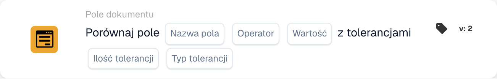

# Porównaj pole z tolerancjami

<figure><figcaption>
Pola karty w pokazanej wersji. Pola nie są jeszcze skonfigurowane.
</figcaption></figure>

## Kiedy używać tej karty

Użyj tego warunku, aby porównać pole liczbowe dokumentu ze stałą wartością odniesienia i dopuścić określone odchylenie. Na przykład kwota całkowita może odpowiadać wartości 100, jeśli różnica nie przekracza 5.

## Gdzie znaleźć kartę

W standardowym projektancie workflow dodaj kartę w sekcji **I**, otwórz **Pole dokumentu** i wybierz porównanie jednego pola z wartością odniesienia i tolerancjami. Poniższy przykład używa wersji 2.

## Ustawienia

Użyj pola liczbowego skonfigurowanego w organizacji. Wartość pola, wartość odniesienia i tolerancja są oceniane liczbowo. Zachowaj zgodność jednostek.

| Ustawienie | Znaczenie |
| --- | --- |
| Nazwa pola | Skonfigurowane pole dokumentu, np. `total_amount`. |
| Operator | Porównanie: `eq`, `neq`, `gt`, `ge`, `lt` lub `le`. |
| Wartość odniesienia | Stała liczba, z którą porównywane jest pole. |
| Tolerancja | Dopuszczalne odchylenie liczbowe. |
| Typ tolerancji | **Wartość** (`value`) oznacza odchylenie bezwzględne, a **Procent** (`percent`) — odchylenie względne. |

Przy dodatniej wartości odniesienia 200 tolerancja procentowa 5 dopuszcza odchylenie 10. Tolerancja bezwzględna 5 dopuszcza odchylenie 5. Sprawdź odpowiednie przypadki graniczne dla wybranego operatora i wartości.

## Jak tolerancja zmienia porównanie

Przy wartości odniesienia **100** i tolerancji bezwzględnej **5** dolna granica wynosi **95**, a górna **105**.

| Operator | Warunek jest spełniony, gdy wartość pola… |
| --- | --- |
| `eq` (=) | Mieści się między 95 a 105, łącznie z obiema granicami. |
| `neq` (≠) | Jest mniejsza od 95 lub większa od 105. |
| `gt` (>) | Jest większa od 105. |
| `ge` (≥) | Wynosi co najmniej 95. |
| `lt` (<) | Jest mniejsza od 95. |
| `le` (≤) | Wynosi co najwyżej 105. |

Karta zwraca wynik warunku. Kolejne kroki zależą od wyzwalacza, pozostałych warunków i akcji skonfigurowanych w workflow.

<!-- workflow-card-complete-example-20261021 condition_docfield_operator_value_tolerances -->

## Przykład praktyczny

1. Wybierz skonfigurowane pole liczbowe **Całkowita kwota** (`total_amount`).
2. Wybierz **Równa się** (`eq`).
3. Wprowadź wartość odniesienia **100** i tolerancję **5**.
4. Wybierz typ tolerancji **Wartość** (`value`).

| Wartość pola | Różnica bezwzględna względem 100 | Oczekiwany wynik |
| --- | --- | --- |
| 103 | 3 | Warunek spełniony. |
| 110 | 10 | Warunek niespełniony. |
| 95 lub 105 | 5 | Warunek spełniony: porównanie równości obejmuje granice tolerancji. |

Są to oczekiwane wyniki obliczeń dla przykładowej konfiguracji. Na potrzeby tego przykładu nie uruchomiono workflow.

## Przed aktywacją reguły

Sprawdź przypadek spełniający warunek, przypadek niespełniający go oraz granice, używając odpowiednich danych testowych. Oddzielnie zbadaj brakujące pola, wartości nieliczbowe i błędy konfiguracji. W dzienniku wykonania sprawdź faktycznie użyte wartości, operator, tolerancję i wynik.

Jeśli obie kwoty pochodzą z pól dokumentu, użyj osobnej karty do [porównywania dwóch pól z tolerancją](compare-two-fields-with-tolerance.md).
