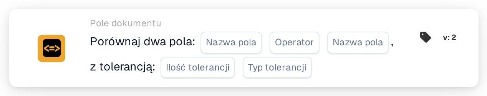

# Porównaj dwa pola z tolerancją

<figure><figcaption>
Wersja 2
</figcaption></figure>

## **Cel:**

Ta karta przepływu pracy służy do automatyzacji akcji poprzez porównanie wartości dwóch określonych pól dokumentu, z dodatkową możliwością zastosowania wartości tolerancji. Funkcja ta umożliwia systemowi uwzględnienie marginesu błędu (tolerancji) podczas porównywania wartości pól, pozwalając na bardziej elastyczne podejmowanie decyzji w przepływach pracy.

## **Komponenty karty:**

1. **Nazwa pola (1)**
   * **Opis:** Określa pierwsze pole dokumentu do porównania.
   * **Szczegóły:** Musi to odpowiadać dokładnemu identyfikatorowi pierwszego pola w dokumencie.
2. **Operatora**
   * **Opis:** Definiuje typ porównania, który ma być wykonany między dwoma polami.
   * **Opcje:**
     * **Równa się (=):** Sprawdza, czy wartości dwóch pól są równe.
     * **Nie równa się (≠):** Zapewnia, że wartości dwóch pól są różne.
     * **Większy niż (>):** Potwierdza, że wartość pierwszego pola jest większa niż drugiego pola.
     * **Większe lub równe (≥):** Weryfikuje, że wartość pierwszego pola jest równa lub większa niż drugiego pola.
     * **Mniejszy niż (<):** Sprawdza, czy wartość pierwszego pola jest mniejsza niż drugiego pola.
     * **Mniejszy lub równy (≤):** Zapewnia, że wartość pierwszego pola jest mniejsza lub równa drugiemu polu.
3. **Nazwa pola (2)**
   * **Opis:** Określa drugie pole dokumentu do porównania z pierwszym polem.
   * **Szczegóły:** Powinno to odpowiadać dokładnemu identyfikatorowi drugiego pola w dokumencie.
4. **Kwota tolerancji**
   * **Opis:** Definiuje akceptowalny margines błędu dla porównania.
   * **Szczegóły:** Kwota tolerancji jest wartością liczbową wskazującą maksymalną dopuszczalną różnicę między dwiema wartościami pól, aby porównanie zostało uznane za prawdziwe.
5. **Typ tolerancji**
   * **Opis:** Określa jednostkę miary dla kwoty tolerancji.
   * **Opcje:**
     * **Wartość:** Tolerancja jest wartością bezwzględną, co oznacza, że dwa pola mogą różnić się o określoną kwotę tolerancji.
     * **Percent:** Tolerancja jest obliczana jako procent wartości drugiego pola, dopuszczając względny margines błędu.

## **Funkcjonalność:**

* **Ocena warunku:** System ocenia, czy wartości w dwóch określonych polach spełniają warunek porównania, z uwzględnieniem zdefiniowanej tolerancji. Jeśli bezwzględna lub względna różnica między dwoma polami mieści się w tolerancji, warunek jest uznawany za prawdziwy.
* **Wykonanie akcji:**
  * **Warunek prawdziwy:**\
    Jeśli wartości dwóch pól, po uwzględnieniu tolerancji, odpowiadają warunkowi porównania, system wyzwala powiązane akcje. Akcje te mogą obejmować kontynuowanie przepływu pracy, aktualizację rekordów, wyzwalanie alertów lub włączanie określonych operacji.
  * **Warunek fałszywy:**\
    Jeśli wartości dwóch pól, po uwzględnieniu tolerancji, nie odpowiadają określonemu warunkowi, mogą zostać wykonane alternatywne akcje lub żadne, w zależności od konfiguracji przepływu pracy.

## **Konfiguracja:**

* Użytkownicy konfigurują kartę, wybierając dwa pola do porównania z listy dostępnych pól w systemie. Operator jest wybierany z listy rozwijanej dostępnych opcji porównania. Użytkownicy wprowadzają kwotę tolerancji i wybierają typ tolerancji (value lub percent).

## **Podsumowanie:**

Karta przepływu pracy "Compare Two Fields with Tolerance" jest potężnym narzędziem do porównywania pól dokumentu z uwzględnieniem dopuszczalnych odchyleń w danych. Stosując tolerancję do porównań pól, karta ta dodaje elastyczność do przepływu pracy, umożliwiając obsługę rzeczywistych różnic danych. Poprawia podejmowanie decyzji, wspiera walidację danych i zwiększa ogólną automatyzację przepływu pracy.

<!-- workflow-card-practical-example-20261021 -->

## Praktyczny przykład

**Kiedy stosować:** Zaakceptuj niewielką różnicę między kwotą wyodrębnioną a kwotą obliczoną oddzielnie.

**Konfiguracja:** Wybierz pola numeryczne `net_total` i `calculated_total`, porównanie równości i tolerancję absolutną `5`. Użyj wartości `103` i `100`.

**Oczekiwany wynik i kontrprzykład:** Różnica wynosi `3`, więc mieści się w granicach tolerancji. W przypadku `110` i `100` różnica wynosi `10` i warunek równości z tolerancją nie jest spełniony.

To jest ilustracyjna konfiguracja i oczekiwany wynik. Korzystaj z pól, użytkowników i grup skonfigurowanych w Twojej organizacji testowej; nie jest to twierdzenie, że ten przykład został wykonany.
