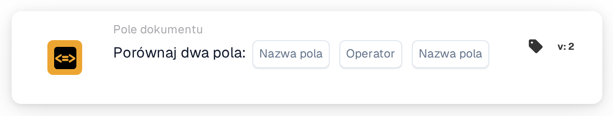

# Porównaj dwa pola

<figure><figcaption>
Wersja 2
</figcaption></figure>

## **Cel:**

Ta karta przepływu pracy służy do automatyzacji akcji poprzez porównanie wartości dwóch określonych pól dokumentu. Umożliwia dynamiczne podejmowanie decyzji na podstawie danych pól i zapewnia, że przepływy pracy są wykonywane na podstawie porównań między różnymi wartościami dokumentu.

## **Komponenty karty:**

1. **Nazwa pola (1)**
   * **Opis:** Określa pierwsze pole dokumentu do porównania.
   * **Szczegóły:** Musi to odpowiadać dokładnemu identyfikatorowi pierwszego pola w dokumencie.
2. **Operatora**
   * **Opis:** Definiuje typ porównania, który ma być wykonany między dwoma polami.
   * **Opcje:**
     * **Równa się (=):** Sprawdza, czy wartości dwóch pól są równe.
     * **Nie równa się (≠):** Zapewnia, że wartości dwóch pól są różne.
     * **Większy niż (>):** Potwierdza, że wartość pierwszego pola jest większa niż drugiego pola.
     * **Większe lub równe (≥):** Weryfikuje, że wartość pierwszego pola jest równa lub większa niż drugiego pola.
     * **Mniejszy niż (<):** Sprawdza, czy wartość pierwszego pola jest mniejsza niż drugiego pola.
     * **Mniejszy lub równy (≤):** Zapewnia, że wartość pierwszego pola jest mniejsza lub równa drugiemu polu.
3. **Nazwa pola (2)**
   * **Opis:** Określa drugie pole dokumentu do porównania z pierwszym polem.
   * **Szczegóły:** Powinno to odpowiadać dokładnemu identyfikatorowi drugiego pola w dokumencie.

## **Funkcjonalność:**

**Ocena warunku:** System ocenia, czy wartości w dwóch określonych polach spełniają warunek porównania zdefiniowany przez operator.

**Wykonanie akcji:**

* **Warunek prawdziwy:**\
  Jeśli wartości dwóch pól odpowiadają warunkowi porównania, system wyzwala powiązane akcje. Akcje te mogą obejmować aktualizację rekordów lub wyzwalanie alertów.
* **Warunek fałszywy:**\
  Jeśli wartości dwóch pól nie odpowiadają określonemu warunkowi, mogą zostać wykonane alternatywne akcje lub żadne, w zależności od konfiguracji przepływów pracy.

## **Konfiguracja:**

* Użytkownicy konfigurują kartę, wybierając dwa pola do porównania z listy dostępnych pól w systemie. Operator jest wybierany z listy rozwijanej dostępnych opcji porównania.

## **Podsumowanie:**

Karta przepływu pracy "Compare Two Fields" jest niezbędnym narzędziem do porównywania danych między polami w dokumentach. Automatyzując akcje na podstawie porównań pól, karta ta pomaga zoptymalizować podejmowanie decyzji, wspiera walidację danych i zwiększa automatyzację przepływu pracy.

<!-- workflow-card-practical-example-20261021 -->

## Praktyczny przykład

**Kiedy używać:** Sprawdź, czy skopiowany odnośnik jest równy oryginalnemu odnośnikowi.

**Konfiguracja:** Wybierz pola tekstowe `purchase_order_number` i `confirmed_order_number` oraz operator równości.

**Oczekiwany wynik i kontrprzykład:** Wartości `PO-DEMO-001` i `PO-DEMO-001` spełniają. Druga wartość `PO-DEMO-002` kończy się niepowodzeniem.

To jest ilustracyjna konfiguracja i oczekiwany wynik. Korzystaj z pól, użytkowników i grup skonfigurowanych w Twojej organizacji testowej; nie jest to twierdzenie, że ten przykład został wykonany.
