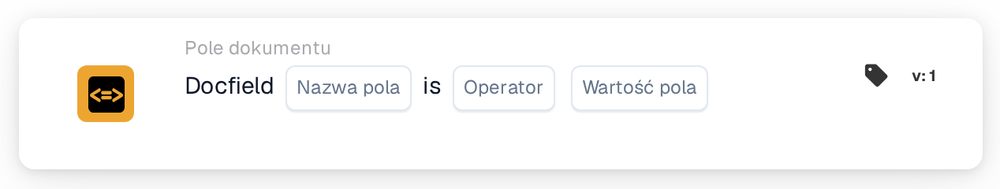

# Porównanie pola dokumentu z wartością odniesienia

<figure><figcaption>
Wersja 1
</figcaption></figure>

<figure><figcaption>
Wersja 2
</figcaption></figure>

## **Cel:**

Ta karta przepływu pracy służy do automatyzacji akcji poprzez porównanie wartości określonego pola dokumentu z wartością referencyjną lub warunkiem. Zapewnia dynamiczne i dokładne podejmowanie decyzji w przepływach pracy na podstawie walidacji danych dokumentu.

## **Komponenty karty:**

1. **Nazwa pola**
   * **Opis:** Określa nazwę pola dokumentu, które ma być oceniane.
   * **Szczegóły:** Musi to odpowiadać dokładnemu identyfikatorowi pola w dokumencie.
2. **Operatorzy**
   * **Opis:** Definiuje typ porównania, który ma być wykonany między wartością pola a wartością referencyjną.
   * **Opcje:**
     * **Równa się (=):** Sprawdza, czy wartość pola odpowiada wartości referencyjnej.
     * **Nie równa się (≠):** Zapewnia, że wartość pola różni się od wartości referencyjnej.
     * **Większy niż (>):** Potwierdza, że wartość pola jest większa niż wartość referencyjna.
     * **Większe lub równe (≥):** Weryfikuje, że wartość pola jest równa lub większa niż wartość referencyjna.
     * **Mniejszy niż (<):** Sprawdza, czy wartość pola jest mniejsza niż wartość referencyjna.
     * **Mniejszy lub równy (≤):** Zapewnia, że wartość pola jest mniejsza lub równa wartości referencyjnej.

## **Funkcjonalność:**

* **Ocena warunku:** System sprawdza, czy wartość pola dokumentu, w odniesieniu do powiązanej z nim kolumny, spełnia warunek porównania określony przez operator i wartość referencyjną.
* **Wykonanie akcji:**
  * **Warunek prawdziwy:**\
    Jeśli wartość pola dokumentu spełnia określony warunek (np. równa się wartości referencyjnej), system wyzwala powiązane akcje. Mogą one obejmować aktualizację rekordów, kontynuowanie przepływu pracy lub generowanie powiadomień.
  * **Warunek fałszywy:**\
    Jeśli wartość pola dokumentu nie spełnia określonego warunku, wykonywane są alternatywne akcje lub żadne, na podstawie konfiguracji przepływu pracy.

## **Konfiguracja:**

* Użytkownik wybiera nazwę pola odpowiedniego dokumentu i wybiera operator z menu rozwijanego. Następnie użytkownik określa wartość pola referencyjnego, aby zakończyć konfigurację.

## **Podsumowanie:**

Karta przepływu pracy "DocField Comparison Validation" jest niezawodnym narzędziem do dynamicznego przetwarzania dokumentów. Automatyzując akcje na podstawie porównań pól, karta ta usprawnia przepływy pracy, zwiększa dokładność i wspiera podejmowanie decyzji opartych na danych.

<!-- workflow-card-practical-example-20261021 -->

## Praktyczny przykład

**Kiedy używać:** Przeglądanie faktur powyżej określonej kwoty.

**Konfiguracja:** Wybierz pole numeryczne `total_amount`, operator `>` i wartość referencyjną `1000`.

**Oczekiwany wynik i kontrprzykład:** Wartość `1200` spełnia warunek. Wartości `1000` i `900` go nie spełniają: operator `>` wymaga wartości większej niż `1000`.

To jest ilustracyjna konfiguracja i oczekiwany wynik. Korzystaj z pól, użytkowników i grup skonfigurowanych w Twojej organizacji testowej; nie jest to twierdzenie, że ten przykład został wykonany.
