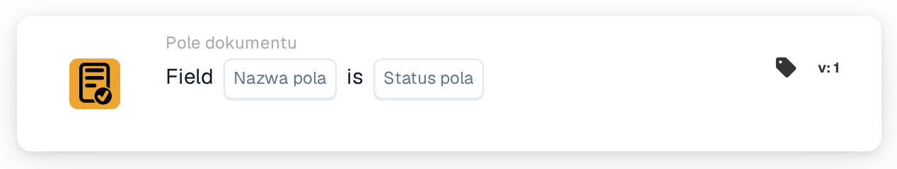
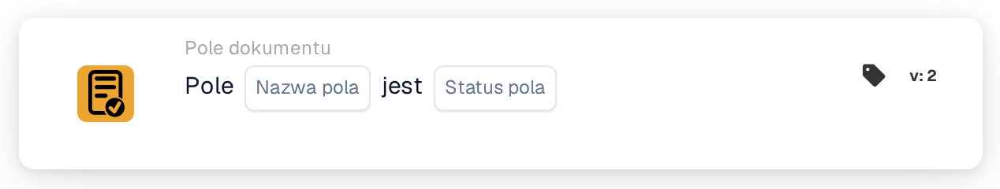

# Sprawdzanie obecności i zawartości pola dokumentu

<figure><figcaption>
Wersja 1
</figcaption></figure>

<figure><figcaption>
Wersja 2
</figcaption></figure>

## Kiedy używać

Użyj tej karty, aby sprawdzić, czy pole dokumentu jest puste lub nieobecne, na przykład gdy faktura nie ma numeru i wymaga dodatkowej kontroli. To warunek; dalszą akcję konfiguruje się osobno.

**Gdzie:** Standardowy workflow → dodatkowe warunki (AND) → Pole dokumentu.

## Konfiguracja — wersja 2

| Ustawienie | Wartość w przykładzie |
| --- | --- |
| Pole | `invoice_id` — numer faktury |
| Stan pola | Puste lub nieobecne (`field_empty`) |

Wybierz rzeczywiste pole skonfigurowane w swojej organizacji. Opcja `field_not_empty` sprawdza, czy pole zawiera wartość.

<!-- workflow-card-practical-example-20261021 -->

## Praktyczny przykład

| Przykładowa wartość | Oczekiwany wynik dla `field_empty` |
| --- | --- |
| Puste lub nieobecne pole | Warunek spełniony |
| `DEMO-001` | Warunek niespełniony |
| Numer obecny, lecz niepoprawny | Warunek niespełniony — pole nadal zawiera wartość |

Są to przykłady oczekiwanych wyników. Do sprawdzania poprawności samego numeru dodaj odpowiedni warunek oceniający treść; ta karta sprawdza stan pola. W wersji 2 spacje są usuwane z początku i końca tekstu przed oceną pustego pola.

## Film z przykładem administratora

Kiedy używam karty, gdzie ją znaleźć i jak wykrywać brakujące numery faktur. Przykłady pokazują oczekiwane wyniki.



[Otwórz film z polskimi napisami](https://docbits-videos.fra1.cdn.digitaloceanspaces.com/settings-assistant/workflow-card-field-status-admin/v1/pl-theme-v4.html)

[Przeczytaj transkrypcję](https://docbits-videos.fra1.cdn.digitaloceanspaces.com/settings-assistant/workflow-card-field-status-admin/v1/pl.txt)
