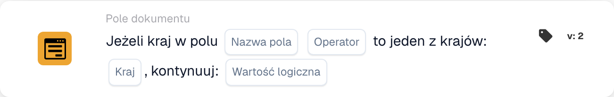

# Jeśli kraj w polu jest jednym z

<figure><figcaption>
Pola karty w pokazanej wersji. Pola nie są jeszcze skonfigurowane.
</figcaption></figure>

Użyj tego warunku, gdy dodatkowy etap przetwarzania ma dotyczyć dokumentów z wybranych krajów, na przykład Niemiec i Francji. Karta porównuje kraj odczytany z pola dokumentu ze skonfigurowaną listą krajów.

**Miejsce:** Standardowy workflow → warunki dodatkowe (AND) → Pole dokumentu. Kolejną akcję skonfiguruj osobno w THEN.

## Konfiguracja — wersja 2

| Ustawienie | Wartość |
| --- | --- |
| Pole | Istniejące pole tekstowe zawierające nazwę kraju |
| Operator | `is` |
| Kraje | `Germany, France` |
| Wartość kontynuacji | `true` |

<!-- workflow-card-practical-example-20261021 -->

## Praktyczny przykład

| Wartość kraju w polu | Oczekiwany warunek |
| --- | --- |
| `Germany` | Spełniony |
| `France` | Spełniony |
| `United States` | Niespełniony |

Nazwy krajów zapisane jako kod są stałymi wartościami wejściowymi w tym przykładzie.

## Ograniczenia i kontrole

`false` nie odwraca porównania. Przy tym ustawieniu nawet pasujący kraj nie daje pozytywnego wyniku warunku. Aby sprawdzić warunek przeciwny, wybierz `isnot` z `true`.

Obsługuj osobno brakujące pola i puste wartości kraju: mogą zwrócić wynik braku danych zamiast zwykłego braku dopasowania.

Analiza kodu źródłowego wersji rozwojowej z 22 października 2026 r. wykazuje błąd konwersji danych ISO, takich jak `DE` i `DEU`. Dlatego przykłady używają pełnych nazw krajów. Osobno sprawdź obsługę kodów ISO w zainstalowanej wersji.
