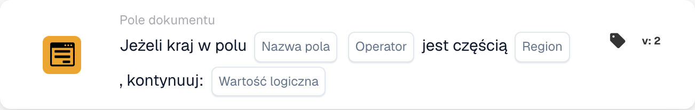

# Jeśli kraj w polu

<figure><figcaption>
Pola karty w pokazanej wersji. Pola nie są jeszcze skonfigurowane.
</figcaption></figure>

Planowane zastosowanie: dodatkowy etap przetwarzania zależy od grupy krajów. Poniższy przykład opisuje regułę przynależności do Unii Europejskiej.

## Bieżące ograniczenie — kod źródłowy sprawdzony 22 października 2026 r.

Lokalne testy kodu źródłowego z natywnym typem wyboru regionu kończą się przed porównaniem kraju i zwracają `missing_variable` lub `error`. Pełne nazwy krajów nie pozwalają ominąć tego problemu. Dla tej wersji nie potwierdzono poprawnego wykonania na wdrożonym backendzie.

**Miejsce:** Standardowy workflow → warunki dodatkowe (AND) → Pole dokumentu. Kolejną akcję skonfiguruj osobno w THEN.

## Konfiguracja — wersja 2

| Ustawienie | Wartość |
| --- | --- |
| Pole | Istniejące pole tekstowe zawierające nazwę kraju |
| Operator | `is` |
| Region | Unia Europejska (UE) |
| Wartość kontynuacji | `true` |

<!-- workflow-card-practical-example-20261021 -->

## Planowany przykład — sprawdź poprawkę przed użyciem

Przed włączeniem reguły sprawdź poprawkę i oba przypadki przykładu w zainstalowanej wersji. Tabela opisuje planowaną regułę biznesową, a nie potwierdzone poprawne wykonanie.

| Wartość kraju w polu | Planowany podział krajów |
| --- | --- |
| `Germany` | W UE |
| `United States` | Poza UE |

Nazwy krajów zapisane jako kod są stałymi wartościami wejściowymi w tym przykładzie.

## Ograniczenia i kontrole

`false` nie odwraca porównania. Przy tym ustawieniu nawet pasujący kraj nie daje pozytywnego wyniku warunku. Aby sprawdzić warunek przeciwny, wybierz `isnot` z `true`.

Obsługuj osobno brakujące pola i puste wartości kraju: mogą zwrócić wynik braku danych zamiast zwykłego braku dopasowania.

Problem konwersji ISO dla danych takich jak `DE` i `DEU` jest niezależny. Zastąpienie kodów ISO pełnymi nazwami krajów nie usuwa błędu wyboru regionu.

Dostępne grupy, w tym UE, Schengen i NAFTA, pochodzą z implementacji karty. Przed użyciem grupy w regule biznesowej sprawdź kraje uwzględnione w swojej wersji.
