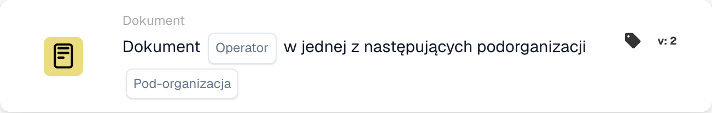

# Dokument

Karty tej kategorii w przeglądarce **Dodaj kartę** Kreatora przepływów:

<figure><figcaption>
Karty dostępne w wybranej kategorii. Uzupełnij pola przed użyciem. Niektóre etykiety tej wersji interfejsu nie są jeszcze przetłumaczone lub mają nieprawidłowe tłumaczenie. Objaśnienia na tej stronie używają właściwych terminów; obraz przedstawia rzeczywisty interfejs.
</figcaption></figure>

<!-- workflow-card-example-condition_sub_org_is_isnot_in_list-20261021 -->

### Dokumentuj w jednej z kilku podorganizacji

<figure><figcaption>
Pola karty w pokazanej wersji. Pola nie są jeszcze skonfigurowane.
</figcaption></figure>

`CONDITION_SUB_ORG_IS_ISNOT_IN_LIST` · wersja 2

Wybierz jest jedną z i skonfigurowanych organizacji podrzędnych `Demo North` i `Demo South`. Dokument należący do którejkolwiek z wybranych jednostek przechodzi; `Demo Default` kończy się niepowodzeniem. Sprawdza to podorganizację dokumentu; to tego nie zmienia.
