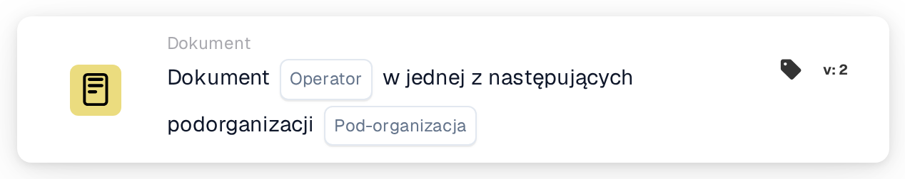

# Operator dokumentów dla podorganizacji jeden z

<figure><figcaption>
Wersja 2
</figcaption></figure>

## Cel:

Ta karta przepływu pracy sprawdza, czy dokument należy do jednej z kilku podorganizacji. Zamiast porównywać dokument z jedną podorganizacją, porównuje go z listą. Dzięki temu jedna karta obejmuje całą grupę podorganizacji, które mają być obsługiwane w ten sam sposób. W zależności od wyniku przepływ pracy jest kontynuowany zgodnie z warunkiem prawdziwym lub fałszywym.

Do porównania z jedną podorganizacją można użyć karty **Document Operator for Sub-Organizations**.

## Komponenty karty:

1. **Operator**
   * **Opis:** Określa, czy dokument powinien należeć do jednej z wymienionych podorganizacji, czy do żadnej z nich.
   * **Opcje:**
     * **Is:** Warunek jest prawdziwy, jeśli podorganizacja dokumentu jest jedną z wymienionych podorganizacji.
     * **Is Not:** Warunek jest prawdziwy, jeśli podorganizacji dokumentu nie ma na liście.
2. **Sub-org**
   * **Opis:** Lista podorganizacji, z którymi porównywany jest dokument.
   * **Szczegóły:** Można wybrać jedną lub kilka podorganizacji organizacji. Porównywana jest podorganizacja, do której przypisany jest dokument.

## Funkcjonalność:

* **Ocena warunku:** System odczytuje podorganizację dokumentu i sprawdza, czy jest ona jedną z podorganizacji wybranych na karcie.
* **Wykonanie akcji:**
  * **Warunek prawdziwy:**\
    Przy **Is** podorganizacja dokumentu jest na liście, przy **Is Not** jej tam nie ma. Przepływ pracy jest kontynuowany zgodnie z warunkiem prawdziwym, na przykład aby przekazać dokument zespołowi odpowiedzialnemu za te podorganizacje lub zastosować reguły obowiązujące tylko dla nich.
  * **Warunek fałszywy:**\
    Jeśli warunek nie jest spełniony, przepływ pracy jest kontynuowany zgodnie z warunkiem fałszywym, na przykład aby zastosować reguły ogólne lub przekazać dokument w inne miejsce.
* **Brakujące dane:** Jeśli dokument nie jest przypisany do żadnej podorganizacji lub na karcie nie wybrano żadnej podorganizacji, karta nie ocenia warunku. Zgłasza brakujące dane w dzienniku przepływu pracy zamiast kontynuować zgodnie z warunkiem fałszywym.

## Konfiguracja:

* Kartę można dodać z kategorii **Dokument**. Następnie można wybrać operator (**Is** lub **Is Not**) i w polu **Sub-org** podorganizacje, z którymi ma nastąpić porównanie. Na koniec ustawia się warunek kontynuacji (prawda lub fałsz), który określa następny krok przepływu pracy.

## Podsumowanie:

Karta przepływu pracy „Document Operator for Sub-Organizations one of” pozwala jednym warunkiem objąć kilka podorganizacji jednocześnie. Dzięki temu przepływy pracy pozostają krótkie, gdy kilka podorganizacji ma te same reguły przetwarzania, a dokumenty są obsługiwane we właściwym kontekście organizacyjnym.
