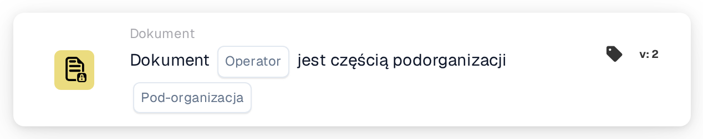

# Operator dokumentów dla podorganizacji

<figure><figcaption>
Wersja 2
</figcaption></figure>

## Cel:

Ta karta przepływu pracy ocenia, czy dokument należy do określonej sub-organizacji. Na podstawie tej oceny przepływ pracy może być kontynuowany lub wyzwalać różne akcje w zależności od tego, czy dokument jest powiązany z określoną sub-organizacją, czy nie.

## Komponenty karty:

1. **Operatora**
   * **Opis:** Definiuje, czy dokument musi należeć do określonej sub-organizacji, czy nie.
   * **Opcje:**
     * **Is:** Dokument musi należeć do określonej sub-organizacji, aby warunek był prawdziwy.
     * **Nie jest:** Dokument nie może należeć do określonej sub-organizacji, aby warunek był prawdziwy.
2. **Podorganizacja**
   * **Opis:** Określa sub-organizację, z którą porównywany ma być dokument.
   * **Szczegóły:** Powinno to odpowiadać identyfikatorowi sub-organizacji. Porównanie sprawdza, czy dokument należy do określonej sub-organizacji.

## Funkcjonalność:

* **Ocena warunku:** System ocenia, czy dokument należy do określonej sub-organizacji. Ocena ta sprawdza sub-organizację dokumentu względem tej podanej przez użytkownika.
* **Wykonanie akcji:**
  * **Warunek prawdziwy:**\
    Jeśli dokument należy do określonej sub-organizacji, przepływ pracy jest kontynuowany z warunkiem prawdziwym. Może to wyzwolić dalsze akcje, takie jak przekierowanie dokumentu do określonego działu, zastosowanie reguł specyficznych dla sub-organizacji lub włączenie funkcji dostosowanych do tej sub-organizacji.
  * **Warunek fałszywy:**\
    Jeśli dokument nie należy do określonej sub-organizacji, przepływ pracy jest kontynuowany z warunkiem fałszywym. Umożliwia to wykonanie alternatywnych akcji, takich jak wysyłanie powiadomień, zatrzymanie przepływu pracy lub zastosowanie ogólnych reguł poza zakresem sub-organizacji.

## Konfiguracja:

* Użytkownicy konfigurują kartę, wybierając pole dokumentu zawierające dokument i określając sub-organizację do sprawdzenia. Następnie operator jest wybierany z listy rozwijanej, aby zdefiniować, czy dokument musi należeć do określonej sub-organizacji, czy nie. Na koniec użytkownicy ustawiają warunek kontynuacji (true lub false), który dyktuje kolejny krok w przepływie pracy.

## Podsumowanie:

Karta przepływu pracy "Document in Sub-organization" jest pomocnym narzędziem do automatyzacji akcji na podstawie tego, czy dokument należy do określonej sub-organizacji. Zapewniając, że dokumenty są przetwarzane zgodnie z regułami specyficznymi dla sub-organizacji, karta ta poprawia efektywność przepływu pracy i zapewnia, że akcje są wykonywane we właściwym kontekście organizacyjnym.

<!-- workflow-card-practical-example-20261021 -->

## Praktyczny przykład

**Kiedy używać:** Trasuj dokumenty należące do jednej jednostki biznesowej.

**Konfiguracja:** Wybierz podorganizację `Demo North` i operator równości.

**Oczekiwany wynik i kontrprzykład:** Dokument w `Demo North` przechodzi pomyślnie. Dokument w `Demo South` kończy się niepowodzeniem.

To jest ilustracyjna konfiguracja i oczekiwany wynik. Korzystaj z pól, użytkowników i grup skonfigurowanych w Twojej organizacji testowej; nie jest to twierdzenie, że ten przykład został wykonany.
